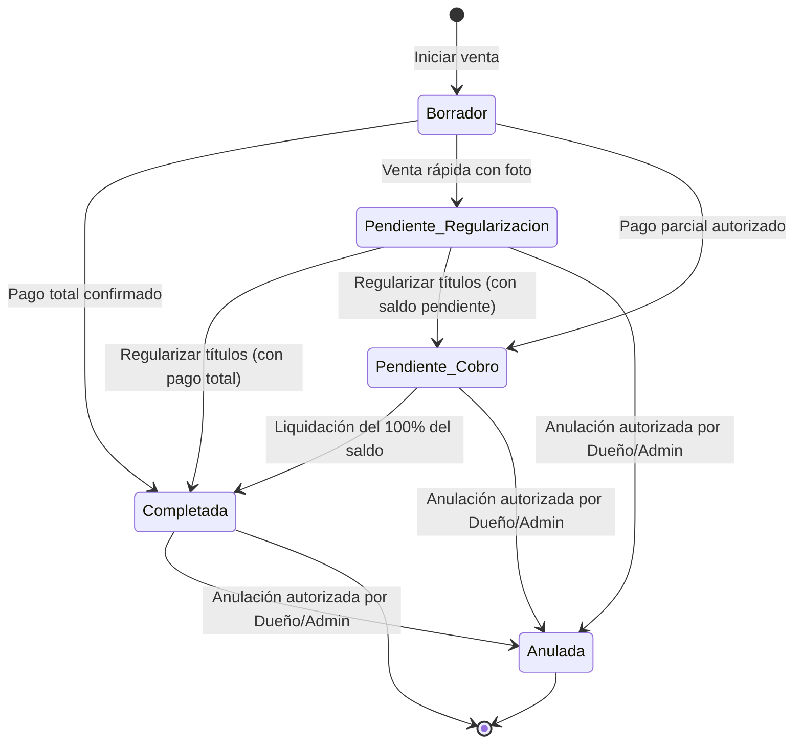
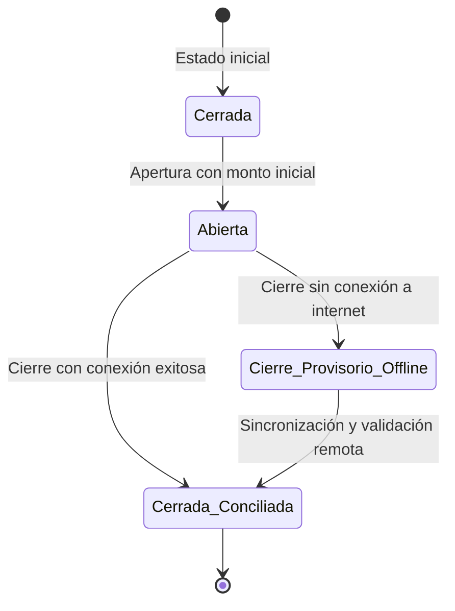
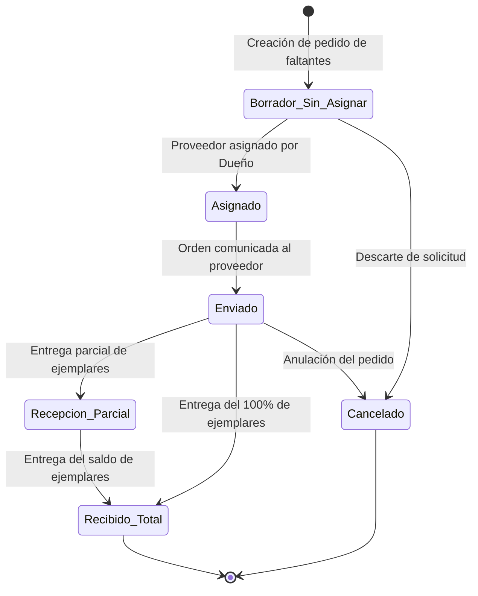

# Reglas de Negocio y Políticas Operativas (REGLAS_NEGOCIO.md)

**Proyecto:** Sistema de Gestión de Librería — Proyecto Tienda  
**Documento:** REGLAS_NEGOCIO.md  
**Estado:** Consolidado H00 / Auditado H00.1  
**Trazabilidad:** [SRS.md](SRS.md) | [../06-gestion/DECISIONES.md](../06-gestion/DECISIONES.md)  
**Total de Reglas de Negocio Consolidadas:** 18 reglas agrupadas en 7 dominios operativos.

---

## 1. Índice y Catálogo de Reglas de Negocio (RN)

| ID | Nombre de la Regla | Dominio | Decisión Asociada | Estado |
| :--- | :--- | :--- | :---: | :---: |
| **RN-ALC-001** | Alcance de tienda única | 1.1 Alcance e Inventario | [DEC-001](../06-gestion/DECISIONES.md#dec-001-alcance-inicial-restringido-a-tienda-única) | **Consolidado** |
| **RN-STK-001** | Catálogo referencial sin bloqueo de stock | 1.1 Alcance e Inventario | [DEC-003](../06-gestion/DECISIONES.md#dec-003-catálogo-referencial-sin-control-cuantitativo-estricto-de-stock-en-mvp) | **Consolidado** |
| **RN-CAT-001** | Diferenciación por edición y estado de conservación | 1.2 Catálogo y Ediciones | [DEC-004](../06-gestion/DECISIONES.md#dec-004-desacoplamiento-de-título-respecto-a-ediciones-y-estados-de-conservación) | **Consolidado** |
| **RN-CAT-002** | Relación multi-proveedor | 1.2 Catálogo y Ediciones | [DEC-005](../06-gestion/DECISIONES.md#dec-005-relación-muchos-a-muchos-entre-libros-y-proveedores-con-costos-variables) | **Consolidado** |
| **RN-CAT-003** | Validación humana de captura OCR | 1.2 Catálogo y Ediciones | [DEC-010](../06-gestion/DECISIONES.md#dec-010-captura-asistida-de-libros-mediante-fotografía-y-ocr) | **Consolidado** |
| **RN-VTA-001** | Flexibilidad de precios y descuentos en mostrador | 1.3 Ventas y Precios | N/A (Operación mostrador) | **Consolidado** |
| **RN-VTA-002** | Venta rápida y regularización obligatoria | 1.3 Ventas y Precios | [DEC-011](../06-gestion/DECISIONES.md#dec-011-modalidad-de-venta-rápida-con-foto-y-detalle-pendiente-de-completar) | **Consolidado** |
| **RN-VTA-003** | Anulación de ventas | 1.3 Ventas y Precios | N/A (Control auditoría) | **Consolidado** |
| **RN-PAG-001** | Multiplicidad y combinación de medios de pago | 1.4 Pagos, Cobros y Créditos | N/A (Operación mostrador) | **Consolidado** |
| **RN-PAG-002** | Autorización obligatoria para entregas con saldo pendiente | 1.4 Pagos, Cobros y Créditos | [DEC-006](../06-gestion/DECISIONES.md#dec-006-autorización-de-entrega-con-saldo-pendiente-de-cobro-fiado) | **Consolidado** |
| **RN-PAG-003** | Amortización de saldos pendientes | 1.4 Pagos, Cobros y Créditos | N/A (Gestión cobranzas) | **Consolidado** |
| **RN-CAJ-001** | Obligatoriedad de sesión de caja activa | 1.5 Caja y Egresos Operativos | N/A (Control de tesorería) | **Consolidado** |
| **RN-CAJ-002** | Cierres provisionales offline y conciliación | 1.5 Caja y Egresos Operativos | [DEC-007](../06-gestion/DECISIONES.md#dec-007-soporte-de-cierres-de-caja-offline-provisionales-con-conciliación-posterior) | **Consolidado** |
| **RN-GAS-001** | Imputación y respaldo de gastos | 1.5 Caja y Egresos Operativos | N/A (Control de tesorería) | **Consolidado** |
| **RN-PED-001** | Ciclo de pedidos de faltantes | 1.6 Proveedores y Pedidos | N/A (Gestión compras) | **Consolidado** |
| **RN-PED-002** | Recepciones parciales y saldos | 1.6 Proveedores y Pedidos | N/A (Gestión compras) | **Consolidado** |
| **RN-PRV-001** | Cuentas corrientes con proveedores | 1.6 Proveedores y Pedidos | N/A (Gestión compras) | **Consolidado** |
| **RN-FAC-001** | Emisión de notas internas en MVP | 1.7 Facturación y Comprobantes | [DEC-008](../06-gestion/DECISIONES.md#dec-008-exclusión-de-facturación-electrónica-en-mvp-con-diseño-extensible) | **Consolidado** |

---

### 1.1 Alcance e Inventario
- **RN-ALC-001 (Alcance de tienda única):**
  - Todas las operaciones comerciales, de caja y compras corresponden a una única sede física. No existen transferencias entre almacenes en el MVP (ref: [DEC-001](../06-gestion/DECISIONES.md#dec-001-alcance-inicial-restringido-a-tienda-única)).
- **RN-STK-001 (Catálogo referencial sin bloqueo de stock):**
  - El sistema no impide registrar una venta por ausencia de existencias numéricas registradas. La existencia física del ejemplar es verificada visualmente por el vendedor en mostrador (ref: [DEC-003](../06-gestion/DECISIONES.md#dec-003-catálogo-referencial-sin-control-cuantitativo-estricto-de-stock-en-mvp)).

### 1.2 Catálogo y Ediciones
- **RN-CAT-001 (Diferenciación por edición y estado de conservación):**
  - Un mismo título de libro puede asociarse a múltiples ediciones (editorial, año, formato) y a diferentes condiciones de conservación (`Nuevo` o `Usado`).
  - Cada combinación de edición y estado de conservación puede tener un precio de venta referencial y costos de adquisición distintos (ref: [DEC-004](../06-gestion/DECISIONES.md#dec-004-desacoplamiento-de-título-respecto-a-ediciones-y-estados-de-conservación)).
- **RN-CAT-002 (Relación multi-proveedor):**
  - Una edición de libro puede estar vinculada a uno, varios o ningún proveedor. Cada vínculo almacena el costo de adquisición de dicho proveedor y el código propio que el proveedor le asigna (ref: [DEC-005](../06-gestion/DECISIONES.md#dec-005-relación-muchos-a-muchos-entre-libros-y-proveedores-con-costos-variables)).
- **RN-CAT-003 (Validación humana de captura OCR):**
  - Ningún registro extraído automáticamente por OCR ingresará al catálogo con estado activo sin la confirmación o edición manual previa de un usuario autenticado (ref: [DEC-010](../06-gestion/DECISIONES.md#dec-010-captura-asistida-de-libros-mediante-fotografía-y-ocr)).

### 1.3 Ventas y Precios
- **RN-VTA-001 (Flexibilidad de precios y descuentos en mostrador):**
  - El precio de venta referencial de un libro es una sugerencia. El vendedor o encargado tiene la facultad de modificar el precio unitario final o aplicar descuentos durante la venta, con el fin de viabilizar promociones, regateo tradicional o liquidaciones de libros usados.
  - El descuento total aplicado a una venta no puede superar el monto bruto de la transacción (el total neto no puede ser negativo).
- **RN-VTA-002 (Venta rápida y regularización obligatoria):**
  - Una venta rápida se registra de inmediato con importe, medio de pago y fotografía del producto/ticket.
  - La venta permanece en estado `Pendiente de Regularización` hasta que se asocien formalmente los títulos vendidos.
  - El sistema emitirá una alerta visible al intentar realizar el cierre de caja diario si existen ventas rápidas sin regularizar (ref: [DEC-011](../06-gestion/DECISIONES.md#dec-011-modalidad-de-venta-rápida-con-foto-y-detalle-pendiente-de-completar)).
- **RN-VTA-003 (Anulación de ventas):**
  - Solo los usuarios con rol `Dueño` o `Administrador` pueden anular una venta registrada.
  - La anulación exige un motivo textual obligatorio y genera automáticamente un contra-asiento en la caja activa si hubo ingresos en efectivo.

### 1.4 Pagos, Cobros y Créditos
- **RN-PAG-001 (Multiplicidad y combinación de medios de pago):**
  - Una venta puede pagarse combinando múltiples transacciones de pago: efectivo, POS físico (tarjeta de débito/crédito) y billeteras digitales (QR / transferencia bancaria).
  - La suma de los pagos registrados no puede superar el total de la venta a menos que se trate de un pago en efectivo con vuelto (cambio).
- **RN-PAG-002 (Autorización obligatoria para entregas con saldo pendiente):**
  - Si una venta no es cancelada al 100% y el cliente se retira con los libros físicamente, la transacción debe ser autorizada por un usuario con rol `Dueño` o `Administrador`.
  - El sistema registrará el ID del usuario autorizador, el nombre/teléfono del cliente deudor y el `saldo_pendiente` (ref: [DEC-006](../06-gestion/DECISIONES.md#dec-006-autorización-de-entrega-con-saldo-pendiente-de-cobro-fiado)).
- **RN-PAG-003 (Amortización de saldos pendientes):**
  - Todo abono posterior hacia una venta con saldo pendiente debe registrar fecha, monto, medio de pago y la sesión de caja receptora. Al cubrirse el total, el estado de pago pasa a `Total`.

### 1.5 Caja y Egresos Operativos
- **RN-CAJ-001 (Obligatoriedad de sesión de caja activa):**
  - No se pueden registrar ventas que involucren cobranza en efectivo sin una sesión de caja en estado `Abierta`.
  - Cada dispositivo o puesto de trabajo opera sobre una única sesión de caja activa a la vez.
- **RN-CAJ-002 (Cierres provisionales offline y conciliación):**
  - En ausencia de conexión a internet, el cierre de caja local se registra como `Cierre Provisorio Offline`.
  - Al recuperar conexión, el registro se sincroniza a Supabase y pasa a estado `Cerrada y Conciliada` si no existen discrepancias mayores, o queda marcado para revisión del Administrador si difiere del total calculado en la nube (ref: [DEC-007](../06-gestion/DECISIONES.md#dec-007-soporte-de-cierres-de-caja-offline-provisionales-con-conciliación-posterior)).
- **RN-GAS-001 (Imputación y respaldo de gastos):**
  - Todo egreso por gastos de librería (alquiler, luz, agua, suministros) debe indicar si se extrae del efectivo de la caja activa (disminuyendo el arqueo teórico) o si proviene de fondos externos (no afecta el saldo de caja física).

### 1.6 Proveedores y Pedidos
- **RN-PED-001 (Ciclo de pedidos de faltantes):**
  - Los pedidos de reposición pueden crearse inicialmente con estado `Borrador / Sin Asignar`, permitiendo que el personal anote libros solicitados por clientes o agotados.
  - Posteriormente, el Dueño asigna el proveedor que ofrezca las mejores condiciones o disponibilidad.
- **RN-PED-002 (Recepciones parciales y saldos):**
  - Cuando un proveedor entrega solo una parte de los libros pedidos, el pedido pasa al estado `Recepción Parcial`. Los libros restantes continúan en seguimiento hasta su entrega o cancelación.
- **RN-PRV-001 (Cuentas corrientes con proveedores):**
  - Los libros recibidos de proveedores generan una obligación de pago (cuenta por pagar). Los pagos o abonos a proveedores disminuyen dicha deuda y pueden vincularse a uno o varios pedidos.

### 1.7 Facturación y Comprobantes
- **RN-FAC-001 (Emisión de notas internas en MVP):**
  - Durante el MVP, todos los comprobantes emitidos son notas de venta internas sin valor tributario electrónico oficial. El diseño del esquema de datos debe incluir campos correlativos para futuras series de boletas/facturas electrónicas (ref: [DEC-008](../06-gestion/DECISIONES.md#dec-008-exclusión-de-facturación-electrónica-en-mvp-con-diseño-extensible)).

---

## 2. Máquinas de Estados y Transiciones

### 2.1 Estados de Venta (`estado_venta`)

- **Borrador:** Venta en preparación en la pantalla de mostrador; no afecta caja ni estadísticas.
- **Completada:** Venta cerrada exitosamente, con ítems detallados y cobro total recibido.
- **Pendiente de Regularización:** Venta rápida registrada con importe y foto, a la espera del desglose de libros.
- **Pendiente de Cobro:** Venta con ítems detallados y entrega efectuada, pero con saldo deudor pendiente de liquidación.
- **Anulada:** Venta revocada por personal autorizado; revierte movimientos asociados.

---

### 2.2 Estados de Pago (`estado_pago`)

| Estado | Definición | Regla de Transición |
| :--- | :--- | :--- |
| **Pendiente** | No se ha recibido ningún pago por la venta. | Transición a `Parcial` al recibir un anticipo o a `Total` si se cancela en un solo acto. |
| **Parcial** | Se ha recibido al menos un pago, pero `total_pagado < total_neto`. | Transición a `Total` una vez que la suma de abonos cubra el 100% del importe neto. |
| **Total** | `total_pagado == total_neto`. Venta completamente pagada. | Estado terminal en el flujo regular. Pasa a `Anulado` si la venta es anulada. |
| **Anulado** | Los pagos registrados fueron revocados o devueltos por anulación de la transacción. | Estado terminal. |

---

### 2.3 Estados de Entrega Física (`estado_entrega`)

| Estado | Definición | Requisito de Negocio |
| :--- | :--- | :--- |
| **Retenido** | Los libros permanecen físicamente en la librería (ej. reserva de cliente). | Aplica cuando hay pago parcial o anticipo pero el cliente no retira los ejemplares. |
| **Entregado Total** | Los libros fueron entregados tras la cancelación del 100% del importe. | Flujo habitual de venta en mostrador. |
| **Entregado con Saldo Pendiente** | Los libros fueron retirados por el cliente existiendo saldo deudor. | **Exige autorización obligatoria de Dueño o Administrador** (RN-PAG-002). |

---

### 2.4 Estados de Sesión de Caja (`estado_caja`)

- **Cerrada:** No hay sesión activa. No se pueden registrar ventas en efectivo.
- **Abierta:** Sesión activa que recibe operaciones de venta, cobranzas de saldos y egresos de caja.
- **Cierre Provisorio Offline:** Arqueo y cierre ejecutado en el cliente sin conectividad hacia Supabase.
- **Cerrada y Conciliada:** Cierre validado y registrado en la base de datos central de Supabase, con arqueo teórico vs. declarado verificado.

---

### 2.5 Estados de Pedidos a Proveedores (`estado_pedido`)

---

## 3. Matriz de Restricciones por Rol de Usuario

| Operación / Acción | Vendedor | Dueño | Administrador |
| :--- | :---: | :---: | :---: |
| Registrar venta regular y cobrar en mostrador | **Permitido** | **Permitido** | **Permitido** |
| Registrar venta rápida con foto | **Permitido** | **Permitido** | **Permitido** |
| Regularizar libros de venta rápida | **Permitido** | **Permitido** | **Permitido** |
| Autorizar entrega con saldo pendiente (fiado) | *Bloqueado* | **Permitido** | **Permitido** |
| Anular ventas registradas | *Bloqueado* | **Permitido** | **Permitido** |
| Apertura y cierre diario de caja | **Permitido** | **Permitido** | **Permitido** |
| Conciliación definitiva de cierres offline con discrepancias | *Bloqueado* | **Permitido** | **Permitido** |
| Registrar gastos con cargo a la caja activa | **Permitido** | **Permitido** | **Permitido** |
| Registrar gastos extraordinarios externos (alquiler, servicios mayores) | *Bloqueado* | **Permitido** | **Permitido** |
| Crear pedidos de libros faltantes (borrador) | **Permitido** | **Permitido** | **Permitido** |
| Asignar proveedor, confirmar costos y autorizar abonos | *Bloqueado* | **Permitido** | **Permitido** |
| Gestionar usuarios, roles y credenciales | *Bloqueado* | *Bloqueado* | **Permitido** |
| Modificar parámetros de configuración y políticas de sistema | *Bloqueado* | *Bloqueado* | **Permitido** |
