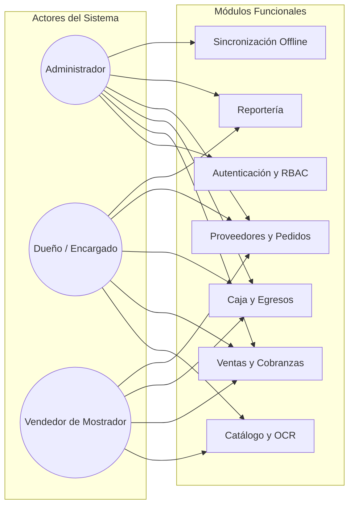
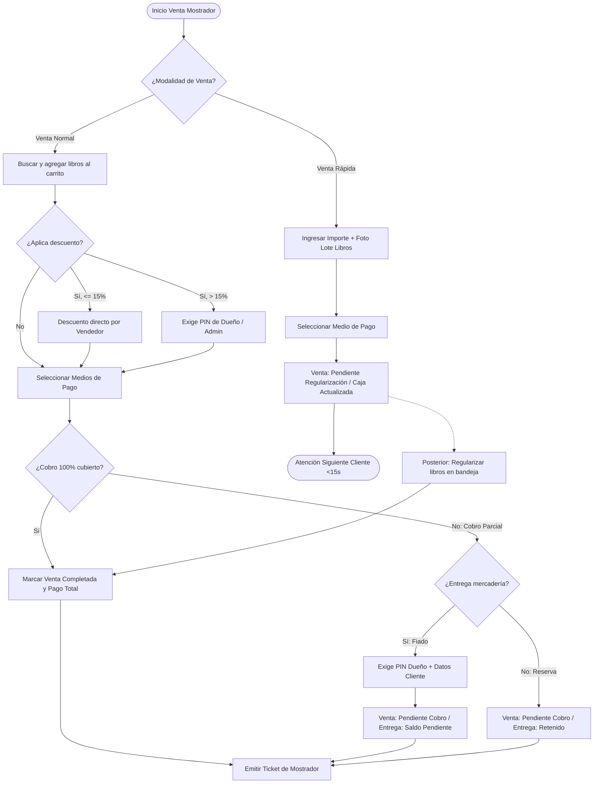
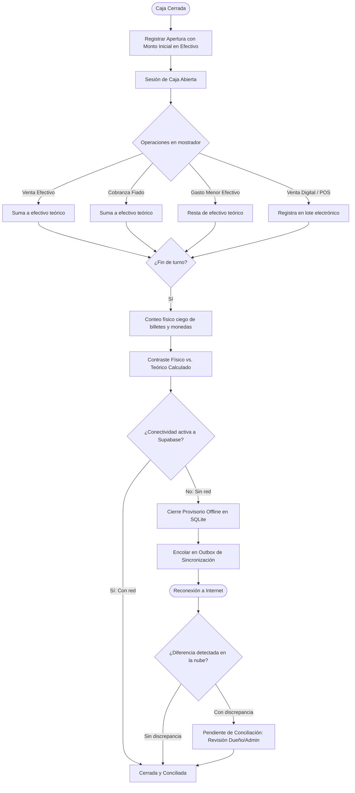
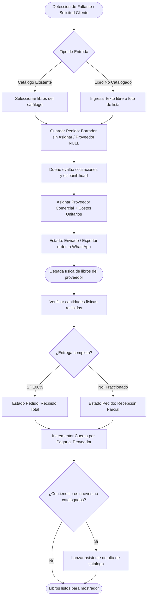

# Especificación de Requerimientos de Software (SRS)

**Proyecto:** Sistema de Gestión de Librería — Proyecto Tienda<br>
**Documento:** SRS.md<br>
**Estado:** Especificación Detallada y Refinada en H01<br>
**Norma de referencia:** Basado en IEEE 830 / ISO/IEC/IEEE 29148<br>
**Trazabilidad:** [REGLAS_NEGOCIO.md](REGLAS_NEGOCIO.md) | [../06-gestion/DECISIONES.md](../06-gestion/DECISIONES.md) | [../02-arquitectura/ARQUITECTURA.md](../02-arquitectura/ARQUITECTURA.md)

---

## 1. Introducción

### 1.1 Propósito
El presente documento define de manera exhaustiva y verificable los requerimientos funcionales, no funcionales, actores, casos de uso detallados y criterios de aceptación del **Sistema de Gestión de Librería**, priorizando la aplicación móvil Android *offline-first* para mostrador e inventario y estableciendo las bases técnicas para el posterior panel web administrativo.

### 1.2 Alcance del Producto
El sistema informatiza y optimiza la totalidad del flujo operativo de una librería física independiente en tienda única:
- Administración de catálogo bibliográfico con separación por ediciones, formatos y estado de conservación (`Nuevo` vs. `Usado`).
- Clasificación temática por categorías y soporte de registro sin ISBN con prevención de duplicados.
- Catalogación asistida por OCR (*Optical Character Recognition*) mediante cámara fotográfica.
- Punto de venta ágil con precios editables, descuentos, pagos mixtos (efectivo, digital, POS), ventas rápidas con foto y control de anticipos (mercadería retenida) y fiados (entrega autorizada con saldo).
- Ciclo integral de caja (apertura, egresos por gastos operativos, arqueo ciego desglosado por medio de pago, cierres provisionales sin red y conciliación remota).
- Directorio de proveedores con WhatsApp, resguardo de datos bancarios confidenciales, pedidos de libros faltantes (por texto o foto, con o sin proveedor inicial) y recepciones parciales.
- Autonomía offline completa en mostrador respaldada por SQLite local y replicación asíncrona hacia Supabase (PostgreSQL, Storage, Auth).

*Exclusiones del MVP:* Control cuantitativo estricto de inventario (kardex continuo) y facturación electrónica oficial SUNAT (previstas para fases posteriores conforme a [DEC-003](../06-gestion/DECISIONES.md#dec-003-catálogo-referencial-sin-control-cuantitativo-estricto-de-stock-en-mvp) y [DEC-008](../06-gestion/DECISIONES.md#dec-008-exclusión-de-facturación-electrónica-en-mvp-con-diseño-extensible)).

### 1.3 Definiciones y Acrónimos
- **POS (Point of Sale):** Terminal o punto de venta para registro de transacciones comerciales.
- **OCR (Optical Character Recognition):** Reconocimiento óptico de caracteres para digitalizar texto desde imágenes.
- **Offline-First:** Paradigma donde la app cliente opera contra una base de datos local y sincroniza en background.
- **Fiado / Entrega con Saldo:** Venta en la que el cliente retira mercadería con pago parcial o nulo, autorizada formalmente.
- **Anticipo / Reserva:** Pago parcial donde la mercadería permanece físicamente en custodia en la tienda.
- **Venta Rápida:** Transacción de emergencia en hora pico capturada con foto e importe, con desglose diferido.
- **CCI:** Código de Cuenta Interbancario para transferencias bancarias a proveedores.

---

## 2. Descripción General y Actores del Sistema



### 2.1 Matriz de Actores y Perfiles de Responsabilidad

| Actor | Descripción y Atribuciones Operativas | Restricciones de Seguridad |
| :--- | :--- | :--- |
| **Administrador** | Superusuario técnico y de gobernanza. Administra cuentas de usuario, asigna roles, audita bitácoras de seguridad, concilia definitivamente cierres de caja con diferencias y accede a todos los reportes gerenciales. | No tiene restricciones operativas en el sistema. |
| **Dueño** | Responsable de la gestión comercial y financiera de la librería. Autoriza entregas con saldo pendiente (fiados), autoriza anulaciones de ventas, gestiona cuentas bancarias de proveedores, aprueba órdenes de compra y abonos, y supervisa la rentabilidad. | Bloqueado para crear/eliminar usuarios y modificar políticas de configuración global. |
| **Vendedor** | Personal de mostrador. Registra ventas ordinarias, ventas rápidas, cobros, consultas y altas preliminares en catálogo, pedidos de libros faltantes en borrador, apertura y arqueo diario de su turno de caja, y gastos menores de mostrador. | Bloqueado para autorizar fiados, anular ventas, conciliar diferencias de caja y ver datos bancarios de proveedores. |

---

## 3. Especificación Detallada de Requerimientos Funcionales (RF)

### 3.1 Módulo 1: Autenticación, Usuarios y Permisos (RF-AUT)

#### RF-AUT-001: Inicio de Sesión y Manejo de Tokens
- **Descripción:** El sistema debe autenticar a los usuarios mediante correo/nombre de usuario y contraseña contra Supabase GoTrue, emitiendo tokens JWT y refrescándolos automáticamente.
- **Actor Responsable:** Administrador, Dueño, Vendedor.
- **Prioridad:** MVP.
- **Precondiciones:** El usuario debe estar activo en la base de datos.
- **Reglas Vinculadas:** [SEC-AUTH-001](../04-seguridad/HARDENING.md), [SEC-AUTH-002](../04-seguridad/HARDENING.md).
- **Criterios de Aceptación:** Al autenticarse correctamente, el sistema almacena el token en `expo-secure-store` y carga el perfil de permisos local.
- **Excepciones y Errores:** Credenciales inválidas devuelven mensaje de error sin revelar si el usuario existe. Tras 5 intentos fallidos, bloqueo temporal por 5 minutos.

#### RF-AUT-002: Control de Acceso Basado en Roles (RBAC)
- **Descripción:** El sistema debe condicionar la visibilidad de pantallas y la ejecución de operaciones según el rol (`admin`, `dueno`, `vendedor`) tanto a nivel de UI móvil como en las políticas RLS remotas.
- **Actor Responsable:** Administrador.
- **Prioridad:** MVP.
- **Precondiciones:** Sesión iniciada.
- **Reglas Vinculadas:** [RN-VTA-003](REGLAS_NEGOCIO.md#23-ventas-y-mostrador), [RN-PAG-002](REGLAS_NEGOCIO.md#24-pagos-cobranzas-y-créditos), [RN-PRV-002](REGLAS_NEGOCIO.md#26-proveedores-y-pedidos).
- **Criterios de Aceptación:** Cualquier intento de invocar una acción no autorizada (ej. anulación por Vendedor) es bloqueado por la UI y rechazado por el backend.
- **Excepciones:** Sesión revocada forza el cierre inmediato y redirección a login.

#### RF-AUT-003: Autenticación Delegada y Modo Desconectado
- **Descripción:** La aplicación móvil debe permitir el inicio de sesión offline utilizando credenciales validadas previamente y cacheadas de forma segura en el Keystore local.
- **Actor Responsable:** Administrador, Dueño, Vendedor.
- **Prioridad:** MVP.
- **Precondiciones:** El usuario debe haber iniciado sesión con éxito al menos una vez con conexión en ese dispositivo.
- **Reglas Vinculadas:** [RN-OFF-001](REGLAS_NEGOCIO.md#28-operación-offline), [DEC-009](../06-gestion/DECISIONES.md#dec-009-arquitectura-offline-first-con-sqlite-local-y-supabase-remoto).
- **Criterios de Aceptación:** Si no hay red, el sistema valida el hash de contraseña localmente en menos de 200ms y habilita el entorno de mostrador.
- **Excepciones:** Usuarios deshabilitados antes de la desconexión no podrán ingresar si la revocación fue sincronizada.

#### RF-AUT-004: Autorización en Dos Pasos para Operaciones Sensibles (PIN de Autorización)
- **Descripción:** Cuando un Vendedor requiere autorizar una entrega con saldo (fiado) o anular una venta, el sistema debe desplegar un modal para que el Dueño o Administrador ingrese su PIN de 4 dígitos o contraseña.
- **Actor Responsable:** Dueño, Administrador.
- **Prioridad:** MVP.
- **Precondiciones:** Operación sensible solicitada en mostrador.
- **Reglas Vinculadas:** [RN-PAG-002](REGLAS_NEGOCIO.md#24-pagos-cobranzas-y-créditos), [RN-VTA-003](REGLAS_NEGOCIO.md#23-ventas-y-mostrador).
- **Criterios de Aceptación:** Si el PIN ingresado coincide con un usuario con rol Dueño o Admin, la operación se autoriza y se graba su `autorizador_id`.
- **Excepciones:** PIN incorrecto bloquea la acción tras 3 intentos sucesivos.

---

### 3.2 Módulo 2: Catálogo, Categorías, Ediciones y Estados (RF-CAT)

#### RF-CAT-001: Estructura Desacoplada de Título y Edición
- **Descripción:** El sistema debe registrar obras bibliográficas (`libros`) separando la ficha intelectual de sus ediciones comerciales (`ediciones_libro`).
- **Actor Responsable:** Vendedor, Dueño, Administrador.
- **Prioridad:** MVP.
- **Precondiciones:** Ninguna.
- **Reglas Vinculadas:** [RN-CAT-001](REGLAS_NEGOCIO.md#22-catálogo-categorías-y-ediciones), [DEC-004](../06-gestion/DECISIONES.md#dec-004-desacoplamiento-de-título-respecto-a-ediciones-y-estados-de-conservación).
- **Criterios de Aceptación:** Un título puede desplegar múltiples renglones de venta según editorial, formato y condición física.

#### RF-CAT-002: Búsqueda Rápida Incremental en Catálogo
- **Descripción:** El sistema debe proveer búsqueda instantánea local (<100ms) por coincidencia parcial en título, autor, editorial, categoría o ISBN.
- **Actor Responsable:** Vendedor, Dueño, Administrador.
- **Prioridad:** MVP.
- **Precondiciones:** Base de datos SQLite local disponible.
- **Reglas Vinculadas:** [RN-STK-001](REGLAS_NEGOCIO.md#21-alcance-e-inventario), [RNF-PERF-001](SRS.md#42-rendimiento-y-eficiencia-rnf-perf).
- **Criterios de Aceptación:** La lista de resultados se actualiza en tiempo real con cada tecla pulsada a partir del segundo caracter.

#### RF-CAT-005: Clasificación Temática por Categorías
- **Descripción:** El sistema debe permitir organizar el catálogo mediante categorías (ej. Ficción, Historia, Infantil, Derecho, Autoayuda). Cada libro debe tener al menos una categoría asignada.
- **Actor Responsable:** Vendedor, Dueño, Administrador.
- **Prioridad:** MVP.
- **Precondiciones:** Categorías preconfiguradas en el sistema.
- **Reglas Vinculadas:** [RN-CAT-005](REGLAS_NEGOCIO.md#22-catálogo-categorías-y-ediciones).
- **Criterios de Aceptación:** Filtros por categoría disponibles en la pantalla de mostrador y búsquedas.

#### RF-CAT-006: Registro de Libros sin Código ISBN
- **Descripción:** El sistema debe permitir registrar libros que carezcan de ISBN (antiguos, usados, independientes), generando internamente un código único referencial de librería (`LIB-XXXXXX`).
- **Actor Responsable:** Vendedor, Dueño, Administrador.
- **Prioridad:** MVP.
- **Precondiciones:** Ninguna.
- **Reglas Vinculadas:** [RN-CAT-004](REGLAS_NEGOCIO.md#22-catálogo-categorías-y-ediciones).
- **Criterios de Aceptación:** El campo ISBN es nullable y el libro es plenamente vendible y localizable por título y autor.

#### RF-CAT-007: Detección y Prevención de Duplicados
- **Descripción:** Al intentar crear un libro, el sistema validará si ya existe un libro con el mismo ISBN. Si no tiene ISBN, evaluará similitud léxica sobre `título + autor`.
- **Actor Responsable:** Vendedor, Dueño, Administrador.
- **Prioridad:** MVP.
- **Precondiciones:** Datos de título y autor ingresados.
- **Reglas Vinculadas:** [RN-CAT-004](REGLAS_NEGOCIO.md#22-catálogo-categorías-y-ediciones).
- **Criterios de Aceptación:** Si hay duplicidad exacta de ISBN, se bloquea y se ofrece asociar una nueva edición. Si hay similitud léxica >85%, se muestra modal de confirmación advirtiendo al usuario.

#### RF-CAT-008: Gestión de Estados de Conservación (`Nuevo` / `Usado`)
- **Descripción:** Cada edición debe marcarse obligatoriamente como `Nuevo` o `Usado`. Para libros usados, se permite registrar notas de estado (ej. "subrayado", "tapa desgastada") y precio rebajado.
- **Actor Responsable:** Vendedor, Dueño, Administrador.
- **Prioridad:** MVP.
- **Precondiciones:** Edición en proceso de alta.
- **Reglas Vinculadas:** [RN-CAT-001](REGLAS_NEGOCIO.md#22-catálogo-categorías-y-ediciones).
- **Criterios de Aceptación:** El estado de conservación se visualiza en la línea de venta de mostrador y en el ticket.

---

### 3.3 Módulo 3: Registro Asistido mediante OCR (RF-OCR)

#### RF-OCR-001: Captura Fotográfica y Detección de Texto
- **Descripción:** El sistema debe permitir capturar con la cámara del dispositivo la portada, contraportada o página legal de un libro y extraer bloques de texto mediante inferencia OCR local (*on-device*).
- **Actor Responsable:** Vendedor, Dueño, Administrador.
- **Prioridad:** MVP.
- **Precondiciones:** Permisos de cámara concedidos en Android.
- **Reglas Vinculadas:** [DEC-010](../06-gestion/DECISIONES.md#dec-010-captura-asistida-de-libros-mediante-fotografía-y-ocr), [RN-CAT-003](REGLAS_NEGOCIO.md#22-catálogo-categorías-y-ediciones).
- **Criterios de Aceptación:** La inferencia toma menos de 3 segundos y extrae las líneas de texto legibles.

#### RF-OCR-002: Parsing Heurístico de Metadatos Bibliográficos
- **Descripción:** El sistema debe procesar el texto detectado por el OCR mediante patrones de expresiones regulares y heurísticas para aislar: Código ISBN (10 o 13 dígitos), Título presunto, Autor presunto y Editorial.
- **Actor Responsable:** Sistema.
- **Prioridad:** MVP.
- **Precondiciones:** Bloques de texto obtenidos de RF-OCR-001.
- **Reglas Vinculadas:** [RN-CAT-003](REGLAS_NEGOCIO.md#22-catálogo-categorías-y-ediciones).
- **Criterios de Aceptación:** Si se detecta un patrón ISBN válido con checksum correcto, se prellena automáticamente el campo ISBN.

#### RF-OCR-003: Interfaz de Validación y Corrección Humana
- **Descripción:** El sistema debe presentar una pantalla donde el usuario visualice la foto capturada en miniatura y los campos prellenados por el OCR, obligando a revisar o corregir antes de guardar.
- **Actor Responsable:** Vendedor, Dueño, Administrador.
- **Prioridad:** MVP.
- **Precondiciones:** Parsing heurístico completado.
- **Reglas Vinculadas:** [RN-CAT-003](REGLAS_NEGOCIO.md#22-catálogo-categorías-y-ediciones).
- **Criterios de Aceptación:** El usuario puede pulsar "Confirmar Alta" solo tras interactuar con la pantalla de validación.

---

### 3.4 Módulo 4: Ventas y Mostrador (RF-VTA)

#### RF-VTA-001: Venta Multitítulo con Cantidades Configurables
- **Descripción:** El sistema debe permitir conformar un carrito de venta agregando uno o varios libros del catálogo, modificando las cantidades por ítem.
- **Actor Responsable:** Vendedor, Dueño, Administrador.
- **Prioridad:** MVP.
- **Precondiciones:** Sesión de caja abierta en el dispositivo.
- **Reglas Vinculadas:** [RN-CAJ-001](REGLAS_NEGOCIO.md#25-caja-y-egresos-operativos).
- **Criterios de Aceptación:** Cálculo en tiempo real de subtotales, descuentos y total neto.

#### RF-VTA-002: Precios Unitarios Editables y Descuentos en Mostrador
- **Descripción:** El vendedor puede ajustar el precio unitario del ejemplar directamente en el carrito o aplicar descuentos (porcentuales o por importe fijo).
- **Actor Responsable:** Vendedor, Dueño, Administrador.
- **Prioridad:** MVP.
- **Precondiciones:** Carrito con al menos un ítem.
- **Reglas Vinculadas:** [RN-VTA-001](REGLAS_NEGOCIO.md#23-ventas-y-mostrador), [RN-VTA-004](REGLAS_NEGOCIO.md#23-ventas-y-mostrador).
- **Criterios de Aceptación:** El total neto resultante no puede ser inferior a 0.00 soles. Si el descuento excede el 15%, se solicita PIN de autorización (RN-VTA-004).

#### RF-VTA-003: Venta Rápida con Fotografía
- **Descripción:** Permite registrar una venta en modo exprés ingresando solo el monto total cobrado, el medio de pago y capturando una fotografía de los libros o comprobante, asignándole estado `Pendiente de Regularización`.
- **Actor Responsable:** Vendedor, Dueño, Administrador.
- **Prioridad:** MVP.
- **Precondiciones:** Caja activa.
- **Reglas Vinculadas:** [DEC-011](../06-gestion/DECISIONES.md#dec-011-modalidad-de-venta-rápida-con-foto-y-detalle-pendiente-de-completar), [RN-VTA-002](REGLAS_NEGOCIO.md#23-ventas-y-mostrador).
- **Criterios de Aceptación:** La transacción se completa en <15 segundos, ingresa el dinero a caja y encola la imagen para sincronización.

#### RF-VTA-004: Bandeja de Regularización de Ventas Rápidas
- **Descripción:** Módulo que lista todas las ventas rápidas pendientes, permitiendo al usuario visualizar la foto capturada y seleccionar los libros del catálogo que corresponden al importe cobrado.
- **Actor Responsable:** Vendedor, Dueño, Administrador.
- **Prioridad:** MVP.
- **Precondiciones:** Existencia de ventas rápidas con `estado_venta = 'pendiente_regularizacion'`.
- **Reglas Vinculadas:** [RN-VTA-002](REGLAS_NEGOCIO.md#23-ventas-y-mostrador).
- **Criterios de Aceptación:** Al desglosar los libros y cuadrar el importe, la venta transiciona a `Completada`. El cierre de caja alerta si existen ventas sin regularizar.

#### RF-VTA-005: Anulación de Ventas con Reversión de Fondos
- **Descripción:** Permite anular una venta registrada previa justificación textual, generando un contra-asiento de egreso en caja si se cobró en efectivo.
- **Actor Responsable:** Dueño, Administrador.
- **Prioridad:** MVP.
- **Precondiciones:** Venta existente no anulada previamente.
- **Reglas Vinculadas:** [RN-VTA-003](REGLAS_NEGOCIO.md#23-ventas-y-mostrador).
- **Criterios de Aceptación:** La venta pasa a estado `Anulada`, sus pagos se marcan `Anulados` y el efectivo de caja disminuye en el monto exacto.

#### RF-VTA-006: Emisión de Comprobante / Ticket de Mostrador
- **Descripción:** El sistema debe generar una nota de venta digital con opción de compartir por WhatsApp o imprimir vía impresora térmica Bluetooth (58mm/80mm).
- **Actor Responsable:** Vendedor, Dueño, Administrador.
- **Prioridad:** MVP.
- **Precondiciones:** Venta confirmada.
- **Reglas Vinculadas:** [RN-FAC-001](REGLAS_NEGOCIO.md#27-facturación-y-comprobantes).
- **Criterios de Aceptación:** El ticket muestra fecha, correlativo interno, detalle de libros, montos, desglose de pagos y saldo pendiente si aplica.

---

### 3.5 Módulo 5: Pagos Mixtos, Anticipos, Saldos Pendientes y Cobranzas (RF-PAG)

#### RF-PAG-001: Pagos Mixtos Combinados
- **Descripción:** El sistema debe admitir registrar cobros fraccionados combinando múltiples medios de pago (`Efectivo`, `Billetera Digital`, `Tarjeta POS`) en una sola venta.
- **Actor Responsable:** Vendedor, Dueño, Administrador.
- **Prioridad:** MVP.
- **Precondiciones:** Venta en pantalla de cobro.
- **Reglas Vinculadas:** [RN-PAG-001](REGLAS_NEGOCIO.md#24-pagos-cobranzas-y-créditos).
- **Criterios de Aceptación:** La suma de pagos coincide exactamente con el monto a abonar.

#### RF-PAG-002: Entrega de Libros con Saldo Pendiente (Fiado Autorizado)
- **Descripción:** Permite cerrar una venta donde el cliente se lleva físicamente los libros habiendo pagado una parte o nada, exigiendo autorización de Dueño/Admin y datos del deudor.
- **Actor Responsable:** Vendedor (solicita) / Dueño o Administrador (autoriza).
- **Prioridad:** MVP.
- **Precondiciones:** `total_pagado < total_neto`.
- **Reglas Vinculadas:** [DEC-006](../06-gestion/DECISIONES.md#dec-006-autorización-de-entrega-con-saldo-pendiente-de-cobro-fiado), [RN-PAG-002](REGLAS_NEGOCIO.md#24-pagos-cobranzas-y-créditos).
- **Criterios de Aceptación:** Venta pasa a `estado_venta = 'pendiente_cobro'`, `estado_entrega = 'entregado_saldo_pendiente'`, guardando `cliente_nombre`, `cliente_telefono`, `cliente_documento` y `autorizador_id`.

#### RF-PAG-003: Anticipo con Mercadería Retenida (Reserva)
- **Descripción:** Permite recibir un pago a cuenta por uno o varios libros sin entregarlos físicamente al cliente, dejándolos en custodia en la tienda.
- **Actor Responsable:** Vendedor, Dueño, Administrador.
- **Prioridad:** MVP.
- **Precondiciones:** Abono parcial registrado.
- **Reglas Vinculadas:** [RN-PAG-004](REGLAS_NEGOCIO.md#24-pagos-cobranzas-y-créditos).
- **Criterios de Aceptación:** Venta queda en `estado_venta = 'pendiente_cobro'`, `estado_entrega = 'retenido'` y `estado_pago = 'parcial'`.

#### RF-PAG-004: Registro de Amortizaciones y Cobranzas Posteriores
- **Descripción:** Permite buscar ventas con saldo pendiente y registrar abonos sucesivos hasta cubrir el 100% de la deuda.
- **Actor Responsable:** Vendedor, Dueño, Administrador.
- **Prioridad:** MVP.
- **Precondiciones:** Venta en estado `pendiente_cobro`.
- **Reglas Vinculadas:** [RN-PAG-003](REGLAS_NEGOCIO.md#24-pagos-cobranzas-y-créditos).
- **Criterios de Aceptación:** Cada abono genera su propio registro en `pagos_venta` e ingresa a la caja activa. Al completarse, transiciona a `estado_pago = 'total'`.

---

### 3.6 Módulo 6: Caja, Movimientos y Cierres (RF-CAJ)

#### RF-CAJ-001: Apertura de Turno de Caja Diaria
- **Descripción:** Exige registrar la apertura de caja indicando el saldo inicial en efectivo antes de permitir registrar cobros en mostrador.
- **Actor Responsable:** Vendedor, Dueño, Administrador.
- **Prioridad:** MVP.
- **Precondiciones:** No debe existir otra caja abierta en el dispositivo.
- **Reglas Vinculadas:** [RN-CAJ-001](REGLAS_NEGOCIO.md#25-caja-y-egresos-operativos).
- **Criterios de Aceptación:** Se crea registro en `sesiones_caja` con `estado_caja = 'abierta'`.

#### RF-CAJ-002: Arqueo Físico Ciego y Cierre de Caja
- **Descripción:** Al cierre de turno, el usuario realiza el conteo ciego del efectivo en gaveta. El sistema calcula la diferencia frente al saldo teórico y genera el resumen.
- **Actor Responsable:** Vendedor, Dueño, Administrador.
- **Prioridad:** MVP.
- **Precondiciones:** Sesión de caja abierta.
- **Reglas Vinculadas:** [RN-CAJ-003](REGLAS_NEGOCIO.md#25-caja-y-egresos-operativos).
- **Criterios de Aceptación:** Se graba `monto_final_declarado`, `monto_final_calculado` y `diferencia`.

#### RF-CAJ-003: Resumen Desglosado por Medio de Pago
- **Descripción:** El cierre de caja debe presentar un reporte desglosado indicando: Total Efectivo en gaveta, Total Billetera Digital cobrado, Total POS procesado, Total Fiados concedidos y Total Gastos en efectivo pagados.
- **Actor Responsable:** Vendedor, Dueño, Administrador.
- **Prioridad:** MVP.
- **Precondiciones:** Arqueo confirmado.
- **Reglas Vinculadas:** [RN-CAJ-003](REGLAS_NEGOCIO.md#25-caja-y-egresos-operativos).
- **Criterios de Aceptación:** El resumen se visualiza en pantalla y puede imprimirse en ticket de cierre.

#### RF-CAJ-004: Cierres de Caja Provisionales Offline
- **Descripción:** Permite efectuar el cierre de caja sin conexión a internet, marcando el estado local como `Cierre Provisorio Offline`.
- **Actor Responsable:** Vendedor, Dueño, Administrador.
- **Prioridad:** MVP.
- **Precondiciones:** Dispositivo sin conectividad.
- **Reglas Vinculadas:** [DEC-007](../06-gestion/DECISIONES.md#dec-007-soporte-de-cierres-de-caja-offline-provisionales-con-conciliación-posterior), [RN-CAJ-002](REGLAS_NEGOCIO.md#25-caja-y-egresos-operativos).
- **Criterios de Aceptación:** La caja se cierra localmente impidiendo nuevas ventas en ese turno y se encola en la bandeja Outbox.

#### RF-CAJ-005: Conciliación Remota de Cierres con Discrepancias
- **Descripción:** Módulo en el panel web o vista administrativa donde el Dueño o Administrador valida los cierres offline sincronizados que presenten diferencias y aprueba su conciliación definitiva.
- **Actor Responsable:** Dueño, Administrador.
- **Prioridad:** MVP.
- **Precondiciones:** Cierre sincronizado en estado provisorio.
- **Reglas Vinculadas:** [RN-CAJ-002](REGLAS_NEGOCIO.md#25-caja-y-egresos-operativos).
- **Criterios de Aceptación:** La sesión pasa a `Cerrada y Conciliada`, registrando notas de auditoría si hubo faltante/sobrante.

---

### 3.7 Módulo 7: Gastos y Egresos Operativos (RF-GAS)

#### RF-GAS-001: Registro Categorizado de Egresos
- **Descripción:** Permite registrar salidas de dinero por gastos operativos (`Alquiler`, `Servicios Públicos`, `Suministros`, `Personal`, `Mantenimiento`, `Otros`), indicando monto, concepto y fecha.
- **Actor Responsable:** Vendedor (gastos menores), Dueño, Administrador.
- **Prioridad:** MVP.
- **Precondiciones:** Caja activa si se paga con efectivo de mostrador.
- **Reglas Vinculadas:** [RN-GAS-001](REGLAS_NEGOCIO.md#25-caja-y-egresos-operativos).
- **Criterios de Aceptación:** Se registra el gasto y, si afecta efectivo, descuenta inmediatamente el saldo teórico de caja.

#### RF-GAS-002: Imputación de Fondos (Caja vs. Fondos Externos)
- **Descripción:** El usuario debe marcar si el gasto se extrae de la caja física en efectivo o si proviene de fondos externos (transferencia bancaria personal del dueño).
- **Actor Responsable:** Vendedor, Dueño, Administrador.
- **Prioridad:** MVP.
- **Precondiciones:** Ninguna.
- **Reglas Vinculadas:** [RN-GAS-001](REGLAS_NEGOCIO.md#25-caja-y-egresos-operativos).
- **Criterios de Aceptación:** Los gastos externos no alteran el arqueo de efectivo pero sí se incluyen en los balances financieros globales.

#### RF-GAS-003: Respaldo Fotográfico de Comprobantes de Gasto
- **Descripción:** Permite adjuntar una fotografía del recibo, factura o boleta de servicio con la cámara del dispositivo.
- **Actor Responsable:** Vendedor, Dueño, Administrador.
- **Prioridad:** MVP.
- **Precondiciones:** Gasto en proceso de registro.
- **Reglas Vinculadas:** [SEC-STRG-001](../04-seguridad/HARDENING.md).
- **Criterios de Aceptación:** La imagen se asocia localmente y se sube a Supabase Storage privado al detectar red.

---

### 3.8 Módulo 8: Proveedores, Catálogos y Cuentas por Pagar (RF-PRV)

#### RF-PRV-001: Directorio de Proveedores con WhatsApp de Contacto
- **Descripción:** Permite registrar distribuidores y editoriales con nombre comercial, persona de contacto, número móvil/WhatsApp, dirección física y notas.
- **Actor Responsable:** Dueño, Administrador.
- **Prioridad:** MVP.
- **Precondiciones:** Ninguna.
- **Reglas Vinculadas:** [RN-PRV-003](REGLAS_NEGOCIO.md#26-proveedores-y-pedidos).
- **Criterios de Aceptación:** Botón directo en la app para abrir chat de WhatsApp con el proveedor.

#### RF-PRV-002: Resguardo Protegido de Información Bancaria
- **Descripción:** Almacena de forma restringida datos bancarios del proveedor (Banco, Tipo de Cuenta, Número de Cuenta, CCI y Titular), accesibles exclusivamente para los roles Dueño y Administrador.
- **Actor Responsable:** Dueño, Administrador.
- **Prioridad:** MVP.
- **Precondiciones:** Permisos de Dueño o Admin.
- **Reglas Vinculadas:** [RN-PRV-002](REGLAS_NEGOCIO.md#26-proveedores-y-pedidos), [SEC-AUTHZ-002](../04-seguridad/HARDENING.md).
- **Criterios de Aceptación:** Para el rol Vendedor, los campos bancarios no se envían al dispositivo cliente o se ofuscan completamente.

#### RF-PRV-003: Catálogo y Costos de Libros por Proveedor
- **Descripción:** Permite asociar cada edición de libro a uno o varios proveedores, guardando el costo unitario de compra y el código de producto propio del proveedor.
- **Actor Responsable:** Dueño, Administrador.
- **Prioridad:** MVP.
- **Precondiciones:** Proveedor y edición de libro creados.
- **Reglas Vinculadas:** [DEC-005](../06-gestion/DECISIONES.md#dec-005-relación-muchos-a-muchos-entre-libros-y-proveedores-con-costos-variables), [RN-CAT-002](REGLAS_NEGOCIO.md#22-catálogo-categorías-y-ediciones).
- **Criterios de Aceptación:** Al crear un pedido a proveedor, se sugiere automáticamente su costo histórico registrado.

#### RF-PRV-004: Control de Cuentas por Pagar, Vencimientos y Abonos
- **Descripción:** Lleva el saldo de deuda acumulado con cada proveedor, registra abonos parciales/totales con soporte fotográfico y notifica vencimientos próximos de facturas.
- **Actor Responsable:** Dueño, Administrador.
- **Prioridad:** MVP.
- **Precondiciones:** Deuda previa registrada por recepción de pedidos.
- **Reglas Vinculadas:** [RN-PRV-001](REGLAS_NEGOCIO.md#26-proveedores-y-pedidos).
- **Criterios de Aceptación:** Cada abono reduce la deuda neta y genera comprobante de egreso si se pagó con efectivo de caja.

---

### 3.9 Módulo 9: Pedidos de Libros Faltantes y Recepciones (RF-PED)

#### RF-PED-001: Solicitud de Faltantes sin Proveedor Inicial
- **Descripción:** Permite al personal registrar una lista de libros solicitados por clientes o agotados, dejándola en estado `Borrador / Sin Asignar`.
- **Actor Responsable:** Vendedor, Dueño, Administrador.
- **Prioridad:** MVP.
- **Precondiciones:** Ninguna.
- **Reglas Vinculadas:** [RN-PED-001](REGLAS_NEGOCIO.md#26-proveedores-y-pedidos).
- **Criterios de Aceptación:** El pedido se guarda localmente y queda disponible en la bandeja de abastecimiento.

#### RF-PED-002: Pedidos por Captura Fotográfica o Texto Libre de Libros No Catalogados
- **Descripción:** Permite anotar pedidos de libros que no están en el catálogo o capturar una fotografía (ej. lista escrita a mano por un cliente escolar o foto de una portada solicitada).
- **Actor Responsable:** Vendedor, Dueño, Administrador.
- **Prioridad:** MVP.
- **Precondiciones:** Ninguna.
- **Reglas Vinculadas:** [RN-PED-003](REGLAS_NEGOCIO.md#26-proveedores-y-pedidos).
- **Criterios de Aceptación:** El pedido almacena la imagen o descripción textual libre sin exigir un `edicion_libro_id` válido.

#### RF-PED-003: Asignación de Proveedor y Emisión de Pedido
- **Descripción:** Permite al Dueño revisar los pedidos en borrador, consolidar ítems, asignar el proveedor elegido y marcar el pedido como `Enviado`.
- **Actor Responsable:** Dueño, Administrador.
- **Prioridad:** MVP.
- **Precondiciones:** Pedido en borrador.
- **Reglas Vinculadas:** [RN-PED-001](REGLAS_NEGOCIO.md#26-proveedores-y-pedidos).
- **Criterios de Aceptación:** Se genera la orden formal y se ofrece exportar el resumen para enviarlo por WhatsApp al proveedor.

#### RF-PED-004: Recepción Parcial de Ejemplares y Actualización de Deuda
- **Descripción:** Al recibir los libros físicos, permite marcar las cantidades efectivamente entregadas por el proveedor (recepción parcial o total), actualizando la cuenta por pagar con el costo final pactado.
- **Actor Responsable:** Vendedor, Dueño, Administrador.
- **Prioridad:** MVP.
- **Precondiciones:** Pedido en estado `Enviado` o `Recepción Parcial`.
- **Reglas Vinculadas:** [RN-PED-002](REGLAS_NEGOCIO.md#26-proveedores-y-pedidos).
- **Criterios de Aceptación:** Si faltan ejemplares, el pedido queda en `Recepción Parcial`. Los libros no catalogados previamente se derivan al flujo de catalogación asistida.

---

### 3.10 Módulo 10: Reportería Operativa y Financiera (RF-REP)

#### RF-REP-001: Resumen Diario y Periódico de Ventas
- **Descripción:** Genera reportes de ventas filtrables por rango de fechas, con métricas de monto bruto, descuentos aplicados, monto neto, ticket promedio y desglose por medio de pago.
- **Actor Responsable:** Dueño, Administrador.
- **Prioridad:** MVP.
- **Precondiciones:** Transacciones registradas en el período.
- **Criterios de Aceptación:** Gráficos y tablas comparativas con exportación a PDF o CSV.

#### RF-REP-002: Balance Comparativo de Caja vs. Gastos Operativos
- **Descripción:** Emite un balance consolidado que contrasta los ingresos reales de mostrador contra los egresos por gastos de funcionamiento, calculando el flujo neto del período.
- **Actor Responsable:** Dueño, Administrador.
- **Prioridad:** MVP.
- **Precondiciones:** Cierres de caja y gastos registrados.
- **Criterios de Aceptación:** Desglose claro entre efectivo físico y movimientos bancarios.

#### RF-REP-003: Reporte de Cartera de Clientes Fiados y Deudas de Proveedores
- **Descripción:** Lista los clientes con saldo deudor pendiente, antigüedad de la deuda y fecha de último contacto, así como las facturas pendientes de pago a distribuidores.
- **Actor Responsable:** Dueño, Administrador.
- **Prioridad:** MVP.
- **Precondiciones:** Ventas con saldo pendiente o recepciones con deuda registradas.
- **Criterios de Aceptación:** Alertas visuales para deudas con más de 15 y 30 días de antigüedad.

---

### 3.11 Módulo 11: Operación Offline y Sincronización (RF-OFF)

#### RF-OFF-001: Autonomía Local Completa en Mostrador
- **Descripción:** Todas las pantallas operativas de ventas, cobros, cajas, consultas de catálogo y gastos deben leer y escribir directamente sobre SQLite sin depender de conexión a internet.
- **Actor Responsable:** Sistema / Vendedor.
- **Prioridad:** MVP.
- **Precondiciones:** SQLite inicializado en el dispositivo.
- **Reglas Vinculadas:** [DEC-009](../06-gestion/DECISIONES.md#dec-009-arquitectura-offline-first-con-sqlite-local-y-supabase-remoto), [RN-OFF-001](REGLAS_NEGOCIO.md#28-operación-offline).
- **Criterios de Aceptación:** La app opera con normalidad en modo avión sin arrojar errores bloqueantes de red.

#### RF-OFF-002: Cola de Mutaciones Asíncronas (Outbox Pattern)
- **Descripción:** Cada inserción, actualización o anulación local debe registrarse en la tabla `sync_outbox` bajo la misma transacción ACID de la operación de negocio.
- **Actor Responsable:** Sistema.
- **Prioridad:** MVP.
- **Precondiciones:** Operación de base de datos confirmada.
- **Reglas Vinculadas:** [ARQUITECTURA 3](../02-arquitectura/ARQUITECTURA.md#3-estrategia-offline-first-y-motor-de-sincronización).
- **Criterios de Aceptación:** Al recuperar internet, un worker en segundo plano envía las mutaciones en lotes ordenados monotónicamente por timestamp UTC.

#### RF-OFF-003: Conciliación Determinista y Prevención de Conflictos
- **Descripción:** El servidor en Supabase procesa las mutaciones identificadas por UUID v4 único. En entidades aditivas (ventas, pagos) no genera colisiones. En estados de caja, aplica marcas de tiempo UTC y desvía diferencias a la bandeja de conciliación.
- **Actor Responsable:** Sistema / Administrador.
- **Prioridad:** MVP.
- **Precondiciones:** Lote de sincronización recibido en Supabase.
- **Reglas Vinculadas:** [RN-CAJ-002](REGLAS_NEGOCIO.md#25-caja-y-egresos-operativos), [SEC-SYNC-002](../04-seguridad/HARDENING.md).
- **Criterios de Aceptación:** Los registros duplicados por reintentos de red son descartados de forma idempotente (*Replay Protection*).

---

## 4. Requerimientos No Funcionales Detallados (RNF)

| ID | Categoría | Métrica Objetivo | Criterio de Verificación |
| :--- | :--- | :--- | :--- |
| **RNF-USAB-001** | Ergonomía Táctil | Botones y zonas interactivas de al menos 48x48 dp | Verificación visual y táctil en dispositivos de 5.5" a 6.7" |
| **RNF-USAB-002** | Velocidad Mostrador | Venta típica completada en < 30 segundos | Pruebas de usabilidad con vendedores capacitados |
| **RNF-PERF-001** | Latencia Local | Consultas y escrituras en SQLite < 100 ms | Pruebas de rendimiento con 10,000 libros en base local |
| **RNF-PERF-002** | Inferencia OCR | Procesamiento de imagen en dispositivo < 3 segundos | Pruebas en Android con procesador gama media (Snapdragon 680) |
| **RNF-CONF-001** | Resiliencia de Red | Cero pantallas blancas de error por desconexión | Pruebas con corte abrupto de red durante flujos de venta |
| **RNF-CONF-002** | Integridad ACID | 100% de transacciones multitabla bajo SQLite Transaction | Verificación de rollback ante caídas de batería del terminal |
| **RNF-SEC-001** | Control RBAC | 100% de endpoints y tablas filtrados por RLS y rol | Pruebas de penetración automatizadas sobre PostgREST |
| **RNF-SEC-002** | Criptografía Local | Tokens y claves en Android Keystore (`SecureStore`) | Análisis estático de almacenamiento y dumps de memoria |
| **RNF-SEC-003** | Tránsito Seguro | Cifrado obligatorio TLS 1.3 en toda comunicación | Comprobación de certificados y cipher suites en conexión |
| **RNF-PORT-001** | Compatibilidad | Android 10 (API level 29) hasta Android 15 | Pruebas en emuladores y dispositivos físicos certificados |
| **RNF-PORT-002** | Reutilización | Paquete `@tienda/shared-types` reutilizado en móvil y web | Compilación cruzada en monorepo sin dependencias nativas |

---

## 5. Casos de Uso Principales (CU) y Criterios de Aceptación

### CU-AUT-01: Inicio de Sesión y Control de Acceso por Rol
- **Actor Principal:** Usuario (Vendedor / Dueño / Administrador)
- **Objetivo:** Autenticarse en el sistema y cargar el perfil de permisos correspondiente.
- **Precondiciones:** Usuario registrado y activo.
- **Flujo Principal:**
  1. El usuario abre la aplicación en el dispositivo Android.
  2. Ingresa su identificador (correo o usuario) y contraseña.
  3. Presiona el botón "Iniciar Sesión".
  4. El sistema valida las credenciales (contra Supabase si hay red, o contra el caché seguro si está offline).
  5. El sistema recupera el rol del usuario (`vendedor`, `dueno`, `admin`).
  6. El sistema redirige a la pantalla principal de mostrador, adaptando los menús y acciones según el rol.
- **Flujos Alternativos:**
  - *4a. Modo Offline:* Si no hay red, valida el hash criptográfico local en SecureStore. Si coincide, autoriza la sesión offline.
- **Excepciones:**
  - *4b. Credenciales incorrectas:* Muestra alerta "Credenciales inválidas" y permite reintentar.
- **Reglas Relacionadas:** [RN-OFF-001](REGLAS_NEGOCIO.md), [SEC-AUTH-001](../04-seguridad/HARDENING.md).
- **Criterio de Aceptación (Gherkin):**
  ```gherkin
  Escenario: Inicio de sesión exitoso de un vendedor
    Dado que el usuario "carlos@libreria.com" tiene el rol "Vendedor"
    Cuando ingresa su contraseña válida y presiona "Iniciar Sesión"
    Entonces el sistema le concede acceso al módulo de mostrador
    Y oculta los accesos a configuración del sistema y datos bancarios de proveedores
  ```

---

### CU-CAT-01: Registro Asistido de Libro con OCR y Validación de Duplicados
- **Actor Principal:** Vendedor / Dueño
- **Objetivo:** Dar de alta un libro en el catálogo extrayendo datos con la cámara y evitando duplicados.
- **Precondiciones:** Dispositivo con cámara operativa.
- **Flujo Principal:**
  1. El usuario selecciona "Nuevo Libro" y presiona "Escanear con Cámara".
  2. Encuadra la portada o contraportada del libro y toma la fotografía.
  3. El sistema procesa la imagen localmente mediante OCR y aísla ISBN, Título presunto, Autor y Editorial.
  4. El sistema busca si el ISBN detectado ya existe en la base de datos local.
  5. Al no existir, prellena el formulario de alta con los campos detectados.
  6. El usuario revisa, selecciona la categoría principal, formato, estado de conservación (`Nuevo`/`Usado`) y precio referencial.
  7. Presiona "Guardar en Catálogo".
  8. El sistema persiste el libro y su edición en SQLite y lo deja listo para la venta.
- **Flujos Alternativos:**
  - *4a. ISBN Duplicado detectado:* El sistema alerta: "El ISBN ya existe para el libro [Título]". Ofrece abrir el libro existente para registrar una nueva edición o cancelar.
  - *5a. Libro sin ISBN detectado:* Aplica validación de similitud sobre Título + Autor. Si supera el 85%, alerta al usuario sobre coincidencia previa.
- **Reglas Reladas:** [RN-CAT-001](REGLAS_NEGOCIO.md), [RN-CAT-003](REGLAS_NEGOCIO.md), [RN-CAT-004](REGLAS_NEGOCIO.md), [DEC-010](../06-gestion/DECISIONES.md).
- **Criterio de Aceptación (Gherkin):**
  ```gherkin
  Escenario: Detección y prevención de duplicados por ISBN en captura OCR
    Dado que existe en catálogo el libro "Cien años de soledad" con ISBN "9780307474728"
    Cuando el usuario escanea un ejemplar cuyo OCR extrae el ISBN "9780307474728"
    Entonces el sistema bloquea la creación de un nuevo libro matriz
    Y muestra la opción "Agregar nueva edición o ejemplar al libro existente"
  ```

---

### CU-VTA-01: Registrar Venta Normal con Pago Mixto
- **Actor Principal:** Vendedor
- **Objetivo:** Registrar una venta de mostrador cobrando mediante múltiples medios de pago.
- **Precondiciones:** Sesión de caja abierta en estado `Abierta`.
- **Flujo Principal:**
  1. El vendedor busca y agrega al carrito los libros solicitados por el cliente.
  2. Ajusta cantidades y, si corresponde, aplica un descuento comercial permitido (<15%).
  3. Presiona "Cobrar". El sistema muestra el total neto (ej. S/ 120.00).
  4. El cliente solicita pagar S/ 50.00 en efectivo y S/ 70.00 con billetera digital (Yape).
  5. El vendedor ingresa S/ 50.00 en la opción `Efectivo` (calcula vuelto si entrega billete mayor).
  6. Agrega un segundo pago de S/ 70.00 en `Billetera Digital` e ingresa el número de operación "YAP-4521".
  7. El saldo restante queda en S/ 0.00. Presiona "Confirmar Venta".
  8. El sistema registra la venta con `estado_venta = 'completada'`, `estado_pago = 'total'` y `estado_entrega = 'entregado_total'`.
  9. Se genera el ingreso de S/ 50.00 en la caja activa y se emite el ticket de venta.
- **Reglas Relacionadas:** [RN-VTA-001](REGLAS_NEGOCIO.md), [RN-PAG-001](REGLAS_NEGOCIO.md), [RN-CAJ-001](REGLAS_NEGOCIO.md).
- **Criterio de Aceptación (Gherkin):**
  ```gherkin
  Escenario: Cobro fraccionado exitoso
    Dado que la venta suma un total neto de 120.00 soles
    Cuando se abonan 50.00 soles en efectivo y 70.00 soles en billetera digital
    Y se confirma la transacción
    Entonces la venta se consolida como Completada y Pagada al 100%
    Y la caja en efectivo incrementa en exactamente 50.00 soles
  ```

---

### CU-VTA-02: Registrar Venta Rápida con Fotografía y Regularización Posterior
- **Actor Principal:** Vendedor
- **Objetivo:** Atender una venta en momento de alta congestión capturando foto e importe, postergando el desglose de libros.
- **Precondiciones:** Caja activa.
- **Flujo Principal:**
  1. El vendedor presiona el botón de acceso rápido "Venta Rápida".
  2. Ingresa el importe total cobrado (ej. S/ 85.00) y selecciona el medio de pago (`Efectivo`).
  3. La app abre la cámara en modo instantáneo; enfoca la pila de libros vendidos y captura la foto.
  4. Presiona "Confirmar Venta Rápida".
  5. El sistema guarda la venta en SQLite con `estado_venta = 'pendiente_regularizacion'`.
  6. El efectivo ingresa de inmediato a la sesión de caja activa y la pantalla queda libre para el siguiente cliente en < 15 segundos.
- **Flujo de Regularización Posterior:**
  7. Al concluir la hora pico, el vendedor ingresa a "Ventas Pendientes de Regularización".
  8. Selecciona la venta rápida; visualiza la fotografía de los libros en pantalla.
  9. Busca y añade los libros correspondientes del catálogo hasta cuadrar los S/ 85.00 cobrados.
  10. Presiona "Confirmar Regularización". La venta pasa a `Completada`.
- **Reglas Relacionadas:** [DEC-011](../06-gestion/DECISIONES.md), [RN-VTA-002](REGLAS_NEGOCIO.md).
- **Criterio de Aceptación (Gherkin):**
  ```gherkin
  Escenario: Alerta de venta rápida pendiente al cierre de caja
    Dado que existe una venta rápida sin regularizar de 85.00 soles
    Cuando el vendedor intenta realizar el cierre diario de caja
    Entonces el sistema despliega una alerta impidiendo el cierre definitivo
    Y exige desglosar los libros de la venta rápida antes de concluir el arqueo
  ```

---

### CU-PAG-01: Venta con Pago Parcial y Entrega Autorizada (Fiado)
- **Actor Principal:** Vendedor (solicita) / Dueño (autoriza)
- **Objetivo:** Entregar libros a un cliente de confianza con cobro parcial y registro de saldo deudor.
- **Precondiciones:** Total neto superior al monto abonado.
- **Flujo Principal:**
  1. En mostrador se arma una venta por S/ 100.00. El cliente entrega S/ 30.00 en efectivo y solicita llevarse los libros pagando el saldo (S/ 70.00) después.
  2. El vendedor selecciona "Entregar con Saldo Pendiente (Fiado)".
  3. El sistema solicita datos del cliente: Nombre ("Juan Pérez"), Teléfono WhatsApp ("952112233") y DNI.
  4. El sistema bloquea la confirmación y solicita la autorización de encargado.
  5. El usuario con rol Dueño ingresa su PIN de autorización de 4 dígitos.
  6. El sistema valida el PIN, aprueba la operación y graba la venta con:
     - `estado_venta = 'pendiente_cobro'`
     - `estado_pago = 'parcial'`
     - `estado_entrega = 'entregado_saldo_pendiente'`
     - `saldo_pendiente = 70.00`
     - `autorizador_id = [UUID del Dueño]`
  7. Se emite el comprobante indicando el abono recibido y el saldo adeudado.
- **Reglas Relacionadas:** [DEC-006](../06-gestion/DECISIONES.md), [RN-PAG-002](REGLAS_NEGOCIO.md).
- **Criterio de Aceptación (Gherkin):**
  ```gherkin
  Escenario: Intento de fiado sin autorización de encargado
    Dado que el vendedor registra una venta con saldo pendiente de 70.00 soles
    Cuando se solicita autorización y se ingresa un PIN no correspondiente a Dueño o Admin
    Entonces el sistema rechaza la entrega física de los libros
    Y mantiene la venta bloqueada en estado de borrador
  ```

---

### CU-PAG-02: Anticipo con Reserva y Retención de Mercadería
- **Actor Principal:** Vendedor
- **Objetivo:** Registrar un pago parcial de un cliente dejando los libros reservados y custodiados en tienda.
- **Precondiciones:** Caja activa.
- **Flujo Principal:**
  1. El cliente aparta un libro de S/ 80.00 y deja un anticipo de S/ 20.00 en efectivo.
  2. El vendedor selecciona la opción "Reserva con Anticipo (Mercadería Retenida)".
  3. El sistema registra el pago de S/ 20.00, ingresa el dinero a caja y asigna:
     - `estado_venta = 'pendiente_cobro'`
     - `estado_pago = 'parcial'`
     - `estado_entrega = 'retenido'`
  4. Se imprime el ticket de reserva con código de seguimiento para el cliente.
  5. El ejemplar físico se coloca en el estante de reservas de tienda.
- **Reglas Relacionadas:** [RN-PAG-004](REGLAS_NEGOCIO.md).
- **Criterio de Aceptación (Gherkin):**
  ```gherkin
  Escenario: Anticipo no autoriza salida física del libro
    Dado que un cliente abona un anticipo de 20.00 soles por un libro de 80.00 soles
    Cuando se confirma la reserva bajo la modalidad mercadería retenida
    Entonces el sistema fija el estado_entrega como "Retenido"
    Y no permite marcar el libro como entregado hasta registrar la amortización de los 60.00 soles restantes
  ```

---

### CU-CAJ-02: Arqueo y Cierre de Caja con Desglose por Medio de Pago
- **Actor Principal:** Vendedor / Dueño
- **Objetivo:** Concluir el turno de mostrador, contar el efectivo físico y generar el resumen consolidado por medio de pago.
- **Precondiciones:** Caja activa en el terminal.
- **Flujo Principal:**
  1. El vendedor accede a "Cierre de Caja".
  2. El sistema muestra la pantalla de arqueo ciego, solicitando el conteo de billetes y monedas.
  3. El vendedor ingresa el total físico contado en gaveta (ej. S/ 450.00).
  4. Presiona "Calcular y Cerrar Turno".
  5. El sistema contrasta contra el saldo teórico calculado:
     `Fondo Inicial (100) + Ventas Efectivo (380) + Cobranzas Efectivo (20) - Gastos Efectivo (50) = Teórico 450.00`.
  6. Diferencia: S/ 0.00 (Cuadre exacto).
  7. El sistema genera el resumen final desglosado:
     - Efectivo: S/ 450.00
     - Billetera Digital: S/ 210.00 (3 operaciones)
     - POS / Tarjetas: S/ 180.00 (2 operaciones)
     - Fiados autorizados del turno: S/ 70.00
  8. Se confirma el cierre. Si hay conexión, transiciona a `Cerrada y Conciliada`. Si no hay red, a `Cierre Provisorio Offline`.
- **Reglas Relacionadas:** [RN-CAJ-002](REGLAS_NEGOCIO.md), [RN-CAJ-003](REGLAS_NEGOCIO.md), [DEC-007](../06-gestion/DECISIONES.md).
- **Criterio de Aceptación (Gherkin):**
  ```gherkin
  Escenario: Cierre de caja sin conexión a internet
    Dado que el vendedor finaliza su turno y el dispositivo no tiene red
    Cuando realiza el arqueo físico y confirma el cierre de caja
    Entonces la sesión local pasa al estado "Cierre Provisorio Offline"
    Y la transacción se encola en sync_outbox para su conciliación al reconectar
  ```

---

### CU-PED-01: Registro de Pedido de Libros Faltantes (Texto/Foto sin Proveedor)
- **Actor Principal:** Vendedor / Dueño
- **Objetivo:** Anotar solicitudes de reposición o pedidos de clientes sin requerir proveedor preasignado.
- **Precondiciones:** Ninguna.
- **Flujo Principal:**
  1. El vendedor detecta un libro agotado o recibe una solicitud escolar de un cliente.
  2. Accede a "Nuevo Pedido de Faltantes".
  3. Selecciona la modalidad de registro:
     - Opción A: Búsqueda de libros del catálogo existente.
     - Opción B: Ingreso de texto libre ("Manual de Álgebra Lineal - 5 unidades").
     - Opción C: Fotografía de lista manuscrita del cliente.
  4. Guarda la solicitud.
  5. El sistema crea el registro con `estado_pedido = 'borrador_sin_asignar'` y `proveedor_id = NULL`.
- **Reglas Relacionadas:** [RN-PED-001](REGLAS_NEGOCIO.md), [RN-PED-003](REGLAS_NEGOCIO.md).
- **Criterio de Aceptación (Gherkin):**
  ```gherkin
  Escenario: Pedido de libro no catalogado por fotografía
    Dado que un cliente entrega una lista escrita a mano de 3 libros no registrados
    Cuando el vendedor toma la fotografía de la lista y la guarda como pedido de faltantes
    Entonces el pedido se registra en estado "Borrador sin asignar"
    Y queda disponible para que el Dueño cotice con los proveedores
  ```

---

### CU-PED-02: Asignación de Proveedor y Recepción Parcial de Pedido
- **Actor Principal:** Dueño (asigna) / Vendedor (recepciona)
- **Objetivo:** Cotizar, enviar la orden a un proveedor y registrar la entrega parcial de los ejemplares físicos.
- **Precondiciones:** Pedido en borrador existente.
- **Flujo Principal:**
  1. El Dueño revisa la lista de faltantes, selecciona el proveedor "Distribuidora Alfa" y define los costos de compra pactados.
  2. Presiona "Asignar y Enviar Pedido". La orden pasa a `estado_pedido = 'enviado'` y se exporta para envío por WhatsApp.
  3. Días después, el transportista del proveedor entrega 8 de los 10 libros solicitados.
  4. El Vendedor abre el pedido en la app y marca:
     - Ítem 1 (5 unidades): 5 recibidas (Completo).
     - Ítem 2 (5 unidades): 3 recibidas (Pendientes: 2).
  5. Presiona "Confirmar Recepción".
  6. El sistema actualiza el pedido a `estado_pedido = 'recepcion_parcial'`.
  7. Incrementa la cuenta por pagar con el proveedor en el importe exacto de los 8 libros recibidos.
- **Reglas Relacionadas:** [RN-PED-001](REGLAS_NEGOCIO.md), [RN-PED-002](REGLAS_NEGOCIO.md), [RN-PRV-001](REGLAS_NEGOCIO.md).
- **Criterio de Aceptación (Gherkin):**
  ```gherkin
  Escenario: Recepción parcial actualiza deuda proporcional
    Dado un pedido de 10 libros a 20.00 soles cada uno (total 200.00 soles)
    Cuando el proveedor entrega únicamente 8 libros
    Entonces el pedido pasa al estado "Recepción Parcial"
    Y la cuenta por pagar con el proveedor se incrementa en exactamente 160.00 soles
  ```

---

## 6. Diagramas de Flujo y Procesos de Negocio (Mermaid)

### 6.1 Diagrama de Flujo: Venta Normal vs. Venta Rápida



---

### 6.2 Diagrama de Flujo: Ciclo de Sesión de Caja y Cierres Offline



---

### 6.3 Diagrama de Flujo: Pedidos de Libros Faltantes y Recepciones Parciales



---

## 7. Matriz de Trazabilidad Integral

| Requisito Funcional | Regla de Negocio Vinculada | Caso de Uso | Criterio de Verificación / Gherkin | Prioridad |
| :--- | :--- | :--- | :--- | :---: |
| **RF-AUT-001** (Login GoTrue) | SEC-AUTH-001 | CU-AUT-01 | Token JWT en SecureStore | **MVP** |
| **RF-AUT-002** (RBAC) | SEC-AUTHZ-002 | CU-AUT-01 | Restricción por rol de usuario | **MVP** |
| **RF-AUT-003** (Login Offline) | RN-OFF-001, DEC-009 | CU-AUT-01 | Validación hash local <200ms | **MVP** |
| **RF-AUT-004** (PIN Autorizador) | RN-PAG-002, RN-VTA-003 | CU-PAG-01 | PIN 4 dígitos valida rol Dueño/Admin | **MVP** |
| **RF-CAT-001** (Libro vs. Edición) | RN-CAT-001, DEC-004 | CU-CAT-01 | Desacoplamiento título y condición | **MVP** |
| **RF-CAT-002** (Búsqueda local) | RN-STK-001, RNF-PERF-001 | CU-VTA-01 | Búsqueda incremental SQLite <100ms | **MVP** |
| **RF-CAT-005** (Categorías) | RN-CAT-005 | CU-CAT-01 | Categoría obligatoria por obra | **MVP** |
| **RF-CAT-006** (Sin ISBN) | RN-CAT-004 | CU-CAT-02 | ISBN nullable + código interno | **MVP** |
| **RF-CAT-007** (Duplicados) | RN-CAT-004 | CU-CAT-01 | Detección ISBN y similitud >85% | **MVP** |
| **RF-CAT-008** (Nuevo vs. Usado) | RN-CAT-001 | CU-CAT-01 | Etiqueta estado y notas en ticket | **MVP** |
| **RF-OCR-001** (Inferencia Cámara) | DEC-010, RN-CAT-003 | CU-CAT-01 | Procesamiento local en <3 segundos | **MVP** |
| **RF-OCR-002** (Parser Heurístico) | RN-CAT-003 | CU-CAT-01 | Extracción Regex ISBN-10/13 | **MVP** |
| **RF-OCR-003** (Validación Humana)| RN-CAT-003 | CU-CAT-01 | Confirmación obligatoria pre-guardado | **MVP** |
| **RF-VTA-001** (Venta Multitítulo) | RN-CAJ-001 | CU-VTA-01 | Carrito con cálculo de totales | **MVP** |
| **RF-VTA-002** (Precios/Descuentos)| RN-VTA-001, RN-VTA-004 | CU-VTA-01 | Descuento >15% pide autorización | **MVP** |
| **RF-VTA-003** (Venta Rápida Foto) | DEC-011, RN-VTA-002 | CU-VTA-02 | Registro exprés en <15 segundos | **MVP** |
| **RF-VTA-004** (Regularización) | RN-VTA-002 | CU-VTA-02 | Desglose diferido de libros | **MVP** |
| **RF-VTA-005** (Anulación Venta) | RN-VTA-003 | N/A | Motivo obligatorio + reversión caja | **MVP** |
| **RF-VTA-006** (Ticket Mostrador) | RN-FAC-001 | CU-VTA-01 | Ticket digital / térmico 58-80mm | **MVP** |
| **RF-PAG-001** (Pagos Mixtos) | RN-PAG-001 | CU-VTA-01 | Efectivo + Billetera + POS combinados | **MVP** |
| **RF-PAG-002** (Fiado Autorizado) | DEC-006, RN-PAG-002 | CU-PAG-01 | Entrega física con saldo autorizado | **MVP** |
| **RF-PAG-003** (Anticipo Reserva) | RN-PAG-004 | CU-PAG-02 | Pago parcial con mercadería retenida | **MVP** |
| **RF-PAG-004** (Cobranza Deuda) | RN-PAG-003 | CU-PAG-01 | Amortización sucesiva de saldos | **MVP** |
| **RF-CAJ-001** (Apertura Caja) | RN-CAJ-001 | CU-CAJ-02 | Bloquea ventas sin apertura activa | **MVP** |
| **RF-CAJ-002** (Arqueo Ciego) | RN-CAJ-003 | CU-CAJ-02 | Conteo físico y cálculo de diferencia | **MVP** |
| **RF-CAJ-003** (Resumen Medios Pago)| RN-CAJ-003 | CU-CAJ-02 | Desglose Efectivo vs. Digital vs. POS | **MVP** |
| **RF-CAJ-004** (Cierre Offline) | DEC-007, RN-CAJ-002 | CU-CAJ-02 | Estado Cierre Provisorio Offline | **MVP** |
| **RF-CAJ-005** (Conciliación Remota)| RN-CAJ-002 | CU-CAJ-02 | Validación de discrepancias en nube | **MVP** |
| **RF-GAS-001** (Gastos Operativos)| RN-GAS-001 | CU-CAJ-02 | Clasificación por categorías de gasto | **MVP** |
| **RF-GAS-002** (Imputación Fondos) | RN-GAS-001 | CU-CAJ-02 | Diferenciación Caja vs. Fondos Dueño | **MVP** |
| **RF-GAS-003** (Foto Comprobante) | SEC-STRG-001 | CU-CAJ-02 | Foto voucher asociada a storage | **MVP** |
| **RF-PRV-001** (WhatsApp Proveedor)| RN-PRV-003 | CU-PED-02 | Acceso directo a chat de compras | **MVP** |
| **RF-PRV-002** (Datos Bancarios) | RN-PRV-002, SEC-AUTHZ-002 | N/A | Acceso restringido a Dueño/Admin | **MVP** |
| **RF-PRV-003** (Costos Proveedor) | DEC-005, RN-CAT-002 | CU-PED-02 | Costo variable por edición | **MVP** |
| **RF-PRV-004** (Cuentas por Pagar) | RN-PRV-001 | CU-PED-02 | Control de deuda y abonos | **MVP** |
| **RF-PED-001** (Pedido sin Prov.) | RN-PED-001 | CU-PED-01 | Borrador sin asignar inicial | **MVP** |
| **RF-PED-002** (Foto/Texto No Cat.)| RN-PED-003 | CU-PED-01 | Captura de lista manuscrita/foto | **MVP** |
| **RF-PED-003** (Asignar Proveedor)| RN-PED-001 | CU-PED-02 | Transición a Enviado por Dueño | **MVP** |
| **RF-PED-004** (Recepción Parcial)| RN-PED-002 | CU-PED-02 | Recepción fraccionada y saldo deuda | **MVP** |
| **RF-REP-001** (Resumen Ventas) | N/A | N/A | Métricas diarias y ticket promedio | **MVP** |
| **RF-REP-002** (Caja vs. Gastos) | RN-GAS-001 | N/A | Balance financiero operativo | **MVP** |
| **RF-REP-003** (Cartera Deudores) | RN-PAG-002, RN-PRV-001 | N/A | Antigüedad saldos clientes/proveedor | **MVP** |
| **RF-OFF-001** (Autonomía Mostrador)| DEC-009, RN-OFF-001 | CU-VTA-01 | Operación 100% offline con SQLite | **MVP** |
| **RF-OFF-002** (Cola Outbox) | ARQUITECTURA 3 | CU-VTA-01 | Cola mutaciones atómicas local | **MVP** |
| **RF-OFF-003** (Replay Protection) | SEC-SYNC-002 | CU-CAJ-02 | Idempotencia y marcas de tiempo UTC | **MVP** |

---

## 8. Desafíos y Problemas Detectados en el Modelo de Datos Preliminar

Durante el refinamiento de requerimientos en el hito **H01**, se identificaron las siguientes necesidades de ajuste en las entidades de base de datos preliminares de [MODELO_DATOS.md](../02-arquitectura/MODELO_DATOS.md):

1. **Ausencia de Entidad `categorias`:**
   - *Hallazgo:* El modelo preliminar carece de tabla de categorías bibliográficas.
   - *Impacto:* Requerido por `RF-CAT-005` y `RN-CAT-005`.
   - *Acción programada:* Se incorporará la entidad `categorias` y la tabla de unión `libro_categoria` en el diseño físico definitivo de **H03**.
2. **Atributos de Proveedores (WhatsApp y Cuentas Bancarias Protegidas):**
   - *Hallazgo:* La entidad preliminar `proveedores` no contempla campos específicos para WhatsApp ni para datos bancarios estructurados (`banco`, `tipo_cuenta`, `numero_cuenta`, `cci`, `titular`).
   - *Impacto:* Requerido por `RF-PRV-001`, `RF-PRV-002` y `RN-PRV-002`.
   - *Acción programada:* Incorporación formal de columnas protegidas en **H03**.
3. **Soporte de Pedidos por Foto / Texto Libre sin Libro Catalogado:**
   - *Hallazgo:* La tabla `pedido_detalles` exigía obligatoriamente una clave foránea `edicion_libro_id`.
   - *Impacto:* Entra en conflicto con `RF-PED-002` y `RN-PED-003` para pedidos de libros no catalogados.
   - *Acción programada:* Flexibilizar `edicion_libro_id` como nullable en `pedido_detalles`, agregando `descripcion_libre` y `foto_referencia_url` en **H03**.
4. **Desglose de Arqueo Físico por Medio de Pago en `sesiones_caja`:**
   - *Hallazgo:* `sesiones_caja` solo guardaba un único `monto_final_declarado`.
   - *Impacto:* Requerido por `RF-CAJ-003` para discriminar el arqueo de gaveta física de los totales conciliados en POS y billeteras digitales.
   - *Acción programada:* Refinar los atributos de arqueo en **H03**.
5. **Notas de Condición en Ediciones Usadas:**
   - *Hallazgo:* `ediciones_libro` requería un campo textual de notas de conservación física (`condicion_notas`) para detallar defectos de libros de segunda mano (`RF-CAT-008`).
   - *Acción programada:* Incorporar en el diccionario definitivo de **H03**.

> [!NOTE]
> Estas observaciones quedan formalmente registradas como directrices de modelado para el hito **H03 (Modelo y diccionario de datos)**, respetando la restricción de no modificar el diseño físico definitivo en H01.
