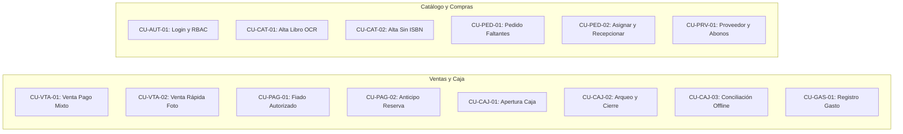
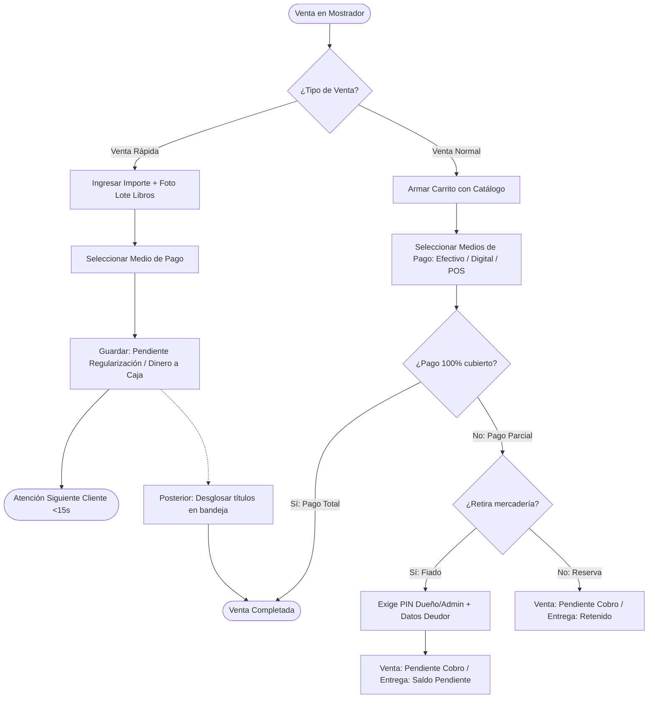
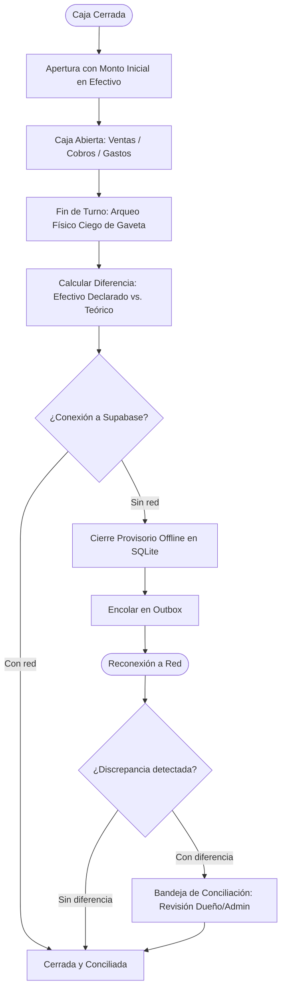
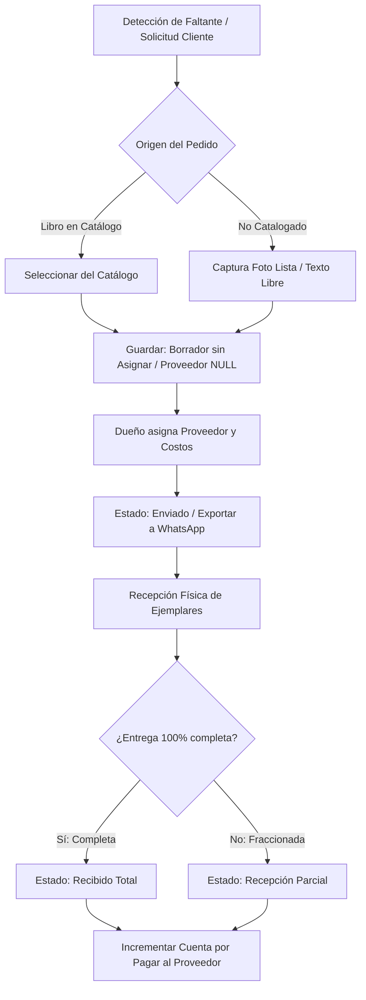

# Especificación de Requerimientos de Software (SRS)

**Proyecto:** Sistema de Gestión de Librería — Proyecto Tienda<br>
**Documento:** SRS.md<br>
**Estado:** Simplificado y Normalizado en H01.1<br>
**Norma de referencia:** Basado en IEEE 830 / ISO/IEC/IEEE 29148<br>
**Trazabilidad:** [REGLAS_NEGOCIO.md](REGLAS_NEGOCIO.md) | [../06-gestion/DECISIONES.md](../06-gestion/DECISIONES.md) | [../02-arquitectura/ARQUITECTURA.md](../02-arquitectura/ARQUITECTURA.md)

---

## 1. Introducción y Alcance

### 1.1 Propósito y Alcance
Especificar los requerimientos funcionales y no funcionales del **Sistema de Gestión de Librería**, priorizando la aplicación móvil Android *offline-first* para mostrador e inventario, con extensión hacia un panel web administrativo en Supabase.
- **Alcance MVP:** Tienda única, catálogo referencial sin bloqueo de stock, ventas ágiles, pagos mixtos, ventas rápidas con foto, fiados autorizados, reservas con libro retenido, arqueo de caja con desglose, gastos operativos, pedidos de faltantes con recepción parcial y sincronización asíncrona SQLite-Supabase.
- **Exclusiones MVP:** Control de inventario cuantitativo estricto (kardex) y facturación electrónica oficial (previstas para fases posteriores conforme a [DEC-003](../06-gestion/DECISIONES.md) y [DEC-008](../06-gestion/DECISIONES.md)).

### 1.2 Definiciones Clave
- **Offline-First:** Aplicación cliente autónoma con base de datos local SQLite y sincronización en segundo plano.
- **Venta Rápida:** Transacción de emergencia en hora pico capturada con foto del lote e importe, regularizada posteriormente.
- **Fiado (Entrega con saldo):** Entrega física de mercadería con saldo deudor pendiente, autorizada por Dueño/Admin.
- **Reserva (Anticipo):** Cobro parcial donde el libro permanece custodiado en la librería hasta la liquidación total.

---

## 2. Actores y Permisos

| Actor | Atribuciones Principales | Restricciones |
| :--- | :--- | :--- |
| **Administrador** | Superusuario técnico: gestión de usuarios, roles, auditoría de seguridad, conciliación definitiva de cierres y reportes. | Ninguna. |
| **Dueño** | Gestión comercial: autorización de fiados y anulaciones, visualización de datos bancarios de proveedores, órdenes de compra y abonos. | No gestiona cuentas de usuario ni configuración global. |
| **Vendedor** | Mostrador: ventas, cobros mixtos, ventas rápidas, alta preliminar de libros, arqueo de su caja y pedidos en borrador. | No autoriza fiados, no anula ventas, no ve datos bancarios. |

---

## 3. Requerimientos Funcionales (RF)

### 3.1 Módulo 1: Autenticación, Usuarios y Permisos
| ID | Descripción Verificable | Actor | Prioridad | Regla | Criterio de Aceptación | Excepción / Error |
| :--- | :--- | :---: | :---: | :---: | :--- | :--- |
| **RF-AUT-001** | Login con credenciales y gestión de JWT en Supabase GoTrue. | Todos | MVP | SEC-AUTH-001 | Token persistido en `SecureStore`. | Credenciales erróneas: bloqueo tras 5 intentos. |
| **RF-AUT-002** | Control RBAC en vistas móviles y políticas RLS remotas. | Admin | MVP | SEC-AUTHZ-002 | Vistas restringidas según rol. | Intento no autorizado bloqueado por RLS. |
| **RF-AUT-003** | Autenticación delegada offline con hash seguro en dispositivo. | Todos | MVP | RN-OFF-001 | Login offline <200ms para usuarios ya cacheados. | Bloqueo si usuario fue desactivado en nube. |
| **RF-AUT-004** | Autorización en dos pasos con PIN de Dueño/Admin para acciones sensibles. | Dueño/Admin | MVP | RN-PAG-002 | PIN 4 dígitos autoriza fiados y anulaciones. | PIN erróneo bloquea la acción tras 3 intentos. |

### 3.2 Módulo 2: Catálogo, Categorías, Ediciones y Estados
| ID | Descripción Verificable | Actor | Prioridad | Regla | Criterio de Aceptación | Excepción / Error |
| :--- | :--- | :---: | :---: | :---: | :--- | :--- |
| **RF-CAT-001** | Separación de ficha de obra (`libros`) y variantes (`ediciones_libro`). | Todos | MVP | RN-CAT-001 | Un título admite múltiples ediciones y precios. | Requiere al menos una edición activa. |
| **RF-CAT-002** | Búsqueda local incremental ultrarrápida por texto o ISBN. | Todos | MVP | RN-STK-001 | Resultados actualizados en <100ms. | Sin resultados: opción directa de registrar libro. |
| **RF-CAT-005** | Clasificación obligatoria por categorías temáticas principales. | Todos | MVP | RN-CAT-005 | Cada libro se asocia al menos a una categoría. | Alerta si no se selecciona categoría. |
| **RF-CAT-006** | Registro de libros sin ISBN con generación de código `LIB-XXXXXX`. | Todos | MVP | RN-CAT-004 | Campo ISBN nullable, búsqueda por título/autor. | Código interno generado automáticamente. |
| **RF-CAT-007** | Detección de duplicados por ISBN o similitud léxica >85%. | Todos | MVP | RN-CAT-004 | Bloqueo si ISBN coincide; alerta si título/autor similar. | Usuario confirma si es edición distinta. |
| **RF-CAT-008** | Estado de conservación (`Nuevo`/`Usado`) con notas de condición física. | Todos | MVP | RN-CAT-001 | Etiqueta visible en mostrador y comprobante. | Campo estado obligatorio. |

### 3.3 Módulo 3: Registro Asistido mediante OCR
| ID | Descripción Verificable | Actor | Prioridad | Regla | Criterio de Aceptación | Excepción / Error |
| :--- | :--- | :---: | :---: | :---: | :--- | :--- |
| **RF-OCR-001** | Captura fotográfica con cámara e inferencia OCR on-device. | Todos | MVP | DEC-010 | Extracción de bloques de texto en <3 segundos. | Imagen borrosa: alerta para recapturar. |
| **RF-OCR-002** | Parser heurístico con expresiones regulares para ISBN-10/13 y metadatos. | Sistema | MVP | RN-CAT-003 | Prellenado de ISBN con checksum validado. | Sin ISBN detectado: prellena solo título/autor. |
| **RF-OCR-003** | Interfaz obligatoria de validación y confirmación humana previa al alta. | Todos | MVP | RN-CAT-003 | El usuario edita/confirma campos antes de persistir. | Bloqueo si faltan campos obligatorios. |

### 3.4 Módulo 4: Ventas y Mostrador
| ID | Descripción Verificable | Actor | Prioridad | Regla | Criterio de Aceptación | Excepción / Error |
| :--- | :--- | :---: | :---: | :---: | :--- | :--- |
| **RF-VTA-001** | Venta multitítulo con carrito y modificación de cantidades. | Todos | MVP | RN-CAJ-001 | Cálculo inmediato de subtotales y total neto. | Carrito vacío bloquea botón de cobro. |
| **RF-VTA-002** | Precios unitarios editables y descuentos en mostrador (total neto >= 0). | Todos | MVP | RN-VTA-001 | Edición ágil in situ. *(Propuesta RN-VTA-004: >15% pide PIN)*. | Total neto negativo estrictamente bloqueado. |
| **RF-VTA-003** | Venta rápida exprés con fotografía del lote e importe cobrado. | Todos | MVP | RN-VTA-002 | Transacción registrada en <15s en SQLite. | Importe 0 o sin foto bloquea confirmación. |
| **RF-VTA-004** | Bandeja de regularización de ventas rápidas pendientes de desglose. | Todos | MVP | RN-VTA-002 | Desglose de libros cuadra importe y cierra venta. | Alerta previa obligatoria al cierre de caja. |
| **RF-VTA-005** | Anulación de ventas justificadas con restitución automática de gaveta. | Dueño/Admin | MVP | RN-VTA-003 | Venta y pagos pasan a `Anulada`, revierte efectivo. | Motivo <10 caracteres bloquea anulación. |
| **RF-VTA-006** | Emisión de nota de venta interna (digital o térmica Bluetooth 58/80mm). | Todos | MVP | RN-FAC-001 | Ticket con detalle, correlativo, pagos y saldos. | Falla de impresora ofrece compartir digital. |

### 3.5 Módulo 5: Pagos Mixtos, Anticipos, Saldos y Cobranzas
| ID | Descripción Verificable | Actor | Prioridad | Regla | Criterio de Aceptación | Excepción / Error |
| :--- | :--- | :---: | :---: | :---: | :--- | :--- |
| **RF-PAG-001** | Pagos mixtos combinados (Efectivo con vuelto, Billetera Digital, POS). | Todos | MVP | RN-PAG-001 | Suma de pagos cubre importe a cobrar. | Diferencia en suma bloquea confirmación. |
| **RF-PAG-002** | Entrega con saldo pendiente (Fiado) con PIN de Dueño/Admin y datos cliente. | Dueño/Admin | MVP | RN-PAG-002 | Venta: `pendiente_cobro`, Entrega: `entregado_saldo_pendiente`. | Sin datos de cliente o sin PIN bloquea salida. |
| **RF-PAG-003** | Anticipo con mercadería retenida (Reserva en custodia física de tienda). | Todos | MVP | RN-PAG-004 | Venta: `pendiente_cobro`, Entrega: `retenido`. | Prohibido entregar libro sin saldo cero. |
| **RF-PAG-004** | Amortizaciones sucesivas a cuentas por cobrar hasta liquidación total. | Todos | MVP | RN-PAG-003 | Abonos registran caja y transicionan a `total`. | Abono mayor al saldo restante bloqueado. |

### 3.6 Módulo 6: Caja, Movimientos y Cierres
| ID | Descripción Verificable | Actor | Prioridad | Regla | Criterio de Aceptación | Excepción / Error |
| :--- | :--- | :---: | :---: | :---: | :--- | :--- |
| **RF-CAJ-001** | Apertura de turno con monto inicial en efectivo en gaveta. | Todos | MVP | RN-CAJ-001 | Sesión en `abierta`; habilita ventas en mostrador. | Caja ya abierta bloquea nueva apertura. |
| **RF-CAJ-002** | Arqueo físico ciego de gaveta y cálculo de discrepancias. | Todos | MVP | RN-CAJ-003 | Registra declarado, calculado y diferencia. | Diferencia no bloquea cierre; se audita. |
| **RF-CAJ-003** | Resumen de cierre desglosado por medio de pago (Efectivo, Digital, POS, Fiado). | Todos | MVP | RN-CAJ-003 | Reporte claro en pantalla y ticket de arqueo. | Datos electrónicos se cotejan por lote. |
| **RF-CAJ-004** | Cierre provisional offline sin conexión a internet. | Todos | MVP | RN-CAJ-002 | Estado `Cierre Provisorio Offline` en SQLite. | Encolado en Outbox para sync posterior. |
| **RF-CAJ-005** | Conciliación remota de cierres offline sincronizados con discrepancia. | Dueño/Admin | MVP | RN-CAJ-002 | Transición a `Cerrada y Conciliada` tras revisión. | Cierres limpios se concilian automáticamente. |

### 3.7 Módulo 7: Gastos y Egresos Operativos
| ID | Descripción Verificable | Actor | Prioridad | Regla | Criterio de Aceptación | Excepción / Error |
| :--- | :--- | :---: | :---: | :---: | :--- | :--- |
| **RF-GAS-001** | Registro categorizado de gastos (Alquiler, Servicios, Suministros, etc.). | Todos | MVP | RN-GAS-001 | Gasto registrado con monto, categoría y concepto. | Monto <= 0 bloquea guardado. |
| **RF-GAS-002** | Imputación de fondos: Efectivo de caja activa vs. Fondos externos del dueño. | Todos | MVP | RN-GAS-001 | Si afecta caja, descuenta efectivo teórico. | Gasto externo no afecta gaveta de mostrador. |
| **RF-GAS-003** | Respaldo fotográfico de comprobantes o recibos de gasto. | Todos | MVP | SEC-STRG-001 | Foto adjunta localmente y sincronizada a Storage. | Imagen inaccesible: se permite reintentar. |

### 3.8 Módulo 8: Proveedores, Catálogos y Cuentas por Pagar
| ID | Descripción Verificable | Actor | Prioridad | Regla | Criterio de Aceptación | Excepción / Error |
| :--- | :--- | :---: | :---: | :---: | :--- | :--- |
| **RF-PRV-001** | Directorio de proveedores con WhatsApp de contacto directo. | Dueño/Admin | MVP | RN-PRV-003 | Ficha con enlace directo para abrir chat WhatsApp. | Teléfono inválido bloquea guardado. |
| **RF-PRV-002** | Resguardo restringido de datos bancarios (Banco, Cuenta, CCI, Titular). | Dueño/Admin | MVP | RN-PRV-002 | Visibles exclusivamente para Dueño y Admin. | Vendedor no recibe campos bancarios en UI. |
| **RF-PRV-003** | Asociación libro-proveedor con costos históricos variables. | Dueño/Admin | MVP | RN-CAT-002 | Sugerencia automática de último costo en pedidos. | Costo negativo estrictamente bloqueado. |
| **RF-PRV-004** | Control de cuentas por pagar, vencimiento de facturas y abonos parciales. | Dueño/Admin | MVP | RN-PRV-001 | Abonos disminuyen saldo de deuda con distribuidor. | Abono superior a deuda exige confirmación. |

### 3.9 Módulo 9: Pedidos de Libros Faltantes y Recepciones
| ID | Descripción Verificable | Actor | Prioridad | Regla | Criterio de Aceptación | Excepción / Error |
| :--- | :--- | :---: | :---: | :---: | :--- | :--- |
| **RF-PED-001** | Solicitud de faltantes en borrador sin proveedor preasignado. | Todos | MVP | RN-PED-001 | Estado `borrador_sin_asignar`, proveedor NULL. | Pedido vacío bloquea confirmación. |
| **RF-PED-002** | Registro por fotografía o texto libre de libros no catalogados. | Todos | MVP | RN-PED-003 | Captura imagen de lista manuscrita o texto libre. | No exige `edicion_libro_id` en origen. |
| **RF-PED-003** | Asignación de proveedor y exportación de orden formal a WhatsApp. | Dueño/Admin | MVP | RN-PED-001 | Transición a `Enviado` y exporta texto formateado. | Falta de proveedor bloquea pase a Enviado. |
| **RF-PED-004** | Recepción física parcial con incremento proporcional de cuenta por pagar. | Todos | MVP | RN-PED-002 | Estado `Recepción Parcial`, deuda solo por recibidos. | Cantidad recibida > solicitada exige aviso. |

### 3.10 Módulo 10: Reportería Operativa y Financiera
| ID | Descripción Verificable | Actor | Prioridad | Regla | Criterio de Aceptación | Excepción / Error |
| :--- | :--- | :---: | :---: | :---: | :--- | :--- |
| **RF-REP-001** | Resumen diario/periódico de ventas netas, descuentos y ticket promedio. | Dueño/Admin | MVP | N/A | Métricas consolidadas filtrables por fecha. | Sin datos en rango muestra balance en cero. |
| **RF-REP-002** | Balance operativo de caja de mostrador vs. egresos clasificados. | Dueño/Admin | MVP | RN-GAS-001 | Flujo neto discriminando efectivo y bancos. | Discrepancias de arqueo resaltadas en rojo. |
| **RF-REP-003** | Cartera de clientes fiados con antigüedad y cuentas por pagar a proveedores. | Dueño/Admin | MVP | RN-PAG-002 | Listado de deudores con alertas >15 y >30 días. | Actualización en tiempo real con abonos. |

### 3.11 Módulo 11: Operación Offline y Sincronización
| ID | Descripción Verificable | Actor | Prioridad | Regla | Criterio de Aceptación | Excepción / Error |
| :--- | :--- | :---: | :---: | :---: | :--- | :--- |
| **RF-OFF-001** | Autonomía offline total en mostrador, cobros, consultas y cajas. | Sistema | MVP | RN-OFF-001 | Lectura y escritura en SQLite con latencia cero. | Pérdida de red no interrumpe transacciones. |
| **RF-OFF-002** | Cola Outbox transaccional atómica para mutaciones asíncronas. | Sistema | MVP | DEC-009 | Mutaciones encoladas bajo transacción ACID local. | Reintentos con retroceso exponencial. |
| **RF-OFF-003** | Conciliación determinista con UUID v4 e idempotencia contra repeticiones. | Sistema | MVP | SEC-SYNC-002 | Cero duplicados en base central al reconectar. | Conflictos de caja derivados a bandeja admin. |

---

## 4. Requerimientos No Funcionales (RNF)

| ID | Categoría | Requisito Cuantificado | Verificación |
| :--- | :--- | :--- | :--- |
| **RNF-USAB-001** | Ergonomía Táctil | Elementos táctiles interactivos >= 48x48 dp. | Inspección visual en pantallas Android de 5.5" a 6.7". |
| **RNF-USAB-002** | Rapidez Mostrador | Venta ordinaria completada en < 30 segundos; venta rápida en < 15 segundos. | Prueba cronometrada con usuarios en mostrador. |
| **RNF-PERF-001** | Latencia Local | Consultas y persistencia en SQLite en < 100 ms con 10,000 libros. | Benchmarking de queries con base indexada. |
| **RNF-PERF-002** | Rendimiento OCR | Inferencia y extracción de texto local en < 3 segundos. | Prueba en hardware de gama media (Snapdragon 680 / 4GB RAM). |
| **RNF-CONF-001** | Resiliencia de Red | Cero bloqueos o pérdidas de datos ante corte abrupto de red. | Desconexión forzada (modo avión) durante venta y arqueo. |
| **RNF-CONF-002** | Transaccionalidad | 100% de operaciones multientidad bajo transacción SQLite ACID. | Prueba de caída de energía/batería durante inserción. |
| **RNF-SEC-001** | Control RBAC / RLS| 100% de tablas PostgreSQL protegidas con Row Level Security. | Pruebas de acceso con JWT de diferentes roles. |
| **RNF-SEC-002** | Criptografía | Tokens JWT y claves resguardados en Android Keystore (`SecureStore`). | Dumps de memoria e inspección de almacenamiento privado. |
| **RNF-SEC-003** | Cifrado Tránsito | Comunicación obligatoria bajo HTTPS / TLS 1.3 con Supabase. | Verificación de certificados y handshake SSL. |
| **RNF-PORT-001** | Compatibilidad | Soporte operativo en Android 10 (API 29) hasta Android 15. | Pruebas en emuladores y dispositivos físicos oficiales. |
| **RNF-PORT-002** | Reutilización | Tipos de dominio compartidos entre aplicación móvil y futuro panel web. | Compilación cruzada en monorepo desde `@tienda/shared-types`. |

---

## 5. Casos de Uso Principales (CU)

Se desarrollan los **14 casos de uso clave** del sistema, cubriendo los flujos esenciales sin redundancia:



### CU-AUT-01: Inicio de Sesión y Control de Acceso por Rol
- **Actor:** Usuario (Vendedor / Dueño / Admin). **Objetivo:** Autenticarse y cargar entorno según permisos.
- **Precondición:** Usuario registrado en sistema.
- **Flujo Principal:** 1. Usuario ingresa identificador y contraseña. 2. Presiona "Iniciar Sesión". 3. Sistema valida credenciales (Supabase GoTrue con red o caché local SecureStore offline). 4. Recupera rol y abre pantalla de mostrador adaptando accesos.
- **Alternativa / Excepción:** Credenciales inválidas: muestra mensaje de error. Si no hay red y nunca inició sesión en el equipo, exige conectividad inicial.
- **Gherkin:**
  ```gherkin
  Escenario: Acceso vendedor restringe vistas administrativas
    Dado que el usuario "vendedor1" inicia sesión con éxito
    Entonces el sistema muestra el punto de venta y catálogo
    Y oculta la configuración del sistema y cuentas bancarias de proveedores
  ```

### CU-CAT-01: Registro Asistido de Libro con OCR y Validación de Duplicados
- **Actor:** Vendedor / Dueño. **Objetivo:** Catalogar un ejemplar asistido por cámara evitando duplicidades.
- **Precondición:** Cámara disponible.
- **Flujo Principal:** 1. Usuario selecciona "Escanear Portada". 2. Captura foto. 3. OCR extrae ISBN, título y autor. 4. Sistema busca duplicados. 5. Prellena formulario; usuario selecciona categoría, formato, conservación (`Nuevo`/`Usado`) y precio. 6. Presiona "Guardar".
- **Alternativa / Excepción:** Si el ISBN existe, bloquea y ofrece añadir edición al libro existente. Si no tiene ISBN y título+autor coincide >85%, alerta posible duplicidad.
- **Gherkin:**
  ```gherkin
  Escenario: Prevención de duplicado exacto por ISBN
    Dado que existe el libro con ISBN "9780307474728"
    Cuando se escanea un ejemplar con dicho ISBN
    Entonces el sistema bloquea la duplicación y sugiere agregar nueva edición al libro matriz
  ```

### CU-CAT-02: Alta Manual de Libro sin ISBN y Asignación de Categorías
- **Actor:** Vendedor / Dueño. **Objetivo:** Registrar libros antiguos, usados o independientes sin código de barras.
- **Precondición:** Datos del ejemplar físico a la vista.
- **Flujo Principal:** 1. Usuario presiona "Alta Manual". 2. Marca casilla "Sin ISBN". 3. Sistema asigna código referencial `LIB-XXXXXX`. 4. Ingresa título, autor, categoría obligatoria y precio. 5. Guarda el registro.
- **Gherkin:**
  ```gherkin
  Escenario: Alta exitosa de libro sin ISBN
    Dado que el usuario ingresa un libro antiguo marcando "Sin ISBN"
    Cuando completa título, autor y categoría obligatoria
    Entonces el sistema asigna un código interno referencial y lo hace disponible para la venta
  ```

### CU-VTA-01: Registrar Venta Normal con Pago Mixto
- **Actor:** Vendedor. **Objetivo:** Registrar venta cobrando con combinación de medios de pago.
- **Precondición:** Sesión de caja `Abierta`.
- **Flujo Principal:** 1. Agrega libros al carrito. 2. Presiona "Cobrar". 3. Cliente fracciona importe (ej. parte efectivo, parte billetera digital). 4. Vendedor ingresa cada monto y referencia. 5. Saldo restante llega a 0.00. 6. Confirma venta; sistema registra `Completada`, ingresa efectivo a caja y emite ticket.
- **Gherkin:**
  ```gherkin
  Escenario: Venta con pago mixto exacto
    Dado un carrito con total neto de 100.00 soles
    Cuando se abonan 40.00 soles en efectivo y 60.00 soles por billetera digital
    Entonces la venta transiciona a Completada y la caja en efectivo suma 40.00 soles
  ```

### CU-VTA-02: Registrar Venta Rápida con Fotografía y Regularización Posterior
- **Actor:** Vendedor. **Objetivo:** Atender clientes en hora pico en <15s postergando desglose de libros.
- **Precondición:** Caja activa.
- **Flujo Principal:** 1. Selecciona "Venta Rápida". 2. Ingresa importe cobrado y medio de pago. 3. Toma foto del lote de libros. 4. Confirma; dinero ingresa a caja y venta queda en `pendiente_regularizacion`. 5. Al finalizar hora pico, abre bandeja de pendientes, visualiza la foto, selecciona los libros del catálogo y completa la transacción.
- **Gherkin:**
  ```gherkin
  Escenario: Cierre diario alerta sobre ventas rápidas sin regularizar
    Dado que existe una venta rápida pendiente de desglose
    Cuando el vendedor intenta cerrar la caja diaria
    Entonces el sistema despliega una advertencia obligando a regularizar los títulos vendidos
  ```

### CU-PAG-01: Venta con Pago Parcial y Entrega Autorizada (Fiado)
- **Actor:** Vendedor (solicita) / Dueño o Admin (autoriza). **Objetivo:** Entregar libros con cobro pendiente.
- **Precondición:** `total_pagado < total_neto`.
- **Flujo Principal:** 1. Vendedor selecciona "Entrega con Saldo (Fiado)". 2. Captura nombre, teléfono WhatsApp y DNI del cliente. 3. Sistema exige PIN de encargado. 4. Dueño ingresa PIN válido. 5. Venta pasa a `pendiente_cobro`, entrega a `entregado_saldo_pendiente` y se emite ticket con saldo deudor.
- **Alternativa / Excepción:** PIN incorrecto bloquea la entrega física de los libros.
- **Gherkin:**
  ```gherkin
  Escenario: Autorización de fiado con PIN de dueño
    Dado un saldo pendiente de 50.00 soles con datos de cliente registrados
    Cuando el Dueño ingresa su PIN válido de 4 dígitos
    Entonces se autoriza la entrega física y se registra el crédito por cobrar
  ```

### CU-PAG-02: Anticipo con Reserva y Retención de Mercadería
- **Actor:** Vendedor. **Objetivo:** Recibir pago a cuenta manteniendo el libro custodiado en tienda.
- **Precondición:** Caja activa.
- **Flujo Principal:** 1. Cliente deja anticipo. 2. Vendedor selecciona "Reserva con Anticipo". 3. Registra monto abonado. 4. Venta queda en `pendiente_cobro`, pago `parcial` y entrega `retenido`. 5. El libro físico se coloca en estantería de reservas.
- **Gherkin:**
  ```gherkin
  Escenario: Mercadería reservada no puede entregarse físicamente
    Dado un anticipo del 30% sobre un libro bajo modalidad reserva
    Cuando se genera el comprobante
    Entonces el estado de entrega queda formalmente registrado como "Retenido"
  ```

### CU-CAJ-01: Apertura de Sesión de Caja Diaria
- **Actor:** Vendedor / Dueño. **Objetivo:** Iniciar turno de mostrador con fondo de sencillo.
- **Precondición:** Terminal sin caja activa.
- **Flujo Principal:** 1. Usuario ingresa a "Apertura de Caja". 2. Declara fondo inicial en efectivo (ej. S/ 100.00). 3. Presiona "Confirmar". 4. Caja pasa a `Abierta`, habilitando cobros en mostrador.
- **Gherkin:**
  ```gherkin
  Escenario: Apertura habilita operaciones de venta en efectivo
    Dado que el vendedor declara 100.00 soles de saldo inicial
    Cuando confirma la apertura de caja
    Entonces el sistema permite registrar transacciones comerciales en mostrador
  ```

### CU-CAJ-02: Arqueo y Cierre de Caja con Desglose por Medio de Pago
- **Actor:** Vendedor / Dueño. **Objetivo:** Concluir turno, contar efectivo ciego y emitir resumen desglosado.
- **Precondición:** Sesión `Abierta`.
- **Flujo Principal:** 1. Usuario accede a "Cierre de Caja". 2. Realiza conteo ciego de billetes y monedas. 3. Ingresa monto contado. 4. Sistema calcula diferencia contra saldo teórico. 5. Muestra resumen desglosado (Efectivo gaveta, Billetera Digital, POS, Fiados). 6. Confirma cierre (Pasa a `Cerrada y Conciliada` si hay red, o `Cierre Provisorio Offline` sin red).
- **Gherkin:**
  ```gherkin
  Escenario: Cierre provisorio offline por falta de red
    Dado que el terminal no tiene acceso a internet al finalizar el turno
    Cuando el usuario confirma el arqueo de caja
    Entonces la sesión se guarda en SQLite como "Cierre Provisorio Offline" y se encola en Outbox
  ```

### CU-CAJ-03: Conciliación de Cierre Provisorio Offline con Discrepancia
- **Actor:** Dueño / Admin. **Objetivo:** Resolver diferencias financieras de cierres offline en la nube.
- **Precondición:** Cierre offline sincronizado con diferencias reportadas.
- **Flujo Principal:** 1. Dueño ingresa a "Bandeja de Conciliación". 2. Revisa sesión con diferencia. 3. Contrasta cobros electrónicos y efectivo. 4. Aprueba el cierre registrando notas de ajuste de auditoría. 5. Sesión pasa a `Cerrada y Conciliada`.
- **Gherkin:**
  ```gherkin
  Escenario: Conciliación definitiva de cierre descuadrado
    Dado un cierre sincronizado con un faltante de 10.00 soles
    Cuando el Administrador revisa la bitácora y confirma el ajuste con justificación
    Entonces la sesión transiciona definitivamente al estado "Cerrada y Conciliada"
  ```

### CU-PED-01: Registro de Pedido de Libros Faltantes (Texto/Foto sin Proveedor)
- **Actor:** Vendedor / Dueño. **Objetivo:** Registrar pedidos de reposición o encargo sin proveedor definido.
- **Precondición:** Ninguna.
- **Flujo Principal:** 1. Usuario accede a "Nuevo Pedido". 2. Ingresa libros de catálogo, texto libre o toma foto de lista manuscrita de cliente. 3. Guarda orden en estado `borrador_sin_asignar` con `proveedor_id = NULL`.
- **Gherkin:**
  ```gherkin
  Escenario: Registro de pedido por lista fotográfica
    Dado que un cliente solicita libros no catalogados mediante lista escrita
    Cuando el vendedor fotografía la lista y la guarda en faltantes
    Entonces se crea la solicitud en estado borrador sin requerir proveedor inicial
  ```

### CU-PED-02: Asignación de Proveedor y Recepción Parcial de Pedido
- **Actor:** Dueño (asigna) / Vendedor (recibe). **Objetivo:** Ordenar a distribuidor y recibir entrega fraccionada.
- **Precondición:** Pedido en borrador existente.
- **Flujo Principal:** 1. Dueño asigna proveedor y costos; marca `Enviado` (exporta a WhatsApp). 2. Días después llega el pedido con entrega incompleta. 3. Vendedor verifica cantidades físicas y marca ítems recibidos. 4. Pedido pasa a `Recepción Parcial` y deuda con proveedor aumenta proporcionalmente.
- **Gherkin:**
  ```gherkin
  Escenario: Recepción parcial incrementa deuda proporcional
    Dado un pedido de 10 libros a 20.00 soles cada uno
    Cuando el proveedor entrega físicamente solo 6 unidades
    Entonces el pedido pasa a "Recepción Parcial" y la cuenta por pagar suma exactamente 120.00 soles
  ```

### CU-PRV-01: Gestión de Proveedor, Datos Bancarios y Abonos de Deuda
- **Actor:** Dueño / Admin. **Objetivo:** Administrar distribuidores, datos confidenciales y amortizar deudas.
- **Precondición:** Sesión de Dueño o Admin.
- **Flujo Principal:** 1. Dueño registra proveedor con WhatsApp y datos bancarios protegidos (banco, CCI, titular). 2. Consulta saldo deudor acumulado. 3. Registra abono adjuntando comprobante. 4. Cuenta por pagar disminuye.
- **Gherkin:**
  ```gherkin
  Escenario: Abono a proveedor reduce cuenta por pagar
    Dado una deuda de 500.00 soles con el distribuidor "Alfa"
    Cuando el Dueño registra un abono por transferencia de 200.00 soles
    Entonces la deuda con "Alfa" se actualiza a 300.00 soles
  ```

### CU-GAS-01: Registro de Gasto Operativo con Respaldo Fotográfico
- **Actor:** Vendedor (menores) / Dueño / Admin. **Objetivo:** Registrar salidas por servicios o suministros.
- **Precondición:** Caja activa si se paga con efectivo.
- **Flujo Principal:** 1. Usuario selecciona "Registrar Gasto". 2. Elige categoría (ej. Servicios Básicos - Luz). 3. Ingresa monto y concepto. 4. Marca "Pagado de Caja Efectivo". 5. Toma foto del recibo. 6. Guarda; dinero descuenta del efectivo teórico de caja.
- **Gherkin:**
  ```gherkin
  Escenario: Gasto en efectivo disminuye arqueo teórico
    Dado un saldo teórico de caja de 300.00 soles
    Cuando se registra un gasto de luz por 50.00 soles en efectivo
    Entonces el saldo teórico de caja disminuye inmediatamente a 250.00 soles
  ```

---

## 6. Diagramas de Procesos Principales (Mermaid)

### 6.1 Proceso de Ventas en Mostrador y Modalidades de Cobro



### 6.2 Ciclo de Sesión de Caja y Conciliación Offline



### 6.3 Ciclo de Abastecimiento: Pedido de Faltantes y Recepción Parcial



---

## 7. Matriz de Trazabilidad Integral

| Requisito Funcional | Regla Vinculada | Caso de Uso | Criterio de Verificación / Gherkin | Prioridad |
| :--- | :--- | :--- | :--- | :---: |
| **RF-AUT-001** (Login GoTrue) | SEC-AUTH-001 | CU-AUT-01 | Token JWT en SecureStore | **MVP** |
| **RF-AUT-002** (RBAC) | SEC-AUTHZ-002 | CU-AUT-01 | Restricción de vistas según rol | **MVP** |
| **RF-AUT-003** (Login Offline) | RN-OFF-001, DEC-009 | CU-AUT-01 | Validación hash local <200ms | **MVP** |
| **RF-AUT-004** (PIN Autorizador) | RN-PAG-002, RN-VTA-003 | CU-PAG-01 | PIN 4 dígitos valida rol Dueño/Admin | **MVP** |
| **RF-CAT-001** (Libro vs. Edición) | RN-CAT-001, DEC-004 | CU-CAT-01 | Desacoplamiento de obra y formato | **MVP** |
| **RF-CAT-002** (Búsqueda local) | RN-STK-001, RNF-PERF-001 | CU-VTA-01 | Búsqueda incremental SQLite <100ms | **MVP** |
| **RF-CAT-005** (Categorías) | RN-CAT-005 | CU-CAT-02 | Categoría obligatoria por obra | **MVP** |
| **RF-CAT-006** (Sin ISBN) | RN-CAT-004 | CU-CAT-02 | ISBN nullable + código interno | **MVP** |
| **RF-CAT-007** (Duplicados) | RN-CAT-004 | CU-CAT-01 | Detección ISBN y similitud >85% | **MVP** |
| **RF-CAT-008** (Nuevo vs. Usado) | RN-CAT-001 | CU-CAT-01 | Etiqueta estado y notas en ticket | **MVP** |
| **RF-OCR-001** (Inferencia Cámara) | DEC-010, RN-CAT-003 | CU-CAT-01 | Procesamiento local en <3 segundos | **MVP** |
| **RF-OCR-002** (Parser Heurístico) | RN-CAT-003 | CU-CAT-01 | Extracción Regex ISBN-10/13 | **MVP** |
| **RF-OCR-003** (Validación Humana)| RN-CAT-003 | CU-CAT-01 | Confirmación obligatoria pre-guardado | **MVP** |
| **RF-VTA-001** (Venta Multitítulo) | RN-CAJ-001 | CU-VTA-01 | Carrito con cálculo de totales | **MVP** |
| **RF-VTA-002** (Precios/Descuentos)| RN-VTA-001, RN-VTA-004 | CU-VTA-01 | Descuentos modificables in situ | **MVP** |
| **RF-VTA-003** (Venta Rápida Foto) | DEC-011, RN-VTA-002 | CU-VTA-02 | Registro exprés en <15 segundos | **MVP** |
| **RF-VTA-004** (Regularización) | RN-VTA-002 | CU-VTA-02 | Desglose diferido de libros | **MVP** |
| **RF-VTA-005** (Anulación Venta) | RN-VTA-003 | N/A | Motivo obligatorio + reversión caja | **MVP** |
| **RF-VTA-006** (Ticket Mostrador) | RN-FAC-001 | CU-VTA-01 | Ticket digital / térmico 58-80mm | **MVP** |
| **RF-PAG-001** (Pagos Mixtos) | RN-PAG-001 | CU-VTA-01 | Efectivo + Billetera + POS combinados | **MVP** |
| **RF-PAG-002** (Fiado Autorizado) | DEC-006, RN-PAG-002 | CU-PAG-01 | Entrega física con saldo autorizado | **MVP** |
| **RF-PAG-003** (Anticipo Reserva) | RN-PAG-004 | CU-PAG-02 | Pago parcial con mercadería retenida | **MVP** |
| **RF-PAG-004** (Cobranza Deuda) | RN-PAG-003 | CU-PAG-01 | Amortización sucesiva de saldos | **MVP** |
| **RF-CAJ-001** (Apertura Caja) | RN-CAJ-001 | CU-CAJ-01 | Bloquea ventas sin apertura activa | **MVP** |
| **RF-CAJ-002** (Arqueo Ciego) | RN-CAJ-003 | CU-CAJ-02 | Conteo físico y cálculo de diferencia | **MVP** |
| **RF-CAJ-003** (Resumen Medios Pago)| RN-CAJ-003 | CU-CAJ-02 | Desglose Efectivo vs. Digital vs. POS | **MVP** |
| **RF-CAJ-004** (Cierre Offline) | DEC-007, RN-CAJ-002 | CU-CAJ-02 | Estado Cierre Provisorio Offline | **MVP** |
| **RF-CAJ-005** (Conciliación Remota)| RN-CAJ-002 | CU-CAJ-03 | Validación de discrepancias en nube | **MVP** |
| **RF-GAS-001** (Gastos Operativos)| RN-GAS-001 | CU-GAS-01 | Clasificación por categorías de gasto | **MVP** |
| **RF-GAS-002** (Imputación Fondos) | RN-GAS-001 | CU-GAS-01 | Diferenciación Caja vs. Fondos Dueño | **MVP** |
| **RF-GAS-003** (Foto Comprobante) | SEC-STRG-001 | CU-GAS-01 | Foto voucher asociada a storage | **MVP** |
| **RF-PRV-001** (WhatsApp Proveedor)| RN-PRV-003 | CU-PRV-01 | Acceso directo a chat de compras | **MVP** |
| **RF-PRV-002** (Datos Bancarios) | RN-PRV-002, SEC-AUTHZ-002 | CU-PRV-01 | Acceso restringido a Dueño/Admin | **MVP** |
| **RF-PRV-003** (Costos Proveedor) | DEC-005, RN-CAT-002 | CU-PED-02 | Costo variable por edición | **MVP** |
| **RF-PRV-004** (Cuentas por Pagar) | RN-PRV-001 | CU-PRV-01 | Control de deuda y abonos | **MVP** |
| **RF-PED-001** (Pedido sin Prov.) | RN-PED-001 | CU-PED-01 | Borrador sin asignar inicial | **MVP** |
| **RF-PED-002** (Foto/Texto No Cat.)| RN-PED-003 | CU-PED-01 | Captura de lista manuscrita/foto | **MVP** |
| **RF-PED-003** (Asignar Proveedor)| RN-PED-001 | CU-PED-02 | Transición a Enviado por Dueño | **MVP** |
| **RF-PED-004** (Recepción Parcial)| RN-PED-002 | CU-PED-02 | Recepción fraccionada y saldo deuda | **MVP** |
| **RF-REP-001** (Resumen Ventas) | N/A | N/A | Métricas diarias y ticket promedio | **MVP** |
| **RF-REP-002** (Caja vs. Gastos) | RN-GAS-001 | N/A | Balance financiero operativo | **MVP** |
| **RF-REP-003** (Cartera Deudores) | RN-PAG-002, RN-PRV-001 | N/A | Antigüedad saldos clientes/proveedor | **MVP** |
| **RF-OFF-001** (Autonomía Mostrador)| DEC-009, RN-OFF-001 | CU-VTA-01 | Operación 100% offline con SQLite | **MVP** |
| **RF-OFF-002** (Cola Outbox) | ARQUITECTURA 3 | CU-VTA-01 | Cola mutaciones atómicas local | **MVP** |
| **RF-OFF-003** (Replay Protection) | SEC-SYNC-002 | CU-CAJ-02 | Idempotencia y marcas de tiempo UTC | **MVP** |

---

## 8. Desafíos y Problemas Detectados en el Modelo de Datos Preliminar para H03

1. **Entidad `categorias` y tabla asociativa `libro_categoria`:** Requerida para clasificación temática (`RF-CAT-005`).
2. **WhatsApp y datos bancarios protegidos en `proveedores`:** Campos `whatsapp`, `banco`, `tipo_cuenta`, `numero_cuenta`, `cci` y `titular` con visualización filtrada (`RF-PRV-001`, `RF-PRV-002`).
3. **Flexibilización de `pedido_detalles`:** Permitir `edicion_libro_id NULL` para admitir pedidos de libros no catalogados capturados por foto o texto (`RF-PED-002`).
4. **Desglose de arqueo físico en `sesiones_caja`:** Separar el arqueo en efectivo físico de gaveta de los totales reportados por POS y billeteras electrónicas (`RF-CAJ-003`).
5. **Notas de conservación en `ediciones_libro`:** Atributo `condicion_notas` para libros de segunda mano (`RF-CAT-008`).

> [!NOTE]
> Estas observaciones se consolidarán en el diseño físico definitivo durante el hito **H03 (Modelo y diccionario de datos)**.
