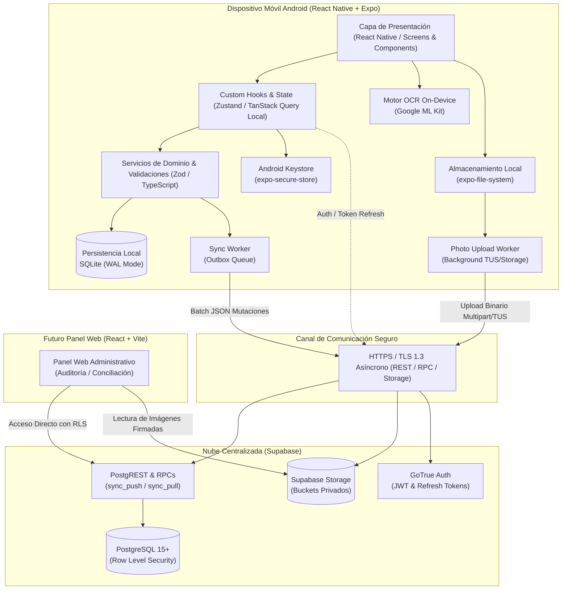
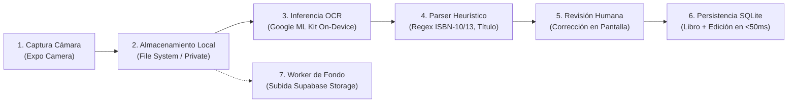
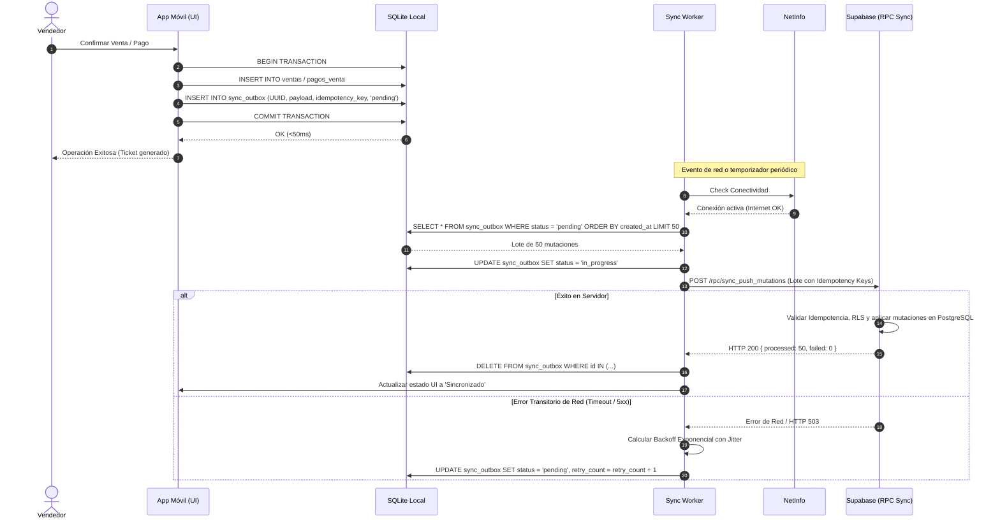
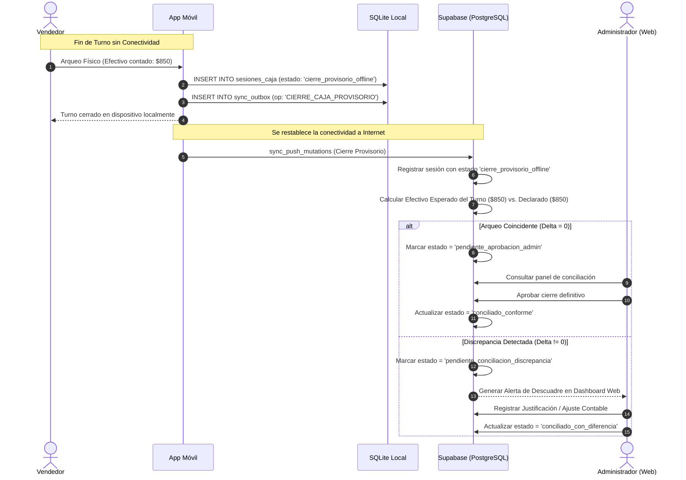

# Arquitectura del Sistema y Estrategia Offline-First (ARQUITECTURA.md)

**Proyecto:** Sistema de Gestión de Librería — Proyecto Tienda<br>
**Documento:** ARQUITECTURA.md<br>
**Estado:** Consolidado y Refinado en H02<br>
**Trazabilidad:** [../06-gestion/DECISIONES.md](../06-gestion/DECISIONES.md) | [../01-requerimientos/SRS.md](../01-requerimientos/SRS.md) | [../01-requerimientos/REGLAS_NEGOCIO.md](../01-requerimientos/REGLAS_NEGOCIO.md) | [../04-seguridad/HARDENING.md](../04-seguridad/HARDENING.md)

---

## 1. Visión General y Estilo Arquitectónico

El sistema adopta el paradigma **Local-First (Offline-First)** asistido por un backend centralizado en **Supabase** (BaaS con PostgreSQL, GoTrue y Storage).

### 1.1 Principios Arquitectónicos
1. **Autonomía Operativa Local:** Toda acción crítica de mostrador (ventas, cobros, gastos, cierres de caja) se completa localmente en SQLite en <50ms, sin bloqueo por red.
2. **Generación Descentralizada de Identificadores:** Todas las tablas generan claves primarias **UUID v4** en el cliente, eliminando colisiones al sincronizar.
3. **Integridad Financiera Anti-LWW:** Se prohíbe *Last-Write-Wins* en ventas, cobros, cuentas por pagar y caja. Se utiliza un modelo de **Libro Mayor Append-Only** (registros aditivos e inmutables) con conciliación explícita.
4. **Desacoplamiento UI / Dominio:** La lógica comercial reside en servicios puros de dominio dentro de paquetes compartidos, reutilizables directamente por la futura aplicación web.

### 1.2 Diagrama General de Arquitectura



---

## 2. Organización del Monorepo

Se estructura un monorepo gestionado con **pnpm workspaces** y orquestado mediante **Turborepo** ([DEC-014](../06-gestion/DECISIONES.md#dec-014-orquestador-de-monorepo-turborepo--pnpm)):

```text
/
├── apps/
│   ├── mobile/                  # Aplicación React Native / Expo (Android MVP)
│   └── web/                     # Futuro panel administrativo en React (Fase H08+)
├── packages/
│   ├── shared-types/            # Entidades de dominio, DTOs, Enums y contratos
│   ├── business-logic/          # Reglas de validación, cálculos financieros y Zod schemas
│   ├── database/                # Esquemas SQLite/Postgres, DDL, migraciones y seeders
│   ├── sync-engine/             # Cola Outbox, cliente HTTP, idempotencia y reconciliador
│   └── eslint-config/           # Reglas de linting y formateo compartidas
├── docs/                        # Estructura documental oficial
├── pnpm-workspace.yaml          # Declaración de workspaces
├── turbo.json                   # Definición de pipeline de tareas y caché local
└── package.json                 # Raíz con dependencias de tooling y scripts
```

### 2.1 Responsabilidad de Paquetes y Módulos

| Paquete / App | Tipo | Responsabilidad Principal | Tecnologías Clave | Consumidores |
| :--- | :--- | :--- | :--- | :--- |
| `apps/mobile` | Aplicación | POS de mostrador, captura OCR, ventas rápidas y operación offline. | Expo SDK 51+, React Native, React Navigation. | Usuario mostrador. |
| `apps/web` | Aplicación | Auditoría, reportes avanzados, conciliación de caja y gestión gerencial. | React 18+, Vite, Tailwind CSS. | Administrador / Dueño. |
| `packages/shared-types` | Librería | Definición de tipos TypeScript, contratos de RPC, enums y DTOs de sincronización. | TypeScript (Strict mode). | `apps/*`, `packages/*`. |
| `packages/business-logic`| Librería | Reglas de negocio puras, validación de estados compatibles y esquemas Zod. | Zod, TypeScript puro. | `apps/*`, `sync-engine`. |
| `packages/database` | Librería | Abstracción de acceso a datos, migraciones versionadas y DDL para SQLite/Postgres. | `expo-sqlite`, Kysely / Drizzle. | `apps/mobile`, `sync-engine`. |
| `packages/sync-engine` | Librería | Gestión de cola Outbox, resolución de conflictos, backoff y cliente Supabase. | Fetch API, NetInfo, Crypto. | `apps/mobile`, `apps/web`. |

---

## 3. Arquitectura Móvil por Módulos

La aplicación móvil (`apps/mobile`) se organiza bajo un enfoque modular por características (*feature-based*):

```text
apps/mobile/src/
├── features/
│   ├── auth/                    # Login, biometría, PIN offline y sesión en SecureStore
│   ├── catalog/                 # Búsqueda rápida, alta de libros y selección de ediciones
│   ├── ocr/                     # Cámara, inferencia ML Kit local y parsing de metadatos
│   ├── sales/                   # Carrito de venta, precios editables y notas de venta
│   ├── quick-sales/             # Venta rápida: captura de foto, monto total y regularización
│   ├── payments/                # Cobros mixtos, entrega fiada autorizada y abonos de clientes
│   ├── cash-desk/               # Apertura, arqueo, movimientos, cierre provisorio y regularización
│   ├── expenses/                # Registro de gastos operativos y comprobantes
│   ├── suppliers/               # Directorio de proveedores, costos y cuentas pendientes
│   ├── orders/                  # Pedidos de libros faltantes y recepciones fraccionadas
│   └── sync/                    # Estado de conectividad, indicador de sincronización y logs
├── navigation/                  # Root Navigator, Stack Mostrador y Drawer Administrativo
├── components/ui/               # Átomos y moléculas de interfaz accesibles y táctiles
└── services/                    # Adaptadores nativos (Audio beeper, Cámara, Filesystem)
```

### 3.1 Separación Estricta entre UI y Lógica de Dominio
- **Presentación (UI):** Componentes funcionales React Native sin llamadas directas a SQLite ni lógica matemática de ventas.
- **Custom Hooks:** Orquestan el estado de la vista (`useSaleCheckout`, `useCashRegister`) consumiendo los repositorios locales.
- **Domain Services:** Funciones puras e independientes de React (`calculateSaleTotal`, `validateCashClosureDifference`) ubicadas en `packages/business-logic`.
- **Capa de Persistencia:** Acceso a SQLite mediado exclusivamente por Repositorios (`SaleRepository`, `CashRepository`).

---

## 4. Integración con Supabase

### 4.1 Autenticación (GoTrue)
- Autenticación remota mediante correo y contraseña / PIN seguro.
- Al iniciar sesión en línea, GoTrue entrega un JWT (vida corta: 1h) y un Refresh Token (vida larga).
- **Persistencia Segura:** Tokens resguardados en `expo-secure-store` (Android Keystore con AES-256).
- **Operación Offline:** El perfil de usuario y rol (`admin`, `dueno`, `vendedor`) se sincronizan en la tabla SQLite local `usuarios_sesion`. El usuario puede continuar operando sin red validando su sesión mediante PIN local o biometría huella (`expo-local-authentication`).

### 4.2 Base de Datos (PostgreSQL con RLS)
- Centraliza la verdad global del sistema bajo aislamiento estricto por roles mediante **Row Level Security** ([../04-seguridad/HARDENING.md](../04-seguridad/HARDENING.md)).
- Inserción y actualización masiva de sincronización expuesta vía funciones PostgreSQL seguras (`SECURITY DEFINER` con validación de roles en JWT):
  - `rpc_push_mutations(p_mutations JSONB)`: Procesa transaccionalmente el lote de mutaciones respetando idempotencia.
  - `rpc_pull_deltas(p_last_pulled_at TIMESTAMPTZ, p_tables TEXT[])`: Devuelve cambios incrementales ocurridos desde la última marca de tiempo.

### 4.3 Almacenamiento de Archivos (Supabase Storage)
- **Buckets Privados:**
  - `book-covers`: Portadas y contraportadas de libros catalogados.
  - `sales-quick-photos`: Fotografías de soporte de ventas rápidas pendientes de regularizar.
  - `expense-vouchers`: Fotos de boletas y comprobantes de gastos operativos.
  - `supplier-receipts`: Fotografías de guías de remisión y comprobantes de proveedores.
- Acceso de lectura controlado mediante URLs firmadas temporales (*signed URLs*) con vigencia máxima de 30 minutos, o políticas de RLS de storage vinculadas al rol autenticado.

---

## 5. Persistencia Local y Pipeline Multimedia

### 5.1 Configuración de Persistencia SQLite Local
- **Motor:** `expo-sqlite` (Next API) ejecutándose en el hilo nativo de I/O.
- **Directorio de Almacenamiento:** Directorio interno privado de la aplicación (`Context.getNoBackupFilesDir()` / sandbox Android).
- **Parámetros de Rendimiento y Consistencia ACID:**
  ```sql
  PRAGMA journal_mode = WAL;         -- Escrituras y lecturas concurrentes sin bloqueo
  PRAGMA synchronous = NORMAL;       -- Balance óptimo de integridad y velocidad (<30ms)
  PRAGMA foreign_keys = ON;          -- Integridad referencial estricta en el dispositivo
  PRAGMA busy_timeout = 5000;        -- Espera activa ante contención transaccional
  ```

### 5.2 Pipeline de Captura Fotográfica y OCR On-Device



1. **Captura:** Fotografía tomada a resolución moderada (1080p) para balancear nitidez y peso de archivo (<500 KB).
2. **Persistencia Local Inmediata:** La imagen se almacena en el sistema de archivos local (`file:///data/user/0/.../photos/<uuid>.jpg`). Se registra su ruta local en SQLite.
3. **Inferencia OCR On-Device:** Procesamiento mediante **Google ML Kit Text Recognition** (`@react-native-ml-kit/text-recognition`). Operación 100% offline en <300ms.
4. **Parser Heurístico:**
   - Detección de ISBN mediante expresiones regulares estándar (ISBN-10: `\b\d{9}[\dX]\b`, ISBN-13: `\b97[89]\d{10}\b`).
   - Identificación de bloques superiores para título y autor.
5. **Revisión en Mostrador:** El operador confirma o ajusta los datos antes de dar el alta ([DEC-010](../06-gestion/DECISIONES.md#dec-010-captura-asistida-de-libros-mediante-fotografía-y-ocr)).
6. **Subida Asíncrona:** El `PhotoUploadWorker` procesa en segundo plano la transferencia de las imágenes pendientes hacia Supabase Storage al detectar red, actualizando la URL remota en la base de datos sin bloquear al usuario.

---

## 6. Estrategia de Sincronización Offline-First

### 6.1 Catálogo de Operaciones y Disponibilidad Offline

| Operación de Negocio | Modo Offline | Modo En Línea | Mecanismo de Sincronización |
| :--- | :---: | :---: | :--- |
| **Alta y búsqueda en catálogo** | Sí (total) | Sí | Lectura local SQLite; búsqueda por prefijos e índices locales. |
| **Venta normal con ítems** | Sí (total) | Sí | Registro transaccional en `ventas`, `pagos_venta` y `sync_outbox`. |
| **Venta rápida con fotografía** | Sí (total) | Sí | Registro local con foto en filesystem y estado `Pendiente de Regularización`. |
| **Cobro mixto y crédito autorizado** | Sí (total) | Sí | Requiere PIN local de Dueño/Admin si hay saldo pendiente (`RN-VTA-003`). |
| **Apertura de caja** | Sí (total) | Sí | Inicia sesión local con monto inicial en efectivo (`RN-CAJ-001`). |
| **Cierre de caja provisional** | Sí (total) | Sí | Registra `Cierre Provisorio Offline`; queda pendiente de conciliación central. |
| **Registro de gastos corrientes** | Sí (total) | Sí | Egreso directo de caja y foto de comprobante local. |
| **Pedidos de faltantes y recepciones**| Sí (total) | Sí | Alta local de pedido; recepciones parciales con cálculo de saldo pendiente. |
| **Conciliación definitiva de caja** | No | Sí | Exclusivo online en panel web / móvil con permisos de Administrador (`RN-CAJ-004`). |

### 6.2 Patrón Outbox y Estructura de Mutaciones Locales
Toda operación que modifique datos se ejecuta dentro de una transacción atómica única de SQLite:
```sql
BEGIN TRANSACTION;
  INSERT INTO ventas (id, serie, correlativo, total, saldo_pendiente)
  VALUES ('a1b2c3d4-...', 'NV01', 1042, 120.00, 0.00);
  INSERT INTO pagos_venta (id, venta_id, medio_pago, monto)
  VALUES ('e5f6g7h8-...', 'a1b2c3d4-...', 'efectivo', 120.00);
  INSERT INTO movimientos_caja (id, sesion_caja_id, tipo, monto)
  VALUES ('i9j0k1l2-...', 'sesion-uuid', 'ingreso_venta', 120.00);
  INSERT INTO sync_outbox (id, entity_type, entity_id, operation, payload, idempotency_key, status, created_at)
  VALUES ('outbox-uuid', 'ventas', 'a1b2c3d4-...', 'INSERT_VENTA_COMPLETA', '{...}', 'hash-sha256-...', 'pending', '2026-11-15T15:00:00Z');
COMMIT;
```

#### Estructura de la Tabla `sync_outbox` en SQLite Local
- `id` (TEXT PRIMARY KEY): UUID v4 de la mutación.
- `entity_type` (TEXT): Entidad afectada (`ventas`, `pagos_venta`, `libros`, `sesiones_caja`, `gastos`, `pedidos`).
- `entity_id` (TEXT): UUID v4 del registro de negocio.
- `operation` (TEXT): Tipo de mutación (`INSERT`, `UPDATE`, `TRANS_VENTA`, `CIERRE_CAJA`).
- `payload` (TEXT): Datos serializados en formato JSON.
- `idempotency_key` (TEXT UNIQUE): Clave única para evitar duplicación remota (`SHA256(entity_id + operation + created_at)`).
- `status` (TEXT): Estado del envío (`pending`, `in_progress`, `failed`, `synced`).
- `retry_count` (INTEGER DEFAULT 0): Contador de reintentos fallidos.
- `last_error` (TEXT NULL): Mensaje de error técnico devuelto por el servidor.
- `created_at` (TEXT): Marca de tiempo UTC generada en el dispositivo.

### 6.3 Idempotencia y Protección Financiera Anti-Duplicación
Para evitar que una fluctuación de red o reintento genere doble cobro o venta duplicada:
1. **Idempotency Key:** Cada mutación en `sync_outbox` lleva un `idempotency_key`.
2. **Restricción Unívoca en PostgreSQL:** La tabla remota de auditoría `sync_processed_mutations` mantiene `idempotency_key` con índice único:
   ```sql
   CREATE UNIQUE INDEX idx_sync_idempotency ON sync_processed_mutations (idempotency_key);
   ```
3. Si la función RPC de Supabase recibe una mutación ya procesada, retorna éxito inmediato (`HTTP 200 { status: 'already_applied' }`) sin volver a ejecutar los inserts financieros.

### 6.4 Política Anti-LWW y Resolución de Conflictos

> [!IMPORTANT]
> Queda terminantemente vetado el uso de *Last-Write-Wins* (LWW) en transacciones financieras (ventas, pagos, deudas, movimientos y sesiones de caja).

```
┌────────────────────────────────────────────────────────────────────────┐
│               POLÍTICA DE RESOLUCIÓN DE CONFLICTOS                     │
├─────────────────────┬──────────────────────────┬───────────────────────┤
│ TIPO DE DATO        │ ESTRATEGIA               │ REGLA DE RESOLUCIÓN   │
├─────────────────────┼──────────────────────────┼───────────────────────┤
│ Ventas y Pagos      │ Append-Only (Aditivo)    │ Inserción inmutable.  │
│ Movimientos de Caja │ Append-Only (Aditivo)    │ Inserción inmutable.  │
│ Saldo de Deudas     │ Cálculo Dinámico Ledger  │ Saldo = Total - ΣPagos│
│ Cierres de Caja     │ Estado Provisorio        │ Conciliación Humana   │
│ Catálogo (Precios)  │ Servidor Prioritario     │ LWW por Marca de Serv.│
│ Fotos y Multimedia  │ Subida Desacoplada       │ Eventual Consistency  │
└─────────────────────┴──────────────────────────┴───────────────────────┘
```

- **Modelo Append-Only para Pagos y Cobranzas:**
  - Los abonos y pagos parciales nunca sobrescriben un registro existente. Cada pago es un nuevo registro `INSERT`.
  - El saldo pendiente de una venta no se sincroniza como un número absoluto editable, sino que se valida o recalcula como:
    $$\text{Saldo Pendiente} = \text{Monto Total Venta} - \sum \text{Pagos Válidos Registrados}$$
  - Si dos dispositivos registran cobros simultáneos sobre la misma venta, ambos pagos se aceptan. Si la suma supera el total, el sistema clasifica la diferencia como saldo a favor / sobrepago para devolución o ajuste, sin descartar ningún cobro.
- **Conflictos en Catálogo y Metadatos de Libros:**
  - Si el título o descripción de un libro se modifica en dos clientes offline, se resuelve mediante última escritura confirmada en el servidor (*Server-Wins / Timestamp UTC*), preservando un registro en historial de cambios.

### 6.5 Política de Reintentos y Resiliencia
- **Detección de Red:** Supervisada por `@react-native-community/netinfo`.
- **Estrategia de Reintento:** Backoff exponencial con dispersión aleatoria (*jitter*) para evitar el efecto de manada (*thundering herd*):
  $$T_{\text{reintento}} = \min\left(T_{\text{máx}}, T_{\text{base}} \times 2^{\text{retry}} + \text{rand}(0, 1000)\,\text{ms}\right)$$
  - $T_{\text{base}} = 2\,\text{segundos}$, $T_{\text{máx}} = 60\,\text{segundos}$.
- **Umbral de Fallo:** Tras 5 intentos fallidos con causa de negocio (ej. validación fallida), la mutación pasa a `failed_needs_review` y genera una notificación visual en la barra de sincronización sin bloquear las mutaciones subsiguientes.

### 6.6 Cierres de Caja Provisionales y Conciliación
1. **Modo Offline:** El vendedor realiza el conteo de efectivo y registra el cierre. El sistema asigna localmente el estado `Cierre Provisorio Offline` ([DEC-007](../06-gestion/DECISIONES.md#dec-007-soporte-de-cierres-de-caja-offline-provisionales-con-conciliación-posterior)).
2. **Reconexión y Transmisión:** El cierre se envía al servidor manteniendo su condición provisional.
3. **Cálculo Automático de Discrepancia:** En Supabase, la función de conciliación compara:
   $$\Delta_{\text{caja}} = \text{Efectivo Declarado Físicamente} - \left(\text{Monto Apertura} + \sum \text{Efectivo Ventas} - \sum \text{Egresos Caja}\right)$$
4. **Resolución:**
   - Si $\Delta_{\text{caja}} = 0$: El Administrador valida y el estado transiciona a `Conciliado`.
   - Si $\Delta_{\text{caja}} \neq 0$: Se marca como `Pendiente de Conciliación` con alerta de sobrante/faltante (`RN-CAJ-004`). El Administrador registra el ajuste contable formal y cierra definitivamente la sesión.

### 6.7 Autenticación Offline y Caducidad de Sesiones
- **Período de Gracia:** Un usuario autenticado previamente puede operar offline hasta por **7 días continuos** sin conectarse a internet.
- **Desbloqueo Local:** Desbloqueo de app mediante PIN local de 4-6 dígitos o biometría huella/facial, verificado contra el hash almacenado en el Android Keystore.
- **Caducidad:** Transcurridos los 7 días sin contacto con Supabase Auth para renovar el Refresh Token, el sistema inhabilita nuevas operaciones de mostrador hasta que se detecte red y se confirme la vigencia de la cuenta.

---

## 7. Diagramas de Secuencia Esenciales

### 7.1 Sincronización de Mutaciones (Outbox, Idempotencia y Reintentos)



### 7.2 Conciliación de Cierre de Caja Provisorio Offline



---

## 8. Matriz de Evaluación Tecnológica

Evaluación exhaustiva de las decisiones técnicas de arquitectura ([../06-gestion/DECISIONES.md](../06-gestion/DECISIONES.md)):

| Decisión | Alternativas Evaluadas | Expo Compatibility | Offline Native | Complejidad / Mantenimiento | Costo Directo | Recomendación Arquitectónica |
| :--- | :--- | :---: | :---: | :---: | :---: | :--- |
| **DEC-012: Sincronización Offline** | 1. PowerSync<br>2. WatermelonDB<br>3. Outbox con `expo-sqlite` | 1. Media (Prebuild)<br>2. Baja (Nativa C++)<br>3. **Alta (Managed)** | 1. Alta<br>2. Alta<br>3. **Total (ACID)** | 1. Media (requiere puente)<br>2. Alta (modelos propios)<br>3. **Baja (control total)** | 1. Servicio Tiered<br>2. Open Source<br>3. **Cero licencias** | **Recomendado: Outbox Pattern propietario sobre `expo-sqlite`.** Garantiza control total de la semántica anti-LWW en finanzas, sin dependencias de servicios externos ni acoplamiento invasivo de librerías nativas. |
| **DEC-013: OCR para Libros** | 1. Google ML Kit (On-device)<br>2. Cloud Vision API<br>3. Solución Híbrida | 1. Alta (Config Plugin)<br>2. Alta (HTTP REST)<br>3. **Alta (Híbrida)** | 1. Total (100%)<br>2. Nula (0%)<br>3. **Total en mostrador** | 1. Baja<br>2. Baja<br>3. **Modular / Desacoplado**| 1. Gratuito<br>2. Pago por petición<br>3. **Gratuito base** | **Recomendado: Solución Híbrida con ML Kit On-Device.** Extracción offline inmediata de ISBN/texto en mostrador con enriquecimiento cloud opcional (Google Books / Open Library) no bloqueante si hay red. |
| **DEC-014: Monorepo** | 1. pnpm + Turborepo<br>2. npm workspaces | 1. **Alta (Soporte oficial)**<br>2. Alta | 1. N/A<br>2. N/A | 1. **Baja (Pipeline y caché)**<br>2. Media (Scripts manuales) | 1. Open Source<br>2. Open Source | **Recomendado: pnpm Workspaces + Turborepo.** Máxima velocidad de resolución mediante hard links, caché local de compilación determinista y tipado compartido sin duplicación de paquetes. |
| **DEC-015: Cifrado Local SQLite** | 1. SQLCipher completo<br>2. Cifrado por campos + Keystore<br>3. Solo sandbox de Android | 1. Baja (Prebuild nativo)<br>2. **Alta (Managed)**<br>3. Alta | 1. Alta<br>2. **Alta**<br>3. Alta | 1. Alta (riesgo llave/I/O)<br>2. **Baja (Transparente)**<br>3. Mínima | 1. Open Source<br>2. Open Source<br>3. Cero | **Recomendado: Cifrado Híbrido (Keystore + Campos Sensibles).** Rendimiento nativo de SQLite sin sobrecarga I/O, protegiendo tokens JWT, PINs y datos bancarios de proveedores (`RN-PRV-002`) con `expo-secure-store`. |

---

## 9. Trazabilidad y Próximos Pasos

- **Alineación con Hitos:** Este diseño de arquitectura provee la especificación técnica fundacional para el **Modelo y Diccionario de Datos (H03)** y las directrices de **Hardening de Seguridad (H04)**.
- **Decisiones Pendientes de Aprobación Formal:** Las recomendaciones para `DEC-012`, `DEC-013`, `DEC-014` y `DEC-015` se mantienen en estado `Propuesto (Recomendado en H02)` en [DECISIONES.md](../06-gestion/DECISIONES.md) a la espera de la confirmación expresa del usuario.
- **Restricción Operativa:** No se iniciará código ejecutable, inicialización de dependencias ni migraciones hasta superar el Quality Gate al término de H05.
