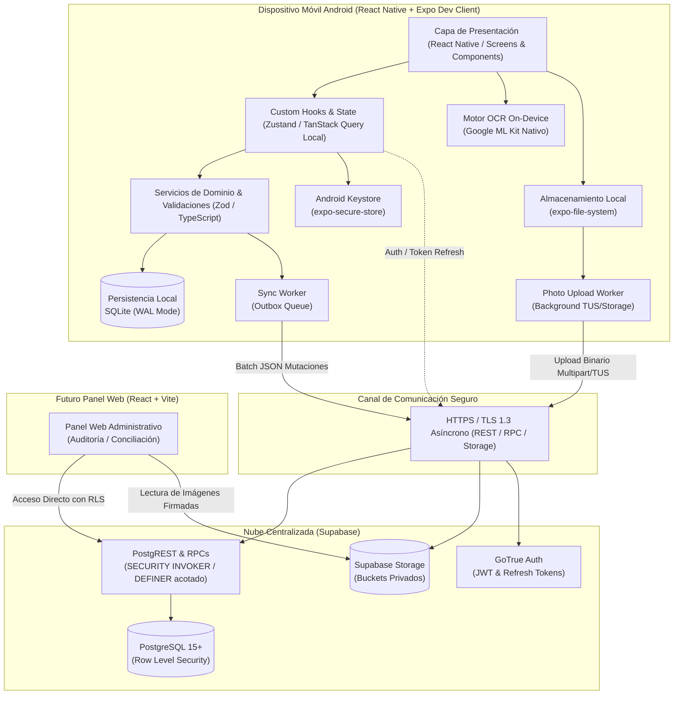
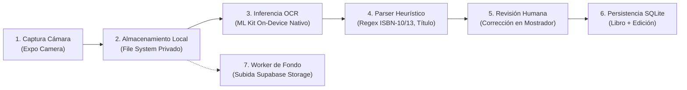
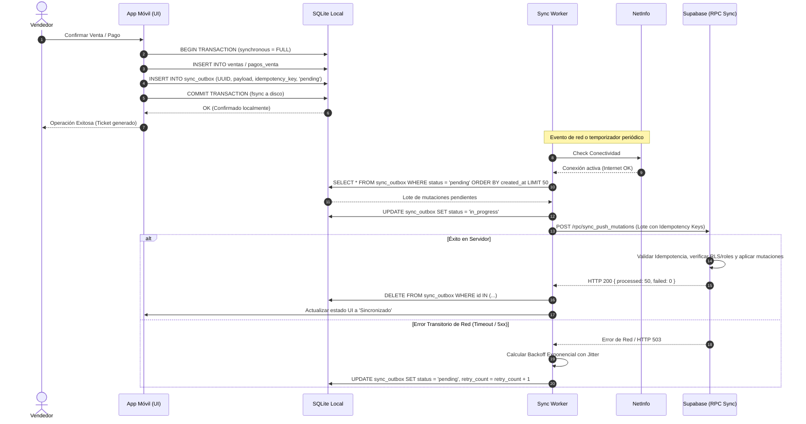
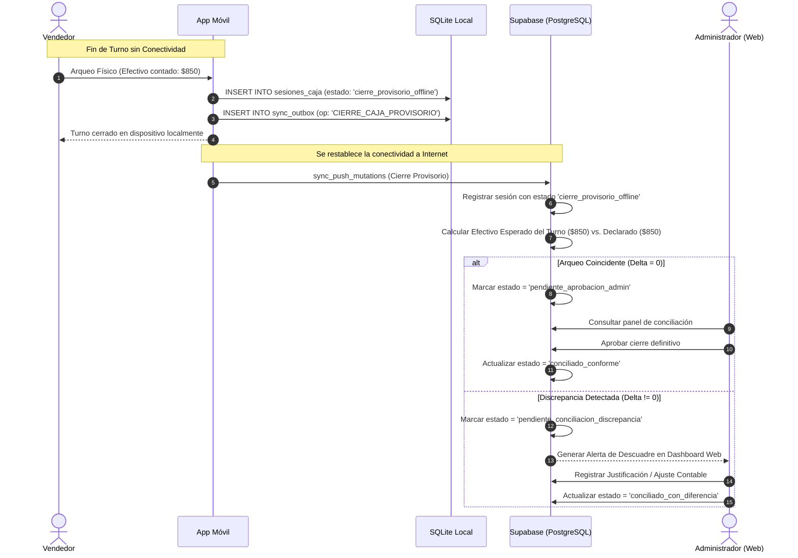

# Arquitectura del Sistema y Estrategia Offline-First (ARQUITECTURA.md)

**Proyecto:** Sistema de Gestión de Librería — Proyecto Tienda<br>
**Documento:** ARQUITECTURA.md<br>
**Estado:** Consolidado y Corregido en H02.1<br>
**Trazabilidad:** [../06-gestion/DECISIONES.md](../06-gestion/DECISIONES.md) | [../01-requerimientos/SRS.md](../01-requerimientos/SRS.md) | [../01-requerimientos/REGLAS_NEGOCIO.md](../01-requerimientos/REGLAS_NEGOCIO.md) | [../04-seguridad/HARDENING.md](../04-seguridad/HARDENING.md)

---

## 1. Visión General y Estilo Arquitectónico

El sistema adopta el paradigma **Local-First (Offline-First)** asistido por un backend centralizado en **Supabase** (BaaS con PostgreSQL, GoTrue y Storage).

### 1.1 Principios Arquitectónicos
1. **Autonomía Operativa Local:** Toda acción crítica de mostrador (ventas, cobros, gastos, cierres de caja) se completa localmente en SQLite. *Objetivo de rendimiento sujeto a benchmark:* latencia de confirmación local <50ms en UI sobre dispositivos Android de referencia (ej. 3GB RAM, Android 11+).
2. **Durabilidad Financiera Diferenciada:** En SQLite WAL mode, las transacciones financieras críticas aplican `PRAGMA synchronous = FULL` para garantizar persistencia física (*fsync*) ante cortes de energía o caídas del SO, reservando `NORMAL` para operaciones no críticas.
3. **Generación Descentralizada de IDs:** Todas las entidades generan claves primarias **UUID v4** en el cliente, eliminando colisiones al sincronizar.
4. **Integridad Financiera Anti-LWW:** Se prohíbe *Last-Write-Wins* en ventas, cobros, deudas y caja. Se utiliza un modelo de **Libro Mayor Append-Only** (registros aditivos e inmutables) con conciliación explícita.
5. **Desacoplamiento UI / Dominio:** La lógica comercial reside en servicios puros de dominio dentro de paquetes compartidos, reutilizables directamente por la futura aplicación web.

### 1.2 Diagrama General de Arquitectura



---

## 2. Organización del Monorepo

Se estructura un monorepo gestionado con **pnpm workspaces** y orquestado mediante **Turborepo** ([DEC-014](../06-gestion/DECISIONES.md#dec-014-orquestador-de-monorepo-turborepo--pnpm)):

```text
/
├── apps/
│   ├── mobile/                  # Aplicación React Native / Expo con Dev Client (Android)
│   └── web/                     # Futuro panel administrativo en React (Fase H11)
├── packages/
│   ├── shared-types/            # Entidades de dominio, DTOs, Enums y contratos
│   ├── business-logic/          # Reglas de validación, cálculos financieros y Zod schemas
│   ├── database/                # Esquemas SQLite/Postgres, DDL, migraciones y seeders
│   ├── sync-engine/             # Cola Outbox, cliente HTTP, idempotencia y reconciliador
│   └── eslint-config/           # Reglas de linting y formateo compartidas
├── docs/                        # Estructura documental oficial
├── pnpm-workspace.yaml          # Declaración de workspaces
├── turbo.json                   # Pipeline de tareas y caché local incremental
└── package.json                 # Raíz con dependencias de tooling y scripts
```

### 2.1 Responsabilidad de Paquetes y Módulos

| Paquete / App | Tipo | Responsabilidad Principal | Tecnologías Clave | Consumidores |
| :--- | :--- | :--- | :--- | :--- |
| `apps/mobile` | Aplicación | POS de mostrador, captura OCR nativa y operación offline. | Expo SDK 51+, React Native, Expo Dev Client. | Usuario mostrador. |
| `apps/web` | Aplicación | Auditoría, reportes avanzados, conciliación de caja y gerencia. | React 18+, Vite, Tailwind CSS. | Administrador / Dueño. |
| `packages/shared-types` | Librería | Definición de tipos TypeScript, contratos RPC y DTOs de sincronización. | TypeScript (Strict mode). | `apps/*`, `packages/*`. |
| `packages/business-logic`| Librería | Reglas de negocio puras, validación de estados y esquemas Zod. | Zod, TypeScript puro. | `apps/*`, `sync-engine`. |
| `packages/database` | Librería | Abstracción de acceso a datos, migraciones y DDL para SQLite/Postgres. | `expo-sqlite`, Kysely / Drizzle. | `apps/mobile`, `sync-engine`. |
| `packages/sync-engine` | Librería | Gestión de cola Outbox, idempotencia, backoff y cliente Supabase. | Fetch API, NetInfo, Crypto. | `apps/mobile`, `apps/web`. |

---

## 3. Arquitectura Móvil Modular

La aplicación móvil (`apps/mobile`) se organiza bajo un enfoque modular por características (*feature-based*):

```text
apps/mobile/src/
├── features/
│   ├── auth/                    # Login, biometría, PIN offline y sesión en SecureStore
│   ├── sync/                    # Estado de red, indicador de sincronización y cola Outbox
│   ├── catalog/                 # Búsqueda rápida, alta de libros y selección de ediciones
│   ├── ocr/                     # Cámara nativa, inferencia ML Kit local y parsing
│   ├── sales/                   # Carrito de venta, precios editables y notas de venta
│   ├── quick-sales/             # Venta rápida: captura de foto, monto total y regularización
│   ├── payments/                # Cobros mixtos, crédito autorizado y abonos de clientes
│   ├── cash-desk/               # Apertura, arqueo, movimientos, cierre provisorio y conciliación
│   ├── expenses/                # Registro de gastos operativos y comprobantes
│   ├── suppliers/               # Directorio de proveedores, costos y cuentas pendientes
│   └── orders/                  # Pedidos de libros faltantes y recepciones fraccionadas
├── navigation/                  # Root Navigator, Stack Mostrador y Drawer Administrativo
├── components/ui/               # Componentes visuales accesibles y táctiles
└── services/                    # Adaptadores nativos (Audio beeper, Cámara, Filesystem)
```

### 3.1 Separación Estricta entre UI y Lógica de Dominio
- **Presentación (UI):** Componentes React Native puros sin llamadas directas a SQLite ni cálculos de saldo.
- **Custom Hooks:** Orquestan el estado de la vista (`useSaleCheckout`, `useCashRegister`) consumiendo repositorios locales.
- **Domain Services:** Funciones puras e independientes de React (`calculateSaleTotal`, `validateCashClosureDifference`) ubicadas en `packages/business-logic`.
- **Capa de Persistencia:** Acceso a SQLite mediado exclusivamente por Repositorios (`SaleRepository`, `CashRepository`).

---

## 4. Integración con Supabase

### 4.1 Autenticación (GoTrue)
- Autenticación remota mediante correo y contraseña / PIN seguro.
- Tokens JWT (vida corta: 1h) y Refresh Tokens (vida larga) persistidos en `expo-secure-store` (Android Keystore con AES-256).
- **Operación Offline:** El perfil de usuario y rol (`admin`, `dueno`, `vendedor`) se sincronizan en SQLite local (`usuarios_sesion`). El usuario opera sin red validando su sesión mediante PIN local o biometría huella (`expo-local-authentication`).

### 4.2 Base de Datos y Seguridad en Funciones RPC
- Centraliza la verdad global del sistema bajo **Row Level Security (RLS)** ([../04-seguridad/HARDENING.md](../04-seguridad/HARDENING.md)).
- **Seguridad en Funciones RPC de Sincronización:**
  - Se prioriza `SECURITY INVOKER` para mutaciones estándar, asegurando que las escrituras se evalúen automáticamente contra las políticas RLS del usuario autenticado.
  - Para funciones transaccionales por lotes que requieran `SECURITY DEFINER` (por ejemplo, validación de la tabla de auditoría `sync_processed_mutations`):
    1. **Restricción de Esquema:** Declarar obligatoriamente `SET search_path = public, pg_temp;` para evitar secuestro de funciones o inyección de rutas.
    2. **Autenticación Obligatoria:** Comprobar `IF auth.uid() IS NULL THEN RAISE EXCEPTION 'No autenticado'; END IF;`.
    3. **Validación de Roles:** Extraer y validar el rol del usuario desde `auth.jwt() -> 'app_metadata' ->> 'role'`.
    4. **Privilegios de Ejecución:** `REVOKE ALL ON FUNCTION rpc_push_mutations FROM PUBLIC; GRANT EXECUTE ON FUNCTION rpc_push_mutations TO authenticated;`.

### 4.3 Almacenamiento de Archivos (Supabase Storage)
- **Buckets Privados:** `book-covers`, `sales-quick-photos`, `expense-vouchers`, `supplier-receipts`.
- Acceso de lectura controlado mediante URLs firmadas temporales (*signed URLs*) con vigencia máxima de 30 minutos y políticas RLS sobre los objetos del bucket.

---

## 5. Persistencia Local y Pipeline Multimedia

### 5.1 Configuración de Persistencia SQLite y Análisis de Durabilidad
- **Motor:** `expo-sqlite` (Next API) sobre almacenamiento interno privado (`Context.getNoBackupFilesDir()`).
- **Análisis de Durabilidad WAL (`synchronous = NORMAL` vs. `FULL`):**
  - `PRAGMA synchronous = NORMAL`: No ejecuta `fsync()` en cada commit del WAL; solo en checkpoints. Reduce la contención de disco pero expone a pérdida de las últimas transacciones confirmadas si ocurre un corte repentino de energía o caída del SO.
  - `PRAGMA synchronous = FULL`: Ejecuta `fsync()` en cada commit del WAL, garantizando durabilidad ACID estricta frente a apagados súbitos, a cambio de una mayor latencia de I/O en disco.
- **Política de Durabilidad Implementada:**
  - **Transacciones Financieras Críticas (Ventas, Cobros, Movimientos y Cierre de Caja):** Se exige `PRAGMA synchronous = FULL` para asegurar que el registro financiero quede físicamente grabado en disco antes de emitir el ticket.
  - **Operaciones No Críticas (Catálogo, Búsquedas, Logs):** Se admite `PRAGMA synchronous = NORMAL` para optimizar velocidad.
  - *Metas de rendimiento sujetas a benchmark:* Latencia transaccional en disco sujeta a pruebas empíricas en dispositivos Android de gama media/baja.

### 5.2 Pipeline de Captura Fotográfica y OCR On-Device



1. **Requerimiento de Integración Nativa:** Google ML Kit Text Recognition (`@react-native-ml-kit/text-recognition`) no es compatible con el cliente genérico de Expo Go; requiere **Expo Prebuild** y **Expo Development Builds** (`npx expo run:android` o builds personalizados en EAS).
2. **Disponibilidad Offline del Modelo:** Para evitar que el modelo de visión intente descargarse dinámicamente desde Google Play Services en un dispositivo sin red, se configura el manifiesto nativo mediante un Expo Config Plugin:
   ```xml
   <meta-data android:name="com.google.firebase.ml.vision.DEPENDENCIES" android:value="ocr" />
   ```
   Esto asegura que el modelo OCR quede empaquetado y disponible de inmediato tras la instalación, permitiendo catalogación 100% offline.
3. **Inferencia y Metas de Rendimiento:** Inferencia local inmediata (*meta de inferencia sujeta a pruebas de campo:* <500ms en hardware representativo).
4. **Parser Heurístico:** Extracción de ISBN-10/13 mediante regex estándar y asignación tentativa de título y autor.
5. **Revisión en Mostrador:** El operador valida o edita los datos antes de confirmar el alta ([DEC-010](../06-gestion/DECISIONES.md#dec-010-captura-asistida-de-libros-mediante-fotografía-y-ocr)).
6. **Subida Asíncrona:** El `PhotoUploadWorker` transfiere las imágenes a Supabase Storage en segundo plano al detectar conectividad.

---

## 6. Estrategia de Sincronización Offline-First

### 6.1 Catálogo de Operaciones y Disponibilidad Offline

| Operación de Negocio | Modo Offline | Modo En Línea | Mecanismo de Sincronización |
| :--- | :---: | :---: | :--- |
| **Alta y búsqueda en catálogo** | Sí (total) | Sí | Lectura local SQLite; búsqueda por prefijos e índices locales. |
| **Venta normal con ítems** | Sí (total) | Sí | Registro transaccional en `ventas`, `pagos_venta` y `sync_outbox`. |
| **Venta rápida con fotografía** | Sí (total) | Sí | Registro local con foto en filesystem y estado `Pendiente de Regularización`. |
| **Cobro mixto y crédito autorizado** | Sí (total) | Sí | Requiere PIN local de Dueño/Admin si hay saldo pendiente (`RN-VTA-003`). |
| **Apertura de caja** | Sí (total) | Sí | Inicia sesión local con monto inicial en efectivo (`RN-CAJ-001`). *(Propuesta: 1 caja activa por terminal)*. |
| **Cierre de caja provisional** | Sí (total) | Sí | Registra `Cierre Provisorio Offline`; queda pendiente de conciliación central. |
| **Registro de gastos corrientes** | Sí (total) | Sí | Egreso directo de caja y foto de comprobante local. |
| **Pedidos de faltantes y recepciones**| Sí (total) | Sí | Alta local de pedido; recepciones parciales con cálculo de saldo pendiente. |
| **Conciliación definitiva de caja** | No | Sí | Exclusivo online en panel web / móvil con permisos de Administrador (`RN-CAJ-004`). |

### 6.2 Patrón Outbox y Estructura de Mutaciones Locales
Toda operación que modifique datos se ejecuta dentro de una transacción atómica única de SQLite:
```sql
BEGIN TRANSACTION;
  INSERT INTO ventas (id, serie, correlativo, total, saldo_pendiente)
  VALUES ('a1b2c3d4-...', 'NV01', 1042, 120.00, 0.00);
  INSERT INTO pagos_venta (id, venta_id, medio_pago, monto)
  VALUES ('e5f6g7h8-...', 'a1b2c3d4-...', 'efectivo', 120.00);
  INSERT INTO movimientos_caja (id, sesion_caja_id, tipo, monto)
  VALUES ('i9j0k1l2-...', 'sesion-uuid', 'ingreso_venta', 120.00);
  INSERT INTO sync_outbox (id, entity_type, entity_id, operation, payload, idempotency_key, status, created_at)
  VALUES ('outbox-uuid', 'ventas', 'a1b2c3d4-...', 'INSERT_VENTA_COMPLETA', '{...}', 'hash-sha256-...', 'pending', '2026-11-15T15:00:00Z');
COMMIT;
```

#### Estructura de la Tabla `sync_outbox` en SQLite Local
- `id` (TEXT PRIMARY KEY): UUID v4 de la mutación.
- `entity_type` (TEXT): Entidad afectada (`ventas`, `pagos_venta`, `libros`, `sesiones_caja`, `gastos`, `pedidos`).
- `entity_id` (TEXT): UUID v4 del registro de negocio.
- `operation` (TEXT): Tipo de mutación (`INSERT`, `UPDATE`, `TRANS_VENTA`, `CIERRE_CAJA`).
- `payload` (TEXT): Datos serializados en formato JSON.
- `idempotency_key` (TEXT UNIQUE): Clave unívoca (`SHA256(entity_id + operation + created_at)`).
- `status` (TEXT): Estado del envío (`pending`, `in_progress`, `failed`, `synced`).
- `retry_count` (INTEGER DEFAULT 0): Contador de reintentos fallidos.
- `last_error` (TEXT NULL): Mensaje de error devuelto por el servidor.
- `created_at` (TEXT): Marca de tiempo UTC del dispositivo.

### 6.3 Idempotencia y Protección Financiera Anti-Duplicación
1. **Idempotency Key:** Cada mutación en `sync_outbox` lleva una clave única basada en hash criptográfico.
2. **Restricción Unívoca en PostgreSQL:** La tabla de auditoría `sync_processed_mutations` aplica un índice único:
   ```sql
   CREATE UNIQUE INDEX idx_sync_idempotency ON sync_processed_mutations (idempotency_key);
   ```
3. Si la función RPC de Supabase recibe una mutación ya registrada, retorna éxito inmediato (`HTTP 200 { status: 'already_applied' }`) sin duplicar las transacciones financieras.

### 6.4 Política Anti-LWW y Resolución de Conflictos

> [!IMPORTANT]
> Queda terminantemente vetado el uso de *Last-Write-Wins* (LWW) en transacciones financieras (ventas, pagos, deudas, movimientos y sesiones de caja).

```
┌────────────────────────────────────────────────────────────────────────┐
│               POLÍTICA DE RESOLUCIÓN DE CONFLICTOS                     │
├─────────────────────┬──────────────────────────┬───────────────────────┤
│ TIPO DE DATO        │ ESTRATEGIA               │ REGLA DE RESOLUCIÓN   │
├─────────────────────┼──────────────────────────┼───────────────────────┤
│ Ventas y Pagos      │ Append-Only (Aditivo)    │ Inserción inmutable.  │
│ Movimientos de Caja │ Append-Only (Aditivo)    │ Inserción inmutable.  │
│ Saldo de Deudas     │ Cálculo Dinámico Ledger  │ Saldo = Total - ΣPagos│
│ Cierres de Caja     │ Estado Provisorio        │ Conciliación Humana   │
│ Catálogo (Precios)  │ Servidor Prioritario     │ LWW por Marca de Serv.│
│ Fotos y Multimedia  │ Subida Desacoplada       │ Eventual Consistency  │
└─────────────────────┴──────────────────────────┴───────────────────────┘
```

- **Modelo Append-Only para Pagos y Cobranzas:**
  - Los pagos y abonos nunca sobrescriben un registro preexistente; son inserts inmutables.
  - El saldo pendiente se valida o recalcula dinámicamente como:
    $$\text{Saldo Pendiente} = \text{Monto Total Venta} - \sum \text{Pagos Válidos Registrados}$$
  - Si dos terminales registran pagos simultáneos sobre la misma venta, ambos se aceptan. Un eventual sobrepago se clasifica como saldo a favor para regularización, sin descartar ingresos.
- **Conflictos en Catálogo:** Resueltos mediante última escritura confirmada en el servidor (*Server-Wins / Timestamp UTC*), preservando auditoría de cambios.

### 6.5 Política de Reintentos y Resiliencia
- **Detección de Red:** Supervisada mediante `@react-native-community/netinfo`.
- **Estrategia de Reintento:** Backoff exponencial con dispersión aleatoria (*jitter*):
  $$T_{\text{reintento}} = \min\left(T_{\text{máx}}, T_{\text{base}} \times 2^{\text{retry}} + \text{rand}(0, 1000)\,\text{ms}\right)$$
  - $T_{\text{base}} = 2\,\text{segundos}$, $T_{\text{máx}} = 60\,\text{segundos}$.
- **Umbral de Fallo:** Tras 5 reintentos fallidos con causa de negocio, pasa a `failed_needs_review` y alerta en UI sin bloquear mutaciones posteriores.

### 6.6 Cierres de Caja Provisionales y Conciliación
> [!NOTE]
> La política de exclusividad de una sesión de caja activa por terminal constituye una propuesta técnica en evaluación ([DEC-018](../06-gestion/DECISIONES.md#dec-018-política-de-exclusividad-de-sesión-de-caja-por-dispositivo)), sujeta a validación operativa.

1. **Modo Offline:** El vendedor realiza el conteo y registra el cierre con estado `Cierre Provisorio Offline` ([DEC-007](../06-gestion/DECISIONES.md#dec-007-soporte-de-cierres-de-caja-offline-provisionales-con-conciliación-posterior)).
2. **Reconexión y Transmisión:** El cierre se transmite manteniendo su condición provisional.
3. **Cálculo de Discrepancia:** En Supabase, la función de conciliación compara:
   $$\Delta_{\text{caja}} = \text{Efectivo Declarado Físicamente} - \left(\text{Monto Apertura} + \sum \text{Efectivo Ventas} - \sum \text{Egresos Caja}\right)$$
4. **Resolución:** Si $\Delta_{\text{caja}} = 0$, se aprueba como `Conciliado`; si $\Delta_{\text{caja}} \neq 0$, se alerta al Administrador para ajuste contable formal (`RN-CAJ-004`).

### 6.7 Autenticación Offline y Caducidad de Sesiones
> [!NOTE]
> El período de gracia offline de 7 días continuos constituye una propuesta técnica en evaluación ([DEC-017](../06-gestion/DECISIONES.md#dec-017-período-de-gracia-para-caducidad-de-sesiones-offline)), sujeta a confirmación del Dueño.

- **Propuesta de Período de Gracia:** Un usuario autenticado previamente puede operar offline hasta por **7 días continuos** sin contactar el servidor.
- **Desbloqueo Local:** Desbloqueo de app mediante PIN local de 4-6 dígitos o biometría huella, validado contra el hash en Android Keystore.
- **Caducidad:** Transcurrido el período sin conectividad para renovar el Refresh Token en GoTrue, se suspende la emisión de nuevas ventas hasta verificar la vigencia de la cuenta.

### 6.8 Autorización Offline de Operaciones Sensibles (Auditoría y Revocación)
Para autorizaciones de mostrador sin red (ventas fiadas o anulaciones autorizadas por Dueño/Admin según `RN-VTA-003` y `RN-PAG-002`):
1. **Caducidad de Credenciales Offline:** Los PINs de supervisores cacheados localmente expiran automáticamente si el dispositivo no sincroniza en el período configurado.
2. **Lista de Revocación Local (Local CRL):** Al detectar conectividad, el cliente sincroniza de forma prioritaria la tabla `credenciales_revocadas`, invalidando de inmediato permisos de usuarios dados de baja.
3. **Auditoría Criptográfica Inmutable:** Toda autorización offline graba en la transacción:
   - `autorizador_id` (UUID del usuario que autorizó).
   - `metodo_autorizacion` (`pin_local` o `biometria`).
   - `dispositivo_id` (UUID del hardware emisor).
   - `timestamp_local` (marca de tiempo del momento exacto del override).
   - `firma_autorizacion` (Hash HMAC de los datos de la venta firmado con clave efímera del autorizador).
4. Al sincronizar con Supabase, el servidor verifica que el autorizador contase con rol habilitado en la fecha y hora de la transacción, alertando discrepancias en el panel administrativo.

---

## 7. Diagramas de Secuencia Esenciales

### 7.1 Sincronización de Mutaciones (Outbox, Idempotencia y Reintentos)



### 7.2 Conciliación de Cierre de Caja Provisorio Offline



---

## 8. Matriz de Evaluación Tecnológica

Evaluación de decisiones de arquitectura con riesgos técnicos explícitos ([../06-gestion/DECISIONES.md](../06-gestion/DECISIONES.md)):

| Decisión | Alternativa Recomendada | Ventajas Clave | Riesgos Técnicos Identificados | Mitigación Arquitectónica |
| :--- | :--- | :--- | :--- | :--- |
| **DEC-012: Sincronización** | **Outbox propio sobre `expo-sqlite`** *(Propuesto)* | Control total anti-LWW en finanzas; cero costos de licencias; soporte nativo en Expo. | Mayor esfuerzo de desarrollo en lógica de reintentos y reconciliación custom. | Implementar la infraestructura base de sincronización e idempotencia en H06 antes de ventas/caja. |
| **DEC-013: OCR para Libros** | **Solución Híbrida (ML Kit On-Device)** *(Propuesto)* | Inferencia offline inmediata; cero costos recurrentes de API; privacidad de datos. | Requiere Expo Dev Client / Prebuild nativo; tamaño de APK incrementado en 30-40 MB. | Empaquetar modelo en manifest (`ocr`) y validar compilación mediante EAS / Development Builds. |
| **DEC-014: Monorepo** | **pnpm Workspaces + Turborepo** *(Propuesto)* | Ahorro de disco por hard links; caché incremental; tipado compartido. | Riesgo de problemas de resolución (*hoisting*) en Metro Bundler de React Native. | Configurar `node-linker=hoisted` o plugins de resolución de workspaces en `metro.config.js`. |
| **DEC-015: Cifrado Local** | **Cifrado Híbrido (Keystore + Campos)** *(Propuesto)* | Rendimiento nativo SQLite (<30ms) sin fragilidad de SQLCipher; bajo riesgo de corrupción. | Catálogo no sensible queda en texto plano en sandbox de Android si el equipo es rooteado. | Cifrar obligatoriamente tokens, PINs y cuentas de proveedores (`RN-PRV-002`) con AES-256 en Keystore. |

---

## 9. Trazabilidad y Próximos Pasos

- **Alineación con Hitos:** Este diseño establece las bases técnicas para el **Modelo y Diccionario de Datos (H03)** y las directrices de **Hardening de Seguridad (H04)**.
- **Decisiones Pendientes de Aprobación Formal:** Las recomendaciones para `DEC-012`, `DEC-013`, `DEC-014`, `DEC-015`, `DEC-017` y `DEC-018` se mantienen en estado `Propuesto` en [DECISIONES.md](../06-gestion/DECISIONES.md) a la espera de confirmación expresa.
- **Restricción Operativa:** No se iniciará código ejecutable, inicialización de dependencias ni migraciones hasta superar el Quality Gate al término de H05.
