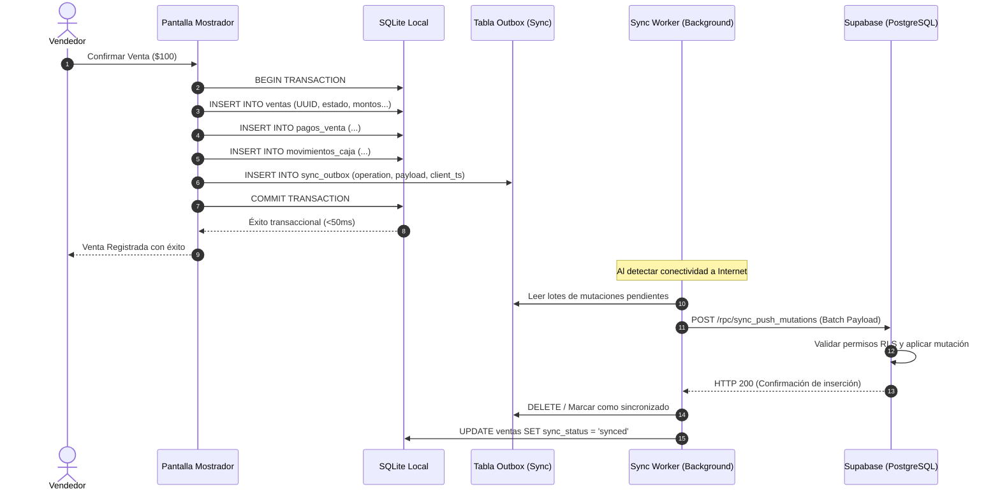

# Documento de Arquitectura de Software (ARQUITECTURA.md)

**Proyecto:** Sistema de Gestión de Librería — Proyecto Tienda  
**Documento:** ARQUITECTURA.md  
**Estado:** Propuesta inicial consolidada H00  
**Trazabilidad:** [../06-gestion/DECISIONES.md](../06-gestion/DECISIONES.md) | [../01-requerimientos/SRS.md](../01-requerimientos/SRS.md)

---

## 1. Visión General y Estilo Arquitectónico

El sistema adopta una arquitectura orientada a la movilidad y a la alta disponibilidad operativa mediante el paradigma **Local-First (Offline-First)**, complementado con un backend como servicio (**BaaS**) en la nube sobre **Supabase**.

```
┌────────────────────────────────────────────────────────────────────────┐
│                   DIAGRAMA DE ARQUITECTURA GENERAL                    │
└────────────────────────────────────────────────────────────────────────┘

 [ DISPOSITIVO MÓVIL ANDROID ]
 ┌──────────────────────────────────────────────────────────────────────┐
 │  UI Layer: React Native (Expo) + TypeScript                          │
 │  State Management: Zustand / React Context                           │
 │  Domain Logic: Servicios desacoplados de dominio                     │
 │                                                                      │
 │  ┌───────────────────────┐            ┌───────────────────────────┐  │
 │  │ Cámara + Pipeline OCR │            │  Outbox Sync Queue        │  │
 │  └───────────┬───────────┘            └─────────────┬─────────────┘  │
 │              │                                      │                │
 │  ┌───────────▼──────────────────────────────────────▼─────────────┐  │
 │  │      Capa de Persistencia Local: SQLite (ACID Transaccional)   │  │
 │  └────────────────────────────────────────────────────────────────┘  │
 └───────────────────────────────────┬──────────────────────────────────┘
                                     │
                                     │ HTTPS / TLS 1.3 (Asíncrono)
                                     │ WebSockets / Realtime (Opcional)
                                     ▼
 [ BACKEND EN LA NUBE - SUPABASE ]
 ┌──────────────────────────────────────────────────────────────────────┐
 │  API Gateway / PostgREST                                             │
 │  Autenticación: GoTrue (JWT + SecureStore)                          │
 │  Base de Datos Relacional: PostgreSQL con Row Level Security (RLS)   │
 │  Almacenamiento de Archivos: Supabase Storage (Buckets Privados)    │
 │  Edge Functions: Sincronización y conciliación (si aplica)           │
 └───────────────────────────────────▲──────────────────────────────────┘
                                     │
                                     │ Futura integración (Fase H08)
                                     ▼
 [ FUTURO PANEL WEB ADMINISTRATIVO ]
 ┌──────────────────────────────────────────────────────────────────────┐
 │  React + TypeScript + Vite + Tailwind CSS                            │
 │  Acceso directo a Supabase con RLS para auditoría y gerencia         │
 └──────────────────────────────────────────────────────────────────────┘
```

---

## 2. Estructura del Monorepo

Para garantizar la máxima reutilización de código entre la aplicación móvil Android y el futuro panel web, se propone estructurar el repositorio como un **Monorepo** orquestado mediante `Turborepo` y `pnpm` (ref: [DEC-014](../06-gestion/DECISIONES.md#dec-014-orquestador-de-monorepo-turborepo--pnpm)):

```text
/
├── apps/
│   ├── mobile/                  # Aplicación React Native con Expo (Android)
│   │   ├── src/
│   │   │   ├── screens/         # Pantallas de venta, catálogo, caja, pedidos
│   │   │   ├── components/      # Componentes visuales móviles
│   │   │   ├── navigation/      # React Navigation
│   │   │   ├── hooks/           # Custom hooks de UI y estado
│   │   │   └── services/        # Adaptadores locales SQLite y cámara
│   │   ├── app.json             # Configuración de Expo y plugins nativos
│   │   └── package.json
│   │
│   └── web/                     # Futuro panel administrativo en React (Fase H08)
│       ├── src/
│       │   ├── pages/           # Vistas de auditoría, reportería y usuarios
│       │   └── components/      # Componentes web de dashboard
│       └── package.json
│
├── packages/
│   ├── shared-types/            # Contratos de datos, DTOs y tipos TypeScript
│   │   ├── src/
│   │   │   ├── domain.ts        # Interfaces de Libro, Venta, Caja, Proveedor
│   │   │   ├── enums.ts         # Estados de Venta, Pago, Entrega, Caja
│   │   │   └── sync.ts          # Tipos para la cola de mutaciones
│   │   └── package.json
│   │
│   ├── sync-engine/             # Motor de replicación y resolución de conflictos
│   │   ├── src/
│   │   │   ├── queue.ts         # Manejo de cola Outbox
│   │   │   ├── reconciler.ts    # Algoritmo de resolución de discrepancias
│   │   │   └── client.ts        # Cliente de sincronización con Supabase
│   │   └── package.json
│   │
│   └── eslint-config/           # Configuración unificada de linting y formateo
│
├── docs/                        # Estructura documental integral del sistema
├── README.md
├── AGENTS.md
├── pnpm-workspace.yaml          # Definición de workspaces
├── turbo.json                   # Pipeline de compilación y caché de tareas
└── package.json                 # Raíz del monorepo
```

---

## 3. Estrategia Offline-First y Motor de Sincronización

### 3.1 Principios de Operación Local
1. **Latencia Cero en UI:** La interfaz móvil nunca espera una respuesta HTTP de red para completar una venta o registrar una apertura de caja. Todas las escrituras impactan de inmediato en la base de datos local SQLite bajo una transacción ACID.
2. **Generación de IDs Descentralizada:** Para evitar colisiones de claves primarias entre registros generados offline y la base de datos central, todas las tablas utilizan **UUID v4** generados en el dispositivo cliente.
3. **Resiliencia ante Desconexión:** El sistema detecta dinámicamente el estado de red mediante `NetInfo`. Al perder conectividad, suspende la cola de envío sin interrumpir la experiencia de usuario.

### 3.2 Patrón Outbox (Bandeja de Salida de Mutaciones)



### 3.3 Estrategia de Resolución de Conflictos
- **Mutaciones aditivas (Ventas, Pagos, Gastos, Movimientos):** En su mayoría son registros acumulativos e inmutables. Se insertan sin conflictos directos dado que sus claves primarias son UUIDs únicos.
- **Mutaciones de estado (Cierres de caja, Edición de catálogo):**
  - Se emplea una estrategia de última escritura (*Last-Write-Wins*) asistida por marca de tiempo UTC confiable (`updated_at`) y versión de registro (`sync_version`).
  - Para los cierres de caja en estado `Cierre Provisorio Offline`, la lógica en el servidor no sobrescribe datos financieros, sino que los ingresa en una tabla de conciliación para que el Administrador valide cualquier diferencia frente a los pagos registrados en la nube (ref: [DEC-007](../06-gestion/DECISIONES.md#dec-007-soporte-de-cierres-de-caja-offline-provisionales-con-conciliación-posterior)).

---

## 4. Pipeline de Captura Asistida por OCR

La catalogación rápida de libros mediante fotografía sigue un pipeline por etapas para optimizar el rendimiento y evitar fallas sin red (ref: [DEC-010](../06-gestion/DECISIONES.md#dec-010-captura-asistida-de-libros-mediante-fotografía-y-ocr)):

```
┌─────────────────┐     ┌──────────────────────┐     ┌────────────────────────┐
│  1. Captura con │     │ 2. Preprocesamiento  │     │ 3. Motor OCR           │
│     Cámara      │────▶│    de Imagen Local   │────▶│    (Extracción Texto)  │
│  (Expo Camera)  │     │ (Escala grises/crop) │     │  (On-device ML Kit)    │
└─────────────────┘     └──────────────────────┘     └───────────┬────────────┘
                                                                 │
                                                                 ▼
┌─────────────────┐     ┌──────────────────────┐     ┌────────────────────────┐
│ 6. Persistencia │     │ 5. Validación y      │     │ 4. Parser Inteligente  │
│    en SQLite    │◀────│    Edición Humana    │◀────│    de Metadatos        │
│  (Libro Activo) │     │  (Pantalla Mostrador)│     │  (Regex ISBN, Título)  │
└─────────────────┘     └──────────────────────┘     └────────────────────────┘
```

1. **Captura:** El usuario fotografía la portada, contraportada o código de barras/ISBN.
2. **Preprocesamiento:** Redimensionamiento y optimización local para maximizar el contraste tipográfico.
3. **Inferencia OCR:** Detección de bloques de texto (prioritariamente *on-device* con Google ML Kit para no depender de internet).
4. **Parser Heurístico:** Algoritmo que identifica patrones estándar:
   - Formatos ISBN-10 / ISBN-13 (expresiones regulares).
   - Bloques principales de texto asignados tentativamente a Título, Autor y Editorial.
5. **Revisión y Edición:** El usuario revisa en pantalla el texto parseado, corrige posibles fallas y selecciona el estado de conservación (`Nuevo` o `Usado`) y precio referencial.
6. **Confirmación:** Inserción del nuevo libro y su edición en SQLite local.

---

## 5. Diseño Extensible para Facturación Electrónica Futura

Aunque la facturación electrónica queda excluida del MVP (ref: [DEC-008](../06-gestion/DECISIONES.md#dec-008-exclusión-de-facturación-electrónica-en-mvp-con-diseño-extensible)), la arquitectura se diseña bajo un patrón desacoplado para incorporarla a futuro sin alterar los flujos base:

```
┌──────────────────┐
│  Módulo Ventas   │
│  (Core Negocio)  │
└────────┬─────────┘
         │
         │ Emite evento: "VentaCompletada"
         ▼
┌────────────────────────────────────────────────────────────────────────┐
│               BUS DE INTEGRACIÓN FISCAL (FUTURO)                       │
├───────────────────────────────────┬────────────────────────────────────┤
│  FASE MVP: ADAPTADOR INTERNO      │  FASE FUTURA: ADAPTADOR TRIBUTARIO │
│  • Genera Nota de Venta interna   │  • Formatea XML UBL 2.1            │
│  • Asigna número correlativo      │  • Firma digital con certificado   │
│  • Impresión de ticket simple     │  • Envío a servidor SUNAT/OSE      │
│                                   │  • Genera CDR y QR tributario      │
└───────────────────────────────────┴────────────────────────────────────┘
```

El modelo de datos y las entidades de venta incorporan desde su concepción campos para `tipo_comprobante` (con valor por defecto `nota_venta_interna`), `serie` y `correlativo`, facilitando la transición futura.

---

## 6. Consideraciones de Seguridad y Aislamiento

- **Row Level Security (RLS) en Supabase:** Todas las tablas de PostgreSQL contarán con RLS activado. Las políticas limitarán la visibilidad de datos y la capacidad de anulación o conciliación según los roles (`admin`, `dueno`, `vendedor`) validados en el JWT (ver [../04-seguridad/HARDENING.md](../04-seguridad/HARDENING.md)).
- **Almacenamiento Local Cifrado:** Las credenciales y claves criptográficas de sesión se resguardan en el Android Keystore mediante `expo-secure-store`.
- **Protección de Archivos Multimedia:** Las fotografías de portadas, comprobantes de gastos y fotos de ventas rápidas se almacenan en buckets privados de Supabase Storage accesibles solo mediante URLs firmadas de vigencia corta.
