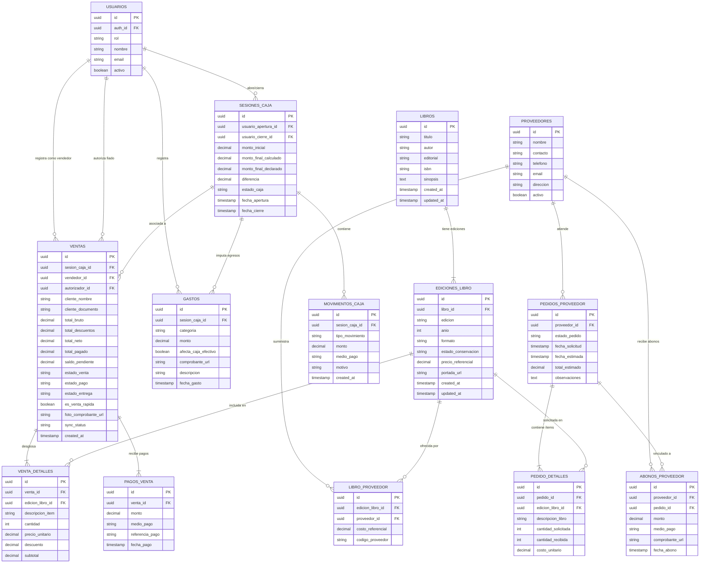

# Modelo de Datos Preliminar (MODELO_DATOS.md)

**Proyecto:** Sistema de Gestión de Librería — Proyecto Tienda  
**Documento:** MODELO_DATOS.md  
**Estado:** Modelo preliminar / Candidato para H00  
**Trazabilidad:** [../01-requerimientos/SRS.md](../01-requerimientos/SRS.md) | [../01-requerimientos/REGLAS_NEGOCIO.md](../01-requerimientos/REGLAS_NEGOCIO.md) | [../06-gestion/DECISIONES.md](../06-gestion/DECISIONES.md)

---

## 1. Principios de Diseño Relacional

1. **Descentralización de Claves Primarias:** Todas las tablas utilizan como clave primaria identificadores universales únicos **UUID v4** generados en el dispositivo cliente, garantizando la inserción concurrente y autónoma sin colisiones en modo *offline* (ref: [DEC-009](../06-gestion/DECISIONES.md#dec-009-arquitectura-offline-first-con-sqlite-local-y-supabase-remoto)).
2. **Homogeneidad entre SQLite y PostgreSQL:** Las tablas locales en SQLite tendrán una estructura equivalente a las tablas centrales en PostgreSQL de Supabase, facilitando la replicación directa de esquemas.
3. **Auditoría y Borrado Lógico:** Cada registro incluye marcas de tiempo UTC (`created_at`, `updated_at`), versión de registro (`sync_version`) y soporte para eliminación lógica (`deleted_at`) para propagar bajas sin pérdida de integridad referencial.
4. **Desacoplamiento Bibliográfico:** Se separa el título base (`libros`) de sus variantes físicas y comerciales (`ediciones_libro`) para reflejar fielmente la condición de libros nuevos y usados (ref: [DEC-004](../06-gestion/DECISIONES.md#dec-004-desacoplamiento-de-título-respecto-a-ediciones-y-estados-de-conservación)).

---

## 2. Diagrama Entidad-Relación Preliminar (ERD)

---

## 3. Catálogo de Entidades Candidatas

### 3.1 Módulo de Identidad y Acceso
- **`usuarios`**: Almacena el perfil operativo del personal en la librería, vinculado al `auth.users` de Supabase a través de `auth_id`.
  - Roles admitidos: `'admin'`, `'dueno'`, `'vendedor'`.

### 3.2 Módulo de Catálogo Bibliográfico
- **`libros`**: Representa la obra intelectual independientemente de su tiraje o estado físico.
  - Atributos clave: `id`, `titulo`, `autor`, `editorial`, `isbn`, `sinopsis`.
- **`ediciones_libro`**: Representa la variante física comercializable de un libro.
  - Atributos clave: `id`, `libro_id`, `edicion` (ej. "1ra ed.", "Conmemorativa"), `formato` (ej. "Tapa dura", "Bolsillo"), `estado_conservacion` (`'nuevo'`, `'usado'`), `precio_referencial`, `portada_url`.
- **`libro_proveedor`**: Tabla asociativa entre una edición de libro y un distribuidor/proveedor.
  - Atributos clave: `edicion_libro_id`, `proveedor_id`, `costo_referencial`, `codigo_proveedor`.

### 3.3 Módulo de Tesorería y Caja
- **`sesiones_caja`**: Controla el ciclo de vida de un turno o jornada de mostrador.
  - Atributos clave: `monto_inicial`, `monto_final_calculado`, `monto_final_declarado`, `diferencia`, `estado_caja` (`'abierta'`, `'cierre_provisorio_offline'`, `'cerrada_conciliada'`).
- **`movimientos_caja`**: Registro granular de entradas y salidas de efectivo dentro de la sesión de caja activa.
  - Atributos clave: `tipo_movimiento` (`'ingreso_venta'`, `'egreso_gasto'`, `'retiro_propietario'`, `'ingreso_extra'`), `monto`, `medio_pago`.

### 3.4 Módulo de Ventas y Cobranzas
- **`ventas`**: Encabezado de la transacción comercial en mostrador.
  - Atributos clave: `total_bruto`, `total_descuentos`, `total_neto`, `total_pagado`, `saldo_pendiente`.
  - Estados: `estado_venta` (`'borrador'`, `'completada'`, `'pendiente_regularizacion'`, `'pendiente_cobro'`, `'anulada'`), `estado_pago` (`'pendiente'`, `'parcial'`, `'total'`, `'anulado'`), `estado_entrega` (`'retenido'`, `'entregado_total'`, `'entregado_saldo_pendiente'`).
  - Atributos de venta rápida: `es_venta_rapida` (boolean), `foto_comprobante_url`.
  - Atributos de autorización: `autorizador_id` (nullable, requerido si `saldo_pendiente > 0` y se entrega el libro).
- **`venta_detalles`**: Ítems incluidos en la venta.
  - Atributos clave: `edicion_libro_id` (nullable temporalmente en ventas rápidas), `descripcion_item`, `cantidad`, `precio_unitario`, `descuento`, `subtotal`.
- **`pagos_venta`**: Registro individual de cada abono o pago recibido para una venta.
  - Atributos clave: `monto`, `medio_pago` (`'efectivo'`, `'tarjeta_pos'`, `'billetera_digital'`), `referencia_pago`.

### 3.5 Módulo de Egresos Operativos
- **`gastos`**: Registro de desembolsos no asociados a compra de libros (servicios, alquiler, suministros).
  - Atributos clave: `categoria` (`'alquiler'`, `'servicios'`, `'suministros'`, `'personal'`, `'otros'`), `monto`, `afecta_caja_efectivo`, `comprobante_url`.

### 3.6 Módulo de Proveedores y Compras
- **`proveedores`**: Catálogo de editoriales, distribuidoras y particulares.
  - Atributos clave: `nombre`, `contacto`, `telefono`, `email`, `direccion`, `activo`.
- **`pedidos_proveedor`**: Órdenes de reposición o pedidos de libros faltantes.
  - Atributos clave: `proveedor_id` (nullable inicialmente para pedidos de faltantes sin asignar), `estado_pedido` (`'borrador_sin_asignar'`, `'asignado'`, `'enviado'`, `'recepcion_parcial'`, `'recibido_total'`, `'cancelado'`).
- **`pedido_detalles`**: Libros y cantidades solicitadas/recibidas en un pedido.
  - Atributos clave: `cantidad_solicitada`, `cantidad_recibida`, `costo_unitario`.
- **`abonos_proveedor`**: Pagos parciales o totales efectuados a distribuidores.
  - Atributos clave: `proveedor_id`, `pedido_id` (nullable), `monto`, `medio_pago`, `comprobante_url`.

### 3.7 Módulo de Sincronización Local (Específico de SQLite)
- **`sync_outbox`**: Cola de mutaciones generadas localmente para transmisión asíncrona hacia Supabase.
  - Atributos clave: `id` (UUID), `tabla_origen`, `operacion` (`'INSERT'`, `'UPDATE'`, `'DELETE'`), `payload` (JSON texto), `client_timestamp` (UTC), `sync_status` (`'pending'`, `'in_flight'`, `'failed'`, `'synced'`), `retry_count`.

---

## 4. Estado del Documento y Próximos Pasos

Este modelo es **preliminar**. No se han generado tablas ni migraciones físicas en este hito (ref: H00 - Restricciones). En el hito **H01** se procederá a la definición formal de los tipos TypeScript y los esquemas DDL en `DICCIONARIO_DATOS.md`.
