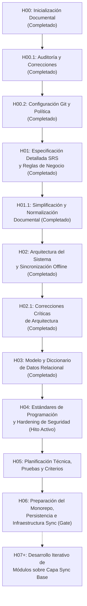

# Plan de Desarrollo del Proyecto (PLAN_DESARROLLO.md)

**Proyecto:** Sistema de Gestión de Librería — Proyecto Tienda 
**Documento:** PLAN_DESARROLLO.md 
**Estado:** Actualizado en H03 
**Trazabilidad:** [../01-requerimientos/SRS.md](../01-requerimientos/SRS.md) | [../06-gestion/DECISIONES.md](../06-gestion/DECISIONES.md)

---

## 1. Estrategia General de Entrega y Secuencia de Hitos

El plan de desarrollo se estructura en dos grandes etapas:
1. **Fase Preparatoria y de Diseño Riguroso (H00 a H05):** Consolidación documental, auditoría, configuración de control de versiones Git, especificación fina de requerimientos, diseño de arquitectura *offline-first*, modelado de datos relacional y estándares de seguridad.
2. **Fase de Preparación de Entorno e Implementación (H06 en adelante):** Inicialización del monorepo e implementación iterativa de la aplicación móvil Android y panel web, sujeta a aprobación previa.

### 1.1 Entregables de Control de Versiones Git por Hito
A partir de H00.2, cada hito completado tiene como entregable mandatorio:
- Un **commit convencional** (`docs(hXX): ...` o `feat(hXX): ...`) que encapsule de forma atómica los cambios del hito.
- Un **push verificado** hacia la rama `master` del repositorio oficial en GitHub (`https://github.com/JMedina255/Proyecto_tienda.git`).
- Comprobación de árbol de trabajo limpio (`git status`) y hash de commit documentado.

---

## 2. Detalle de Hitos del Proyecto

### Hito H00: Inicialización Documental
- **Objetivo:** Establecer la estructura documental del repositorio local, consolidar requerimientos conocidos y sentar las bases para un desarrollo ordenado y seguro sin código ejecutable.
- **Entregables:** 13 documentos base en `/` y `docs/`, `AGENTS.md`, `README.md` principal.
- **Estado:** **Completado.**

---

### Hito H00.1: Auditoría de Consistencia y Consolidación Documental
- **Objetivo:** Auditar los 13 documentos generados en H00, corregir inconsistencias cuantitativas en reglas de negocio (declarar y enumerar exactamente 18 reglas), verificar la unicidad física de `PLAN_DESARROLLO.md` en `docs/05-planificacion/`, realinear el cronograma formal y validar la coherencia entre decisiones, reglas y requerimientos.
- **Dependencias:** H00.
- **Entregables:**
  - Actualización de `REGLAS_NEGOCIO.md` con tabla índice consolidada de las 18 reglas.
  - Actualización de `PLAN_DESARROLLO.md` con la secuencia formal de hitos H00 a H06+.
  - Actualización de `docs/README.md`, `README.md`, `DECISIONES.md`, `HARDENING.md` y `CHANGELOG.md`.
  - Informe de auditoría H00.1 con matriz de decisiones y riesgos abiertos.
- **Estado:** **Completado.**

---

### Hito H00.2: Configuración Git, Publicación Inicial y Política de Versionado
- **Objetivo:** Inicializar el repositorio Git local en la rama `master`, vincularlo con el repositorio remoto oficial en GitHub (`https://github.com/JMedina255/Proyecto_tienda.git`), incorporar `.gitignore` exhaustivo para el monorepo y publicar la línea base documental consolidada bajo una política estricta de versionado.
- **Dependencias:** H00, H00.1.
- **Entregables:**
  - Repositorio Git inicializado en rama `master` con remoto `origin` oficial configurado.
  - Archivo `.gitignore` para monorepo (Expo/Android, Web, TypeScript, Supabase).
  - Política permanente de commits y push documentada en `AGENTS.md`.
  - Línea base documental publicada exitosamente en GitHub.
  - Entregable Git: Commit `docs(h00-h00.1): consolidacion documental y auditoria inicial` y push verificado a `origin/master`.
- **Estado:** **Completado.**

---

### Hito H01: Especificación Detallada de Requerimientos (SRS) y Reglas de Negocio
- **Objetivo:** Refinar exhaustivamente la Especificación de Requerimientos de Software ([SRS.md](../01-requerimientos/SRS.md)) y el catálogo de políticas operativas ([REGLAS_NEGOCIO.md](../01-requerimientos/REGLAS_NEGOCIO.md)).
- **Dependencias:** Aprobación de H00.2.
- **Entregables:**
  - Especificación detallada de 11 módulos funcionales (45 RFs estructurados con actor, prioridad, precondiciones, reglas vinculadas, criterios de aceptación y excepciones).
  - Especificación formal de 14 casos de uso con criterios de aceptación Gherkin y diagramas Mermaid renderizables.
  - Catálogo de 26 reglas de negocio con matriz de compatibilidad de estados y matriz RBAC exhaustiva.
  - Matriz de trazabilidad integral (`RF` -> `RN` -> `CU` -> `Criterio` -> `Prioridad`) y registro de desafíos para H03.
  - **Entregable Git:** Commit `docs(h01): especificacion detallada de requerimientos` y push a `origin/master`.
- **Criterios de Aceptación:** Aprobación formal por parte de los interesados de los flujos de negocio sin ambigüedades.
- **Estado:** **Completado.**

---

### Hito H01.1: Simplificación y Normalización Documental
- **Objetivo:** Eliminar redundancias, simplificar y estructurar densamente `SRS.md` y `REGLAS_NEGOCIO.md` mediante tablas compactas, normalizar las inconsistencias numéricas de H01 (declarar y enumerar exactamente 27 reglas de negocio y 14 casos de uso), mantener políticas no confirmadas (umbral de 15% de descuento en `RN-VTA-004` / `DEC-016`) estrictamente como propuestas pendientes, establecer el estándar documental permanente y actualizar `AGENTS.md`.
- **Dependencias:** H01.
- **Entregables:**
  - `docs/03-estandares/ESTANDAR_DOCUMENTACION.md` con reglas de brevedad, alta densidad, tablas compactas y estabilidad de IDs.
  - Actualización de `AGENTS.md` (Sección 10) mandatoria para todos los agentes en hitos presentes y futuros.
  - `SRS.md` condensado y estructurado con 45 RFs en tablas modulares, 14 CUs completos y matriz de trazabilidad 1 a 1.
  - `REGLAS_NEGOCIO.md` condensado con catálogo de 27 reglas (26 confirmadas + 1 propuesta pendiente), matrices de compatibilidad y RBAC.
  - `DECISIONES.md` con `DEC-016` documentado unívocamente como propuesta pendiente.
  - **Entregable Git:** Commit `docs(h01.1): simplificacion y normalizacion documental` y push a `origin/master`.
- **Criterios de Aceptación:** Documentación ágil, sin redundancias ni prosa decorativa, trazabilidad 100% íntegra y verificada.
- **Estado:** **Completado.**

---

### Hito H02: Arquitectura del Sistema y Sincronización Offline
- **Objetivo:** Detallar el diseño de arquitectura técnica, evaluar y recomendar las decisiones técnicas de sincronización, OCR, monorepo y cifrado local, y especificar el motor de replicación asíncrono con reglas financieras anti-LWW.
- **Dependencias:** H01.1.
- **Entregables:**
  - Evaluación comparativa y recomendaciones para `DEC-012` (Outbox con `expo-sqlite`), `DEC-013` (Solución Híbrida con Google ML Kit on-device), `DEC-014` (pnpm Workspaces + Turborepo) y `DEC-015` (Cifrado Híbrido con Keystore y campos sensibles).
  - Actualización exhaustiva de [ARQUITECTURA.md](../02-arquitectura/ARQUITECTURA.md) con organización del monorepo, arquitectura móvil modular, integración con Supabase (Auth, Postgres, Storage), persistencia SQLite (WAL mode), pipeline de medios/OCR, y estrategia de sincronización offline con modelo de libro mayor append-only.
  - Diagrama de arquitectura general y diagramas de secuencia esenciales (ciclo Outbox e idempotencia; conciliación de caja provisoria offline).
  - **Entregable Git:** Commit `docs(h02): arquitectura y estrategia offline` y push a `origin/master`.
- **Criterios de Aceptación:** Arquitectura offline-first completamente validada con trazabilidad técnica y decisiones técnicas formalmente registradas.
- **Estado:** **Completado.**

---

### Hito H02.1: Correcciones Críticas de Arquitectura
- **Objetivo:** Subsanar los riesgos técnicos identificados en H02: evaluar durabilidad SQLite WAL (`synchronous = FULL` para finanzas), blindar funciones RPC frente a bypass de RLS, reordenar la secuencia de hitos para que la infraestructura de sincronización preceda a ventas y caja, documentar requerimientos nativos de Google ML Kit (Expo Dev Client y empaquetado offline), sustituir afirmaciones de rendimiento por metas sujetas a pruebas, mantener como propuestas pendientes el período de gracia de 7 días y la exclusividad de caja por terminal, y especificar la autorización offline de operaciones sensibles con caducidad y auditoría.
- **Dependencias:** H02.
- **Entregables:**
  - `ARQUITECTURA.md` corregido con durabilidad WAL diferenciada, RPCs seguras, modelo ML Kit empaquetado y autorización offline auditable.
  - `DECISIONES.md` con riesgos y mitigaciones para `DEC-012` a `DEC-015`, y registro formal de `DEC-017` y `DEC-018`.
  - `HARDENING.md` con controles `SEC-AUTHZ-004` y `SEC-SYNC-003`.
  - `PLAN_DESARROLLO.md` realineado con la infraestructura base de sincronización en H06.
  - **Entregable Git:** Commit `docs(h02.1): correcciones criticas de arquitectura` y push a `origin/master`.
- **Criterios de Aceptación:** Consistencia arquitectónica total, trazabilidad rigurosa y eliminación de riesgos de seguridad y secuencia técnica.
- **Estado:** **Completado.**

---

### Hito H03: Modelo y Diccionario de Datos
- **Objetivo:** Consolidar el modelo relacional definitivo y completar el diccionario de datos exhaustivo para SQLite y PostgreSQL, garantizando la integridad de operaciones financieras inmutables (append-only), ventas rápidas, pedidos no catalogados, conciliación de caja y sincronización multi-dispositivo con idempotencia.
- **Dependencias:** H01.1, H02, H02.1.
- **Entregables:**
  - Esquema relacional estructurado por dominios en [MODELO_DATOS.md](../02-arquitectura/MODELO_DATOS.md) con 26 entidades y diagramas ERD Mermaid.
  - Catálogo completo de tablas, tipos PostgreSQL/SQLite, claves primarias UUID v4, nulabilidad, restricciones `CHECK`, `UNIQUE` e índices en [DICCIONARIO_DATOS.md](../03-estandares/DICCIONARIO_DATOS.md).
  - Matriz de integridad y restricciones financieras anti-LWW (prevención de pagos duplicados, saldos negativos y abonos excedentes).
  - **Entregable Git:** Commit `docs(h03): modelo relacional y diccionario de datos` y push a `origin/master`.
- **Criterios de Aceptación:** Coherencia de tipos y restricciones entre SQLite y PostgreSQL para el 100% de las tablas y campos del sistema.
- **Estado:** **Completado.**

---

### Hito H04: Estándares de Programación y Hardening de Seguridad
- **Objetivo:** Definir las directrices estrictas de desarrollo, linters, arquitectura de componentes y la especificación detallada de los controles de seguridad.
- **Dependencias:** H02, H02.1, H03.
- **Entregables:**
  - Reglas de codificación consolidadas en [ESTANDAR_PROGRAMACION.md](../03-estandares/ESTANDAR_PROGRAMACION.md).
  - Resolución formal de `DEC-015` (estrategia de cifrado en reposo para SQLite local).
  - Especificación de políticas Row Level Security (RLS) para PostgreSQL en Supabase.
  - Diseño del almacenamiento seguro de credenciales con Android Keystore / `expo-secure-store`.
  - Definición de procedimientos de auditoría de seguridad y sanitización de datos.
- **Criterios de Aceptación:** Matriz de seguridad [HARDENING.md](../04-seguridad/HARDENING.md) con controles detallados y criterios de verificación técnica.
- **Estado:** **Hito Activo / Próximo hito.**

---

### Hito H05: Planificación Técnica, Pruebas y Criterios de Aceptación
- **Objetivo:** Diseñar la estrategia integral de pruebas automatizadas, definir criterios de pase a producción y trazar el cronograma detallado de la fase de construcción.
- **Dependencias:** H01, H02, H03, H04.
- **Entregables:**
  - Matriz de trazabilidad integral (`RF` / `RN` / `DEC` / `SEC` -> Casos de prueba).
  - Plan de pruebas unitarias, de integración, de resiliencia offline y E2E (Maestro / Detox).
  - Criterios de aceptación para el pase de cada módulo a producción.
  - Aprobación formal de la línea base documental antes del inicio de codificación (*Quality Gate*).
- **Criterios de Aceptación:** Documentación 100% aprobada sin decisiones pendientes ni vacíos técnicos.

---

### Hito H06: Preparación del Monorepo, Persistencia e Infraestructura Sync (Sujeto a Aprobación)
- **Objetivo:** Inicializar la estructura física del monorepo, tooling de desarrollo, persistencia local SQLite e **infraestructura fundacional de sincronización e idempotencia**, como base previa e indispensable antes de desarrollar ventas y tesorería.
- **Dependencias:** Aprobación formal de H05.
- **Entregables:**
  - Configuración de `pnpm-workspace.yaml`, `turbo.json` y dependencias de raíz.
  - Inicialización del paquete `@tienda/shared-types` con tipos TypeScript generados.
  - Inicialización de la aplicación móvil en `apps/mobile` (React Native + Expo con Dev Client).
  - Configuración de persistencia local en SQLite (WAL mode, `synchronous = FULL` para finanzas).
  - **Infraestructura Base de Sincronización e Idempotencia:** Tabla local `sync_outbox`, generador universal de UUIDs v4, generador de claves hash de idempotencia (`idempotency_key`), middleware transaccional y cliente base de comunicación con Supabase RPCs.
- **Criterios de Aceptación:** Compilación limpia de TypeScript, linters pasando sin advertencias y cola de outbox verificada con pruebas unitarias en emulador Android.

---

## 3. Fases Subsiguientes de Desarrollo (H07 en adelante)

Una vez completado el hito H06, la construcción continuará bajo los siguientes hitos de implementación estructurados:
- **H07:** Core Móvil (Catálogo, Ediciones, Búsquedas y Pipeline OCR On-Device).
- **H08:** Tesorería y Ventas de Mostrador (Caja diaria, Pagos mixtos, Fiados autorizados y Venta rápida) **construidos nativamente sobre la base de sincronización previa**.
- **H09:** Abastecimiento y Proveedores (Directorio, Pedidos de libros faltantes, Recepciones y Cuentas por pagar).
- **H10:** Pruebas E2E de Resiliencia Offline, Conciliación de Cierres de Caja y Replicación Bidireccional en Red Inestable.
- **H11:** Panel Web Administrativo en React (Auditoría, Reportería y Gestión de Usuarios).
- **H12:** Adaptador de Facturación Electrónica y Release v1.0 para Producción.
