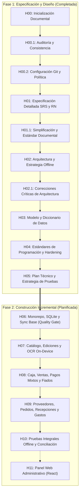

# Plan de Desarrollo del Proyecto y Estrategia de Pruebas (PLAN_DESARROLLO.md)

**Proyecto:** Sistema de Gestión de Librería — Proyecto Tienda 
**Documento:** PLAN_DESARROLLO.md 
**Estado:** Consolidado y Refinado en H05 
**Trazabilidad:** [../01-requerimientos/SRS.md](../01-requerimientos/SRS.md) | [../01-requerimientos/REGLAS_NEGOCIO.md](../01-requerimientos/REGLAS_NEGOCIO.md) | [../02-arquitectura/ARQUITECTURA.md](../02-arquitectura/ARQUITECTURA.md) | [../03-estandares/ESTANDAR_PROGRAMACION.md](../03-estandares/ESTANDAR_PROGRAMACION.md) | [../04-seguridad/HARDENING.md](../04-seguridad/HARDENING.md) | [../06-gestion/DECISIONES.md](../06-gestion/DECISIONES.md)

---

## 1. Estrategia de Entrega Incremental y Secuencia de Hitos

El proyecto se rige por un enfoque de desarrollo estrictamente modular y guiado por pruebas, estructurado en dos grandes macro-etapas:

1. **Fase Preparatoria y de Diseño Riguroso (H00 a H05 — Concluida):** Consolidación documental, auditoría de consistencia, especificación formal del SRS, reglas de negocio, arquitectura *offline-first*, modelado de datos relacional, estándares de codificación y estrategia de pruebas.
2. **Fase de Construcción Incremental (H06 a H11 — Próxima):** Inicialización de la base técnica de sincronización e implementación progresiva de los módulos de negocio sobre la aplicación móvil Android y panel web.

> [!NOTE]
> La facturación electrónica oficial (SUNAT / PSE) y el control cuantitativo continuo de inventario (Kardex) se encuentran explícitamente excluidos del alcance del MVP conforme a [DEC-003](../06-gestion/DECISIONES.md#dec-003-catálogo-referencial-sin-control-cuantitativo-estricto-de-stock-en-mvp) y [DEC-008](../06-gestion/DECISIONES.md#dec-008-exclusión-de-facturación-electrónica-en-mvp-con-diseño-extensible), planificándose para fases posteriores a H11.

---

## 2. Detalle de Fases e Hitos del Proyecto

### 2.1 Resumen de Hitos Concluidos (H00 a H05)
- **H00:** Inicialización documental con 13 documentos fundacionales ([Commit `0ff3ef8`](https://github.com/JMedina255/Proyecto_tienda/commit/0ff3ef8)).
- **H00.1:** Auditoría de consistencia y normalización de reglas a 18 iniciales ([Commit `c262f27`](https://github.com/JMedina255/Proyecto_tienda/commit/c262f27)).
- **H00.2:** Configuración Git oficial en `master` y política de versionado ([Commit `13fef74`](https://github.com/JMedina255/Proyecto_tienda/commit/13fef74)).
- **H01 / H01.1:** Especificación del SRS (45 RFs, 14 CUs, 27 RNs) y estándar de brevedad ([Commit `ee4dbfb`](https://github.com/JMedina255/Proyecto_tienda/commit/ee4dbfb)).
- **H02 / H02.1:** Arquitectura técnica, durabilidad WAL `FULL` y seguridad RPC ([Commit `61fa4e3`](https://github.com/JMedina255/Proyecto_tienda/commit/61fa4e3)).
- **H03:** Modelo relacional de 26 entidades y diccionario relacional exhaustivo ([Commit `7326e39`](https://github.com/JMedina255/Proyecto_tienda/commit/7326e39)).
- **H04:** Estándares de TypeScript, Zod, Result pattern y matriz de seguridad de 21 controles ([Commit `a9d01f0`](https://github.com/JMedina255/Proyecto_tienda/commit/a9d01f0)).
- **H05 (Hito Actual):** Plan de implementación incremental, estrategia de pruebas, criterios de aceptación (*Quality Gates*) y clasificación de decisiones pendientes. **Completado.**

---

### 2.2 Plan de Fases de Construcción Incremental (H06 a H11)

#### Hito H06: Monorepo, Persistencia Local e Infraestructura Sync Base (Gate Técnico)
- **Objetivo:** Inicializar el monorepo y construir la infraestructura fundacional de persistencia local y sincronización como paso previo indispensable antes de abordar ventas o tesorería.
- **Dependencias:** Aprobación formal de H05 y resolución de decisiones bloqueantes (`DEC-012`, `DEC-014`, `DEC-015`).
- **Entregables:**
  - Estructura del monorepo (`apps/mobile`, `packages/shared-types`, `packages/database`, `packages/sync-engine`, `packages/ui`) orquestada con `pnpm` y `Turborepo`.
  - Configuración de Expo con Prebuild / Development Client en Android.
  - Persistencia SQLite local (`expo-sqlite`) configurada con WAL mode y `PRAGMA synchronous = FULL`.
  - Migraciones DDL base para tablas maestras y tabla de cola local `sync_outbox`.
  - Generador de UUIDs v4, algoritmo de hash SHA-256 para `idempotency_key` y middleware transaccional de encolado Outbox.
  - Cliente base de conexión con Supabase (GoTrue Auth y RPCs tipadas).
- **Criterios de Gate:** Compilación limpia de TypeScript (`tsc --noEmit`), linters sin advertencias y pruebas unitarias de inserción en Outbox e idempotencia aprobadas al 100%.

#### Hito H07: Catálogo Bibliográfico, Categorías, Ediciones y OCR On-Device
- **Objetivo:** Implementar la gestión del catálogo de libros con desacoplamiento entre obras y ediciones, y captura asistida fotográfica mediante OCR offline.
- **Dependencias:** H06 concluido y `DEC-013` resuelta.
- **Entregables:**
  - Repositorios, servicios y pantallas de `categorias`, `libros`, `ediciones_libro` y `libro_categoria`.
  - Búsqueda en mostrador optimizada en SQLite (título, autor, ISBN).
  - Pipeline de cámara y reconocimiento OCR con Google ML Kit on-device (`@react-native-ml-kit/text-recognition`) con parser de ISBN y confirmación manual humana obligatoria (`RN-CAT-003`).
  - Almacenamiento y compresión de portadas fotográficas locales y sincronización a bucket privado en Supabase Storage.
- **Criterios de Gate:** Búsqueda local de catálogo con latencia de respuesta fluida en emulador Android y extracción OCR de ISBN comprobada en imágenes de prueba.

#### Hito H08: Caja, Ventas en Mostrador, Pagos Mixtos y Gestión de Fiados
- **Objetivo:** Construir el módulo central transaccional de mostrador: apertura y cierre de caja, emisión de ventas normales y rápidas, cobros combinados y control riguroso de créditos (fiados).
- **Dependencias:** H06 y H07 concluidos; `DEC-016` y `DEC-018` resueltas.
- **Entregables:**
  - Control de turnos de caja: `sesiones_caja`, `arqueos_detalle`, y libro mayor append-only de `movimientos_caja`.
  - Venta de mostrador: cabecera `ventas` con series monotónicas (`serie`, `correlativo`), `venta_detalles` y pagos múltiples `pagos_venta`.
  - Modalidad de Venta Rápida con foto de soporte y regularización posterior (`RN-VTA-002`).
  - Lógica diferenciada de pagos parciales: Reservas con anticipo (`retenido`) vs. Entregas físicas con saldo fiado (`entregado_saldo_pendiente`) exigiendo autorización de supervisor (`RN-PAG-002`).
  - Transacciones atómicas locales enlazadas automáticamente con `sync_outbox`.
- **Criterios de Gate:** Arqueo de caja y cierre provisorio offline funcionales; bloqueo comprobado de fiados sin PIN de supervisor; cuadre exacto de pagos mixtos en céntimos enteros.

#### Hito H09: Proveedores, Pedidos, Recepciones y Gastos Operativos
- **Objetivo:** Digitalizar la cadena de suministro, adquisición de mercadería, pedidos de libros no catalogados y registro de gastos de mostrador.
- **Dependencias:** H08 concluido.
- **Entregables:**
  - Directorio de `proveedores` con WhatsApp y especialidades; resguardo cifrado de cuentas bancarias (`cuentas_bancarias_proveedor`) en Keystore.
  - Matriz de costos variables por distribuidor (`libro_proveedor`).
  - Módulo de pedidos de reposición y títulos faltantes (`pedidos_proveedor` en borrador con fotos manuscritas y texto libre `RN-PED-003`).
  - Recepciones de mercadería parciales con número de guía (`recepciones_pedido`) y amortizaciones (`abonos_proveedor`).
  - Registro de `gastos` operativos con clasificación y comprobante fotográfico.
- **Criterios de Gate:** Flujo completo de pedido no catalogado -> recepción parcial -> abono verificado con pruebas de integración.

#### Hito H10: Pruebas Integrales Offline, Sincronización Concurrente y Conciliación
- **Objetivo:** Someter la aplicación móvil a pruebas extremas de resiliencia de red, simulación de cortes prolongados, concurrencia multi-terminal y conciliación contable de caja.
- **Dependencias:** H06 a H09 concluidos; `DEC-017` resuelta.
- **Entregables:**
  - Ejecución de la matriz integral de pruebas de resiliencia y concurrencia.
  - Validación de la función central de conciliación de cajas provisionales en PostgreSQL ($\Delta_{\text{caja}}$).
  - Verificación del comportamiento del motor de sincronización ante pérdida de señal en plena transacción y reintentos automáticos idempotentes.
  - Informe formal de aseguramiento de calidad y auditoría de seguridad post-construcción móvil.
- **Criterios de Gate:** Cero defectos críticos (P0/P1); tasa de éxito del 100% en pruebas de sincronización sin pérdida ni duplicidad de asientos contables.

#### Hito H11: Panel Web Administrativo en React (Post-MVP Móvil)
- **Objetivo:** Desarrollar el panel web para administración centralizada, reportería gerencial y auditoría contable.
- **Dependencias:** H10 concluido y priorización de negocio por el Dueño.
- **Entregables:**
  - Aplicación web en `apps/web` (React, TypeScript, Tailwind CSS, Supabase Client).
  - Módulos de auditoría financiera, visualización de ventas, reportes de margen comercial y conciliación de diferencias de caja.
- **Criterios de Gate:** Despliegue de producción en hosting seguro con autenticación RBAC y consumo directo de Supabase con RLS.

---

## 3. Estrategia de Pruebas y Matriz de Pruebas Automatizadas

La calidad del sistema se garantiza mediante una pirámide de pruebas automatizadas:
- **Pruebas Unitarias (Vitest):** Cobertura exhaustiva de cálculos financieros en céntimos, parseo monetario seguro, validaciones Zod, generadores de hash y reglas puras de dominio.
- **Pruebas de Integración (React Native Testing Library + SQLite en memoria / Supabase Local):** Verificación de transacciones atómicas locales, repositorios, encolado outbox y evaluación de políticas RLS y RPCs.
- **Pruebas de Sistema y Concurrencia (Vitest + Scripts de Carga):** Simulación de múltiples terminales emitiendo transacciones simultáneas con la misma serie o claves de idempotencia.
- **Pruebas End-to-End y Resiliencia (Maestro en Android):** Flujos completos en dispositivo/emulador Android con desconexión física de red (modo avión), reinicio forzado de la app y reconexión.

### Matriz Compacta de Pruebas del Sistema

| ID de Prueba | Requisito / Control | Escenario | Resultado Esperado | Nivel | Hito |
| :--- | :--- | :--- | :--- | :---: | :---: |
| **TEST-FIN-001** | `ESTANDAR_PROGRAMACION` | Parseo de importes desde cadenas de texto (`"19.90"`, `"5"`, `"0.50"`, `"120.5"`) a céntimos enteros. | Conversión exacta a céntimos enteros (`1990`, `500`, `50`, `12050`) sin error de punto flotante. | Unitaria | H06 |
| **TEST-FIN-002** | `ESTANDAR_PROGRAMACION` | Intento de parsear entradas inválidas (`"abc"`, `"-15"`, `"10.999"`, `""`, `"NaN"`). | Retorno tipado `{ ok: false, error: ... }` rechazando la entrada. | Unitaria | H06 |
| **TEST-FIN-003** | `RN-VTA-001` / `RF-VTA-001` | Venta con múltiples líneas y descuentos aplicados a nivel de ítem y cabecera. | Cálculo exacto de `total_bruto - descuentos = total_neto` en céntimos sin descuadres. | Unitaria | H08 |
| **TEST-FIN-004** | `RN-PAG-003` / `RF-PAG-004` | Intento de registrar un abono superior al saldo pendiente de una venta a crédito. | Transacción abortada con error de sobrepago; deuda permanece inalterada. | Unitaria / Integración | H08 |
| **TEST-SQL-001** | `ARQUITECTURA` §4.2 | Inserción transaccional de venta + pago + mutación en Outbox mediante `withTransactionAsync`. | Atomicidad total: todos los registros persisten en disco o ninguno en caso de fallo. | Integración SQLite | H06 |
| **TEST-SQL-002** | `ARQUITECTURA` §4.2 / H02.1 | Caída súbita del proceso tras inserción con `PRAGMA synchronous = FULL`. | Base de datos íntegra y transacción confirmada recuperada sin corrupción tras reinicio. | Integración SQLite | H06 |
| **TEST-SYNC-001**| `SEC-SYNC-002` / `RN-OFF-001` | Envío duplicado al servidor de la misma mutación con idéntico `idempotency_key` SHA-256. | Supabase procesa de forma idempotente: responde éxito sin duplicar el registro en la BD. | Integración RPC | H06 |
| **TEST-SYNC-002**| `ARQUITECTURA` §6.2 | Fallo de red simulado (HTTP 500 / Timeout) durante el envío de la cola Outbox. | Mutación permanece en estado `pending`, incrementa `retry_count` y aplica retroceso exponencial. | Integración Outbox | H06 |
| **TEST-SYNC-003**| `MODELO_DATOS` §3.7 | Dos dispositivos Android emiten notas con la misma serie y correlativo (`NV01-0001`). | PostgreSQL rechaza la segunda inserción por violación de restricción `UNIQUE(serie, correlativo)`. | Concurrencia | H08 |
| **TEST-VTA-001** | `RN-VTA-002` / `RF-VTA-002` | Registro de Venta Rápida con foto de soporte e importe global sin renglones de libros. | Venta creada con `estado_regularizacion = 'pendiente'` y persistida en SQLite y Outbox. | Integración | H08 |
| **TEST-VTA-002** | `RN-PAG-001` / `RF-PAG-002` | Cobro fraccionado mixto: Efectivo + Billetera Digital QR + Tarjeta POS sumando el total neto. | Inserción de 3 registros en `pagos_venta`; venta transiciona a `estado_pago = 'total'`. | Integración | H08 |
| **TEST-VTA-003** | `RN-PAG-004` / `RF-PAG-003` | Pago parcial con libro custodiado en tienda (Reserva con anticipo). | Venta en `estado_entrega = 'retenido'`, exige nombre del cliente y no requiere PIN de supervisor. | Integración | H08 |
| **TEST-VTA-004** | `RN-PAG-002` / `SEC-AUTHZ-003`| Entrega física con saldo fiado (`entregado_saldo_pendiente`) sin PIN de supervisor. | Bloqueo absoluto de confirmación; exige `autorizador_id` válido y documento de identidad oficial. | Negativo / Integración | H08 |
| **TEST-CAJ-001** | `RN-CAJ-001` / `RF-CAJ-002` | Intento de registrar una venta en efectivo sin haber abierto turno de caja en el dispositivo. | Interfaz bloqueada con mensaje de error; venta no se almacena en SQLite. | Negativo / UI | H08 |
| **TEST-CAJ-002** | `RN-CAJ-002` / `DEC-007` | Cierre de caja en terminal sin conexión a internet y posterior conciliación en la nube. | Cierre registrado como `cierre_provisorio_offline`; al reconectar, evalúa discrepancia $\Delta_{\text{caja}}$. | Integración / E2E | H08 / H10 |
| **TEST-CAJ-003** | `RN-VTA-003` / `RF-VTA-005` | Anulación de venta en efectivo por supervisor Dueño con motivo de 15 caracteres. | Venta marcada como `anulada`, genera contra-asiento en `movimientos_caja` e incrementa auditoría. | Integración | H08 |
| **TEST-SEC-001** | `SEC-AUTHZ-001` / `RN-PRV-002`| Usuario con rol `Vendedor` intenta consultar columnas bancarias de proveedores en Supabase. | Política RLS o consulta RPC retorna `NULL` / deniega acceso a datos financieros. | Seguridad RLS | H06 / H09 |
| **TEST-SEC-002** | `SEC-DATA-001` / `DEC-015` | Inspección de la base de datos SQLite local en dispositivo buscando campos de cuentas bancarias. | El campo `numero_cuenta_cifrado` se encuentra cifrado con AES-256-GCM; texto plano ilegible. | Seguridad / Integración | H06 / H09 |
| **TEST-SEC-003** | `SEC-AUTHZ-004` | Intento de autorización offline con supervisor revocado presente en la lista local CRL. | Validación de HMAC local rechaza la autorización por credencial revocada en caché. | Negativo / Seguridad | H06 / H08 |
| **TEST-RES-001** | `RN-OFF-001` / `RF-OFF-001` | Operación completa de 10 ventas en modo avión (offline) y posterior restablecimiento de red. | Todas las ventas operan fluidamente; al reconectar, la cola Outbox sincroniza el 100% sin pérdidas. | E2E (Maestro) | H10 |
| **TEST-RES-002** | `MODELO_DATOS` §3.8 | Amortizaciones simultáneas a la misma venta desde dos terminales superando la deuda neta. | Bloqueo pesimista `FOR UPDATE` en Supabase procesa el primer cobro y rechaza el segundo por sobrepago. | Concurrencia | H10 |
| **TEST-OCR-001** | `RF-OCR-001` / `DEC-013` | Captura fotográfica de portada y contraportada con cámara en modo offline. | Inferencia on-device con ML Kit extrae texto e ISBN en menos de 1.5s sin conexión. | Dispositivo Android | H07 |
| **TEST-STRG-001**| `SEC-STRG-001` / `SEC-STRG-002`| Subida de comprobante de gasto a Storage y descarga mediante URL firmada. | Archivo alojado en bucket privado (`expense-vouchers`); URL pública caduca tras 15 minutos. | Integración Storage | H07 / H08 |

---

## 4. Criterios de Aceptación y Quality Gates por Hito

Para declarar concluido y aprobado cualquier hito a partir de H06, se deben satisfacer obligatoriamente y con evidencia comprobable los siguientes seis criterios de pase (*Quality Gates*):

1. **Requisitos Implementados y Trazables:** El 100% de los requisitos funcionales (`RF-xxx`), reglas de negocio (`RN-xxx`) y controles de seguridad (`SEC-xxx`) asignados al hito deben contar con código fuente funcional y comentarios de trazabilidad explícitos.
2. **Pruebas Automatizadas Aprobadas:** Todas las pruebas unitarias, de integración o E2E definidas en la matriz para dicho hito deben ejecutarse y aprobarse exitosamente en el pipeline de CI/CD (cobertura mínima de 85% en lógica de negocio).
3. **Cero Defectos Críticos (P0/P1):** No debe existir ningún defecto de severidad bloqueante (*Crash*, pérdida de datos contables, duplicidad de cobros o vulnerabilidad de seguridad) sin resolver.
4. **Verificación de Controles de Seguridad:** Los controles correspondientes en [HARDENING.md](../04-seguridad/HARDENING.md) deben transicionar formalmente de `Pendiente` a `Implementado` o `Verificado` únicamente tras presentar evidencia de ejecución satisfactoria.
5. **Evolución Atómica Código-Documentación:** Cualquier modificación en esquemas de base de datos, APIs o flujos de usuario debe actualizar en el mismo commit los documentos correspondientes en `docs/`.
6. **Commit Convencional y Push Confirmado:** El hito debe cerrarse mediante un commit identificable (`feat(hXX): ...` o `docs(hXX): ...`) y publicarse exitosamente en `origin/master` con árbol de trabajo limpio.

---

## 5. Clasificación y Recomendaciones de Decisiones Pendientes (DEC-012 a DEC-018)

Conforme a la evaluación técnica de H05, las decisiones abiertas se clasifican formalmente en tres niveles de prioridad operativa antes de iniciar la construcción:

| Decisión | Título Resumido | Clasificación H05 | Recomendación Técnica | Justificación Técnica |
| :--- | :--- | :---: | :--- | :--- |
| **DEC-012** | Motor de Sincronización Offline | **Imprescindible antes de H06** | **Outbox con `expo-sqlite` y Supabase RPCs** | Elimina dependencias de servicios externos propietarios y desacopla el modelo transaccional SQLite. |
| **DEC-014** | Orquestador de Monorepo | **Imprescindible antes de H06** | **pnpm Workspaces + Turborepo** | Define la estructura de paquetes y pipeline de compilación compartida de todo el monorepo en H06. |
| **DEC-015** | Cifrado de BD Local y Datos Replicados | **Imprescindible antes de H06** | **Cifrado Híbrido por Campos (Android Keystore + RLS/Vault)** | Evita sobrecarga I/O y corrupción de SQLCipher; permite replicación multi-dispositivo sin compartir claves. |
| **DEC-013** | Tecnología de Reconocimiento OCR | **Necesaria antes de H07** | **Solución Híbrida (Google ML Kit On-Device primario)** | 100% offline en mostrador, costo cero y empaquetado nativo en Android. Bloqueante para el módulo de catálogo. |
| **DEC-016** | Descuento Máximo Delegado a Vendedor | **Necesaria antes de H08** | **Límite del 15% autónomo; mayor con PIN de Dueño/Admin** | Protege márgenes comerciales sin bloquear el dinamismo de mostrador. Bloqueante para la lógica de cobro. |
| **DEC-018** | Exclusividad de Sesión de Caja por Terminal | **Necesaria antes de H08** | **Una única sesión de caja activa por dispositivo físico** | Evita descalces de dinero físico y simplifica la conciliación matemática $\Delta_{\text{caja}}$. Bloqueante para tesorería. |
| **DEC-017** | Período de Gracia de Sesión Offline | **Diferible (evaluar en H10)** | **7 días calendario de operación continua sin reconexión** | Balance adecuado entre resiliencia ante cortes prolongados y seguridad de revocación; evaluable en pruebas de resiliencia. |

> [!IMPORTANT]
> Ninguna de las decisiones anteriores se declara formalmente aprobada sin el consentimiento explícito del usuario. Las recomendaciones constituyen la propuesta técnica óptima del equipo de arquitectura.
